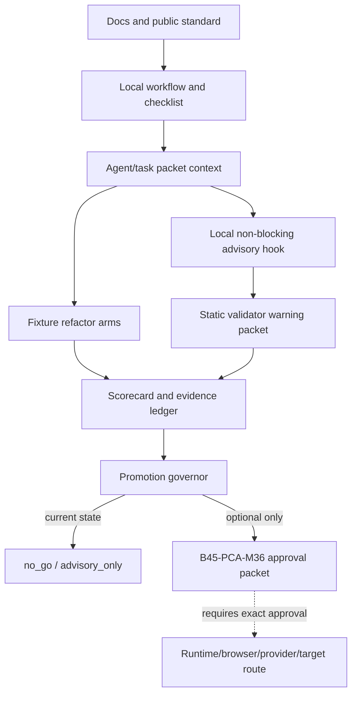

# Batch 45 Quality Retest Architecture Review

Source status: independent architecture review artifact.

Task ID: `B45-QUALITY-RETEST-ARCH-01`
Date: 2026-07-04
Mode: local source read plus one review artifact write. No code change, target command, runtime/browser automation, provider/API call, git action, deployment, publication, hook activation, CI/blocker promotion or external write was performed.

## Scope

This review analyzes Batch 45 Professional Code Authoring after `B45-PCA-M37-A01`, with focus on the enforcement/feedback loop and readiness for repeat quality/refactor testing.

The question is not whether M37 implemented useful local hardening. It did. The question is whether the current architecture is ready to run a meaningful repeat quality/refactor retest without overclaiming behavior improvement, runtime safety or promotion readiness.

## Sources Read

User-requested source packets and control-plane:

- `docs/superpowers/specs/batch45-review-remediation-summary.json`
- `docs/superpowers/specs/batch45-agent-behavior-eval-results.json`
- `docs/superpowers/specs/batch45-comment-policy-promotion-decision.json`
- `docs/superpowers/specs/batch45-real-project-scorecard.json`
- `docs/superpowers/specs/batch45-real-project-decision-packet.json`
- `PLAN.md`
- `EVALS.md`
- `TEST.md`
- `.codex/product-agent-os/lifecycle-state.json`
- `.codex/product-agent-os/reviews/batch45/*.md`

Additional source evidence needed to map where the standard lives:

- `.codex/config.toml`
- `.codex/workflows/task-plan-lifecycle.md`
- `.codex/workflows/control-plane-sync.md`
- `.codex/workflows/coding-standards.md`
- `.codex/artifact-templates/coding-standard-checklist.md`
- `.codex/evals/agent-context-contract.json`
- `.codex/hooks.json`
- `.codex/hooks/hooks.json`
- `.codex/hooks/comment_sufficiency_advisory.py`
- `plugins/product-agent-os/assets/templates/hooks/comment_sufficiency_advisory.py`
- `plugins/product-agent-os/scripts/product_agent_os/comment_sufficiency.py`
- `tests/product_agent_os/test_comment_sufficiency.py`
- `tests/product_agent_os/test_lifecycle_hooks.py`
- `docs/superpowers/plans/2026-06-20-track-11-documentation-architecture-refresh.md`
- `docs/product-agent-os/coding-standards.md`
- `docs/product-agent-os/coding-standards.en.md`
- Batch 45 S0-S5 summary/activation packets under `docs/superpowers/specs/`

Memory was used only as orientation; current findings below are grounded in workspace files.

## Findings By Severity

### P0

No P0 architecture defect found.

Current source packets consistently preserve the important ceiling: Batch 45 remains local/source-owned/advisory-only/no-go. I did not find a current source that promotes CI/blocker enforcement, target mutation, runtime/browser/provider behavior, release readiness, active automation or real AI-agent behavior improvement after M37.

### P1

#### P1-1: Repeat quality/refactor testing does not yet have a single retest contract

M37 records local hook/validator hardening and docs/control-plane/source sync. It does not create the next experimental contract for repeat quality/refactor testing.

Current evidence:

- M26 is negative behavior evidence: baseline average `4.22`, treatment average `3.88`, `15/16` completed, one timeout, reviewer `no_go`.
- M27 keeps the M25 advisory local, non-blocking and reversible; it rejects stronger advisory, CI and blocker promotion.
- M34 blocks promotion because runtime/test/TypeScript-advisory/reviewer-judgment/behavior-improvement gaps override static averages.
- M35 keeps advisory-only/no-go for treatment v2 promotion; smaller treatment v2 is only a future source-only option, and runtime/browser pilot remains approval-required.
- M37 fixes local advisory mechanics but leaves promotion state unchanged.

Impact: a retest launched now would risk mixing three different questions: "does the validator warn less?", "does a refactor arm look cleaner in fixtures?", and "does agent behavior improve?" Those require different evidence, thresholds and approvals.

Required architecture change before retest: create a source-owned retest plan/packet that names one retest mode, scenarios, treatment arms, acceptance thresholds, no-op/timeout failure rules, scorecard weights, reviewer owner and unsupported claims before any retest execution.

#### P1-2: The standard is intentionally distributed, so retest must name the active selector

Professional Code Authoring currently exists across multiple surfaces:

| Surface | Current role | Activation ceiling |
| --- | --- | --- |
| Public docs | `docs/product-agent-os/coding-standards*.md` names the standard and M26/M27/M35/M37 ceiling. | Documentation contract only. |
| Local workflow/checklist | `.codex/workflows/coding-standards.md` and `.codex/artifact-templates/coding-standard-checklist.md`. | Required context for code work, not proof of behavior. |
| Packaged templates | `plugins/product-agent-os/assets/templates/workflows/coding-standards.md` and checklist template. | Distribution template, not installed-cache or runtime proof. |
| Agent/eval contract | `.codex/evals/agent-context-contract.json` and B45 behavioral eval surfaces. | Handoff/eval coverage, not real target behavior. |
| Local hook | `.codex/hooks/comment_sufficiency_advisory.py` wired through PostToolUse. | Local non-blocking fail-open advisory only. |
| Validator | `plugins/product-agent-os/scripts/product_agent_os/comment_sufficiency.py`. | Static advisory signal, now with TS/TSX/modern JS coverage after M37. |
| Discovery/runtime/status | `discovery.py`, `status_dashboard.py`, `codex_runtime_runner/routes.py` expose `professional_code_authoring` as `present_unverified`. | Orientation and routing only. |
| Learning loop/automation | S5 candidate-only policy. | Candidate generation only; no auto-apply or schedule. |
| S7 scenario harness | `research/b45-real-project-scenarios/` plus M32-M35 packets. | Fixture-local/static/no-go evidence only. |

Impact: "standard applied" is not a single runtime state. A repeat retest must state whether it is testing the checklist, the advisory hook, the fixture refactor arms, the agent behavior treatment, or a runtime/browser pilot approval packet.

Required architecture change before retest: add an explicit selector/fallback section to the retest packet:

- intended new path;
- old/fallback path;
- whether fallback is allowed, compatibility-only or forbidden;
- activation proof required for that mode;
- negative proof that unsupported paths did not serve the acceptance scenario.

#### P1-3: M37 repairs local advisory mechanics, but it does not reverse M26/M27/M35 no-go evidence

M37 closes important local gaps: active/template hook parity, TS/TSX and modern JavaScript advisory scanning, invalid-root fail-open, validator exception fail-open, redacted `workspace_ref` diagnostics and focused tests.

That improves the advisory path. It does not prove:

- better AI-agent behavior;
- target behavior preservation;
- structural refactor quality;
- browser/runtime correctness;
- provider/API safety;
- CI/blocker readiness.

Impact: a retest that treats M37 as a reset of the promotion state would contradict the existing decision chain. M37 can be a prerequisite for another experiment, not a passing result for that experiment.

Required architecture change before retest: make the retest packet inherit M26/M27/M35 as active blockers unless the new retest explicitly satisfies a predeclared reversal gate.

#### P1-4: Current lifecycle marker is owned by another review slice

Current `.codex/product-agent-os/lifecycle-state.json` points to `B45-PCA-M37-SKEPTIC-RETEST-A06`, not this architecture review and not a future retest execution slice.

Impact: this is a coordination/ownership risk before launching additional agents or retest execution. Multiple review slices writing the lifecycle marker can make hooks and handoffs ambiguous.

Required architecture change before retest: before any retest execution or delegated worker launch, assign one lifecycle owner, one task id and one allowed write set. Do not let another quality/retest agent inherit a stale or unrelated marker as proof of approval.

### P2

#### P2-1: Static scorecard averages are useful but unsafe as retest promotion signals

M34 reports useful static averages such as MP advisory-guided `7.4`, but it also says aggregate score is not the promotion gate and critical blockers override averages.

Impact: repeat testing should not report "quality improved" from an average score while runtime/test/reviewer/behavior blockers remain. The first visible retest result should be blocker-first, then score detail.

Required architecture change before retest: retest output should compute a blocker-first state:

- `blocked_runtime_gap`
- `blocked_test_gap`
- `blocked_timeout_or_noop`
- `blocked_reviewer_no_go`
- `blocked_unsupported_claim`
- only then optional average/delta.

#### P2-2: Scenario readiness is asymmetric

S7 selected two useful scenarios, but they are not equally ready for repeat refactor testing:

- `MP-CRM-CHAT-OPEN-01` has richer copied backend/frontend test context and is the better candidate for a fixture-local characterization route.
- `SOL-AGENT-ORCH-01` remains valuable as churn-prevention and TypeScript orchestration coverage, but needs TypeScript/static/test evidence before it can support implementation-quality conclusions.

Impact: running both scenarios as if they had equal evidence would dilute the result and repeat the S7 problem where no-code/churn-prevention is useful but not treatment-success evidence.

Required architecture change before retest: select one scenario class and one hypothesis. Recommended first retest boundary is `MP-CRM-CHAT-OPEN-01` fixture-local characterization/refactor evidence. Keep SOL as blocked for treatment-success until a TS static/test/advisory substitute exists.

#### P2-3: Hook validator trust is still local-workspace trust, not target-project enforcement trust

After M37, the hook fails open and redacts workspace paths by default. That is good enough for local advisory hardening. The hook still searches `workspace_plugin` before `packaged_plugin` and reports `validator_source_ref`.

Impact: for `codex_docs` local review this is acceptable and observable. For target-project hook activation or broader enforcement, approving only the hook script is not enough; the imported validator source is part of the executable trust boundary.

Required architecture change before any target/disposable hook route: pin or allowlist validator source, or record `validator_source_ref` as part of the approval packet. Do not use this as blocker/CI enforcement without a separate approval and rollback path.

#### P2-4: Root control-plane space constrains retest evidence routing

`RUNLOG.md` is near the configured 50 KiB budget, and M37 already routes detail to the source-owned remediation summary. Future retest detail cannot live in root control-plane without bloating the compact layer.

Required architecture change before retest: write detailed retest evidence to a source-owned packet/report and put only compact pointers in `PLAN.md`, `TEST.md`, `EVALS.md` or `RUNLOG.md` if those files actually need updates.

### P3

#### P3-1: Local and packaged workflow/checklist copies remain a managed drift surface

M37 added an active-vs-packaged hook parity test. The workflow/checklist standard still exists both as local active `.codex/` files and packaged template files.

Impact: this is expected architecture, not a current blocker. Future retest packets should name whether they validate local workspace behavior, packaged distribution behavior, or both.

#### P3-2: Existing generated/runtime/status views are orientation evidence

Discovery, status dashboard and runtime route visibility help show that Professional Code Authoring exists and is applicable. They still remain `present_unverified` until source/current command/runtime evidence exists.

Impact: retest should not use generated views as proof that the standard was applied correctly. They can be inputs to task selection and operator UX only.

## Architecture Map

Current boundary:

- `A-B-C-D-E-G-H-I` is the active local/source-owned path.
- `J-K` is not approved or executed.
- The hook path is advisory/fail-open and cannot become CI/blocker enforcement by implication.
- The fixture path is static/analysis-only unless a later packet names runtime or characterization evidence.

## Recommended Prerequisites Before Retest

1. Choose the retest mode:
   - `source_only_treatment_v2_design`
   - `fixture_local_static_refactor_retest`
   - `approval_packet_only_for_runtime_browser_pilot`
   - Do not mix these in one result.

2. Create a retest contract packet before execution:
   - task id;
   - selected scenario(s);
   - baseline and treatment arms;
   - selected standard surface under test;
   - commands allowed and forbidden;
   - timeout/no-op failure rule;
   - scorecard/rubric version;
   - blocker-first promotion rule;
   - source artifacts to write;
   - rollback/delete path.

3. Reuse M37 hardening as a prerequisite, not as success evidence:
   - active/template hook parity;
   - TS/TSX/modern JS advisory coverage;
   - fail-open behavior;
   - redacted diagnostics;
   - focused tests named in `TEST.md`.

4. Add a retest run manifest:
   - run id;
   - task/scenario id;
   - treatment arm;
   - model/settings only if a provider/model run is approved;
   - sandbox and approval boundary;
   - files changed or no-op reason;
   - changed-file digests when safe;
   - commands/tests run;
   - exit code;
   - timeout flag;
   - no-op/read-only flag;
   - advisory warning count;
   - reviewer result.

5. Calibrate scorecard display before retest output:
   - blocker status first;
   - average score second;
   - unsupported claims explicit;
   - no "quality improved" wording unless the predeclared behavior/test gate passes.

6. Resolve lifecycle ownership:
   - assign one current task id;
   - avoid overwriting another active review marker;
   - require a visible Task Brief and completion handoff for any non-mechanical retest slice.

## Exact Next Gates

Gate 0: Ownership and lifecycle preflight

- Confirm no other active retest agent owns `.codex/product-agent-os/lifecycle-state.json`.
- Record one task id and one allowed write set.
- Approval boundary must exclude runtime/browser/provider/git/target/external actions unless separately approved.

Gate 1: Retest contract packet

- Create a source-owned retest packet or plan.
- Must name retest mode, scenario, treatment arms, thresholds, no-op/timeout rules and unsupported claims.
- No execution before this exists.

Gate 2: Local M37 prerequisite verification

- Run or cite current-run focused local checks for the advisory hardening path if the retest uses it:
  - `python -m unittest tests.product_agent_os.test_comment_sufficiency tests.product_agent_os.test_lifecycle_hooks -v`
  - `python -m unittest tests.product_agent_os.test_coding_standards_artifacts -v`
  - `python tools\check_docs.py`
  - `git diff --check`

Gate 3: Scenario preflight

- For MP: prove fixture-local characterization route or explicitly mark it static-only.
- For SOL: do not use as treatment-success evidence until TS static/test/advisory substitute exists.
- Keep target workspaces read-only unless a later approval names exact mutation/runtime boundaries.

Gate 4: Retest execution gate

- If source-only or fixture-local: execute only local allowed commands and write only source-owned evidence.
- If provider/model/browser/runtime/target execution is desired: stop and prepare `B45-PCA-M36` approval packet first; do not execute from the retest plan alone.

Gate 5: Review gate

- Independent reviewer must check:
  - no timeout/no-op primary run;
  - no unsupported runtime/product claim;
  - treatment beats predeclared threshold;
  - no privacy/path/raw-source leak;
  - scorecard blockers are not averaged away.

Gate 6: Control-plane sync

- `PLAN.md`: update only compact next-state pointer if sequencing changes.
- `TEST.md`: update only if verification route changes.
- `EVALS.md`: update only if eval threshold/rubric changes.
- `RUNLOG.md`: handoff-required or compact pointer only; route detail to source-owned packet because budget is tight.
- `prod_test.md`: not applicable; Batch 39 surface.

## Residual Risks

- M26 remains active negative behavior evidence.
- M27/M35 remain active no-go/advisory-only decisions.
- M37 improves local advisory mechanics but does not establish behavior improvement.
- Scenario coverage remains narrow.
- Runtime/browser/provider/target behavior remains unproven and approval-required.
- Scorecard averages can mislead if shown before blockers.
- Lifecycle marker ownership can conflict across simultaneous review agents.
- Root control-plane files are compact and budget-sensitive.
- Hook validator import source is acceptable for local advisory use but not sufficient as target enforcement trust.

## Control-Plane Sync Decision

- `REQUIREMENTS.md`: `not_applicable`; this review does not change scope or acceptance.
- `PLAN.md`: `handoff_required_if_owner_accepts_retest_prerequisites`; no direct root update in this report.
- `TEST.md`: `handoff_required_if_owner_accepts_new_retest_gates`; current report recommends gates but does not change canonical command policy.
- `EVALS.md`: `handoff_required_if_owner_accepts_retest_rubric`; no eval threshold changed here.
- `RUNLOG.md`: `handoff_required_due_budget`; keep details in this source-owned report.
- `prod_test.md`: `not_applicable_batch39_surface`.
- `.codex/product-agent-os/lifecycle-state.json`: `ownership_overlap_observed`; current marker points to `B45-PCA-M37-SKEPTIC-RETEST-A06`, so this report did not overwrite it.

## Rollback

Rollback for this review artifact only:

- Delete `.codex/product-agent-os/reviews/batch45/quality-retest-agent-01-architecture.md`.

No code, docs, hook, test, target, git or external state was intentionally changed by this review beyond the report artifact.

## Recommended Next Role

Recommended next role: implementation planner or tester only after the owner selects one retest mode.

Recommended first route: `fixture_local_static_refactor_retest` for `MP-CRM-CHAT-OPEN-01`, preceded by a retest contract packet and blocker-first scorecard. Keep runtime/browser/provider/target execution behind `B45-PCA-M36` approval-packet work.

