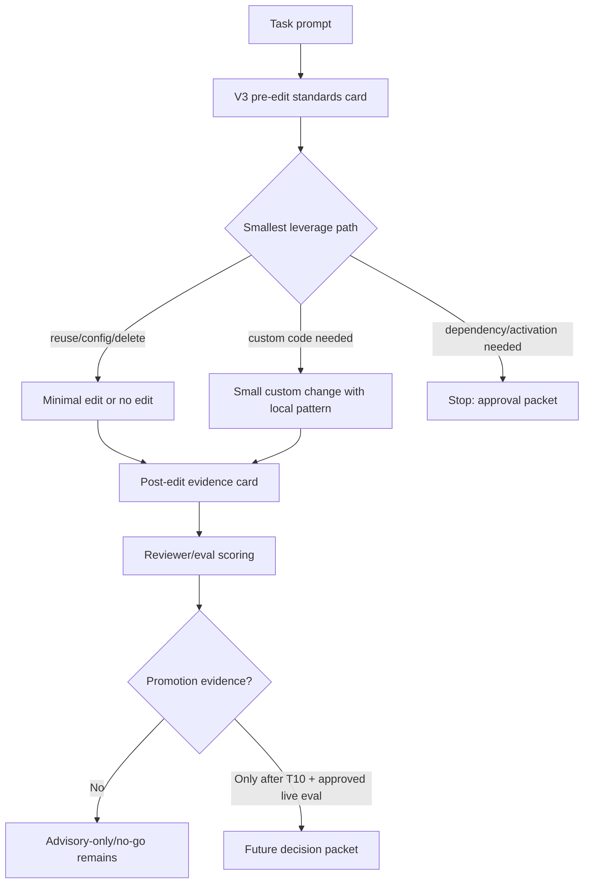

# B45-POSTQ4-T11-TREATMENT-V3-SOURCE-DESIGN architecture review

Source status: independent source-only architecture analysis. No live/model/provider/API, runtime/browser, target workspace command or mutation, git, CI/blocker, automation activation, or raw private data action was performed.

Task ID: `B45-POSTQ4-T11-TREATMENT-V3-SOURCE-DESIGN`
Role: architecture agent
Date: 2026-07-05
Closure level: `docs_contract_ready`

## Sources Read

| Source | Claim used | Relevance | Freshness | Confidence | Conflicts |
| --- | --- | --- | --- | --- | --- |
| `docs/superpowers/specs/batch45-postq4-architecture-next-actions.json` | Current claim ceiling is `advisory_only_no_go_with_local_static_quality_improvement`; T11 is source-only design. | Primary post-T08 architecture route. | 2026-07-04 | High | None; explicitly blocks promotion from static-only evidence. |
| `docs/superpowers/specs/batch45-post-q4-next-tasks.json` | T11 depends on T08 and must explain M26 underperformance, map standards to behaviors, and avoid hook/CI/blocker/live activation. | Task acceptance source. | 2026-07-04 | High | None. |
| `docs/superpowers/specs/batch45-agent-behavior-eval-results.json` | M26 treatment reduced warnings 29 -> 15 but scored worse than baseline: 3.88 vs 4.22, worse on 4/8 tasks, timeout on 1 run, reviewer no-go. | Primary evidence for why treatment v2 is not promotable. | 2026-06-30 | High | Static warning improvement conflicts with behavior quality; behavior result wins. |
| `docs/superpowers/specs/batch45-postq4-t05-live-model-rerun-results.json` | Post-Q4 rerun stopped on baseline timeout; no treatment/reviewer comparison exists; M26/M35 remain unreversed. | Current post-Q4 live-eval ceiling. | 2026-07-04 | High | None; T05 is not comparable evidence. |
| `docs/product-agent-os/coding-standards.md` | Professional Code Authoring is a compact leverage-first code-authoring layer; current evidence ceiling remains docs/synthetic/local and M26/M27/M35/M37 no-go/advisory-only. | Standards content that treatment v3 must route without overloading prompts. | Current project doc | High | None. |
| `.codex/workflows/coding-standards.md` | Coding standards are a sub-gate, not lifecycle/review/control-plane replacement; use not-applicable for docs-only/read-only work. | Code-bearing architecture constraint. | Current project workflow | High | None. |
| `.codex/artifact-templates/coding-standard-checklist.md` | Checklist fields define enterprise leverage, dependency, module/legacy, comments, evidence, and completion gates. | Boundary for future task packet/checklist surface. | Current project template | High | None. |

Memory was used only as orientation for locating current Batch 45 context; all findings below are grounded in the current local sources above.

## Findings

1. Treatment v2 failed as a behavior-improvement architecture, even though it improved the static advisory signal.
   M26 is the controlling evidence: baseline averaged `4.22`, treatment averaged `3.88`, treatment was worse on 4 of 8 tasks, one treatment run timed out, and the independent reviewer decision was `no_go`. The warning delta `29 -> 15` is useful hygiene evidence, not proof that agents made better engineering decisions.

2. T05 after Q4 does not rescue treatment v2 or validate treatment v3.
   The approved rerun stopped after baseline `B45-HELDOUT-02` timed out. Treatment did not run, reviewer did not run, and the packet explicitly says it cannot compare baseline vs treatment or supersede M26. Therefore T11 must design a new source contract, not claim new behavior evidence.

3. The current failure mode is likely prompt/control-plane friction, not absence of standards.
   The standards themselves are sensible: check existing capability, prefer deletion/configuration/stdlib/project helpers, avoid unnecessary dependencies, avoid shallow abstractions, add comments only for non-obvious invariants, and record unsupported claims. The problem is that v2 appears to have acted as a broad generation-time overlay that reduced comment warnings but increased time/flake risk and did not consistently improve architecture, test coverage, privacy, or custom-code avoidance dimensions.

4. Static warning suppression and comment sufficiency must stay downstream of design intent.
   If treatment v3 optimizes directly for zero comment warnings, it can recreate the M26 failure: cleaner advisory output while real task quality stagnates or drops. Comment policy should be a reviewer/checklist consequence of the selected design path, not the primary prompt objective.

5. T11 should not introduce a new subsystem, dependency, hook, CI rule, or active automation.
   The smallest viable architecture is a prompt/context contract plus checklist mapping for future eval packets. Enforcement remains advisory-only unless a future approval-gated live eval and runtime/browser route prove otherwise.

## Option Synthesis

| Option | Description | Value | Cost/Risk | Decision |
| --- | --- | --- | --- | --- |
| A. Simplest viable: compact standards card | Give the agent a small pre-edit decision card and ask for a final evidence ledger. | Low prompt friction, reversible, easy to eval. | May be too weak unless reviewer checks are explicit. | Selected as base. |
| B. Robust production route: full gated workflow | Require full checklist completion before each code edit, reviewer packet, and hard stop on missing fields. | Strong traceability. | High latency, likely repeats v2 friction, not justified by no-go evidence. | Rejected for T11; possible later only after behavior proof. |
| C. Contrarian: no treatment prompt, reviewer-only scoring | Do not change generation prompt; only score final output against standards. | Minimal generation interference. | Does not teach planning behavior and may miss early design errors. | Rejected as sole route; keep reviewer-only checks as part of hybrid. |
| D. Selected hybrid: small pre-edit card + post-edit reviewer checklist | Use a short planning scaffold before implementation and a structured reviewer/evidence checklist after implementation. | Balances lower prompt load with measurable standards behavior. | Still unproven until T10/live eval update and approved rerun. | Recommended. |

## Recommended Treatment V3 Architecture

Treatment v3 should be a two-stage source contract:

1. Pre-edit planning card, max 8 compact fields.
   The agent must choose the smallest leverage path before coding:
   `delete/reduce`, `configure`, `stdlib/language`, `current dependency`, `project helper`, `tiny adapter`, `small custom code`, or `new dependency approval required`.

2. Post-edit reviewer/evidence card, max 6 compact fields.
   The agent records what was actually changed, which standards gate mattered, tests/evals run or accepted gap, unsupported claims, and rollback/fallback.

Do not embed the full coding standards document into the task prompt. Instead, expose only the behavioral contract that maps to the existing workflow/checklist.

### Proposed Contract Shape

```text
Treatment v3 Professional Code Authoring card

Before editing:
1. Existing path checked:
2. Smallest viable leverage path:
3. One-line/native candidate:
4. Why custom code remains needed, or not needed:
5. Dependency decision:
6. Shared/legacy/public-contract risk:
7. Evidence gate:
8. Unsupported claims:

After editing:
1. Selected path and files touched:
2. Rejected broader/custom/dependency options:
3. Tests/evals/checks or accepted gap:
4. Runtime/activation/fallback claim status:
5. Reviewer concerns:
6. Rollback path:
```

### Behavior Mapping

| Standard | V3 prompt behavior | Reviewer check | Anti-pattern to avoid |
| --- | --- | --- | --- |
| `enterprise_leverage_check` | Ask for the smallest leverage path before code. | Verify existing capability was actually named. | Writing new helper first. |
| `existing_capability_scan` | Require standard library/framework/current helper scan only where relevant. | Reject generic "checked existing code" with no concrete path. | Broad repo archaeology. |
| `one_line_candidate` | Ask for a native/direct expression candidate for small utility behavior. | Confirm why it was accepted or rejected. | Multi-line abstraction by default. |
| `negative_dependency_rule` | Default new dependencies to forbidden unless approved. | Verify no dependency was added or approval is explicit. | Adding package to solve local logic. |
| `deep_module_check` | Trigger only for shared modules, public contracts, generated code, runtime/data/security/concurrency. | Verify abstraction hides real complexity. | Shallow wrapper. |
| `legacy_seam_check` | Require characterization/seam/rollback for fragile refactors. | Verify no broad rewrite happened. | Rewriting legacy module from first principles. |
| `comment_policy` | Comments only for non-obvious invariant/hazard/tradeoff. | Check comments explain why, not what. | Optimizing for zero warnings with noisy comments. |
| `cleverness_budget` | Prefer direct readable code unless complexity is justified. | Compare simpler rejected option. | Clever indirection without payoff. |

### Lightweight Architecture Flow



## Prompt And Context Boundaries

- Treatment v3 prompt must include only the compact card, task-specific acceptance criteria, allowed files, forbidden surfaces, and evidence gate.
- It must not include raw research bodies, raw private data, raw eval traces, or full historical ledgers.
- It must not ask the agent to optimize for advisory warning count as the primary goal.
- It must not activate `.codex/workflows/coding-standards.md` as enforcement; the workflow remains a source contract and checklist boundary.
- It must not replace Task Brief, Completion Brief, control-plane sync, review slice, security/privacy approval, or release gates.
- It must not claim behavior improvement until a future T10-redesigned, approval-gated live eval produces paired baseline/treatment evidence and reviewer approval.
- It must separate generation context from reviewer context: generation gets the compact card; reviewer gets the richer checklist mapping and scoring rubric.
- It must preserve `advisory_only_no_go` as the default fallback state.

## Unsupported Claims

- Treatment v3 improves real AI-agent behavior.
- Treatment v3 reverses M26, M35, T05, or T06 no-go decisions.
- Static warning reduction proves behavior quality, runtime safety, or production readiness.
- The coding standards workflow is live enforcement.
- CI/blocker/hook/automation promotion is justified.
- Runtime/browser/product behavior has been verified.
- Target workspace apply safety has been proven.
- Provider/model/API rerun is approved.
- Raw trace retention in repo is allowed.
- Human review can be replaced.

## Risks

1. Prompt bloat regression.
   If v3 imports the full standards/checklist into every task prompt, it may repeat v2 latency and timeout behavior.

2. Metric gaming.
   Agents may add comments to satisfy warning checks while not improving design, tests, privacy, or maintainability.

3. Reviewer drift.
   If reviewer scoring overweights comment sufficiency, the M26 failure mode can look like success.

4. Incomparable future eval.
   A future run without paired baseline/treatment tasks and timeout handling will not produce promotable evidence.

5. Boundary confusion.
   Source-only design can be mistaken for activation. The report must remain `docs_contract_ready`, not runtime or behavior proof.

6. Control-plane bloat.
   Detailed T11 analysis belongs in this source-owned report, not in `RUNLOG.md`.

## Next Acceptance Gates

1. T11 source design review gate.
   Accept only if the treatment v3 contract is compact, maps each standards gate to observable behavior, and preserves unsupported-claim boundaries.

2. T10 live-eval harness redesign gate before any rerun.
   Future eval must define paired task execution, timeout policy, retry/diagnostic modes, reviewer timing, cost cap, temp-only raw retention, and abort conditions.

3. Eval-plan update gate.
   Update the future eval plan to compare baseline vs treatment v3 without changing task set, model policy, scoring rubric, or reviewer threshold mid-run.

4. Approval gate.
   Exact owner approval is required before any live/model/provider/API call, runtime/browser action, target command/mutation, CI/blocker/hook/automation activation, git action, release/deploy/publish action, or external write.

5. Behavior promotion gate.
   Promotion requires treatment v3 to beat baseline by the accepted threshold on comparable paired runs, avoid critical failures/timeouts, and pass independent reviewer decision. Static warning count cannot substitute.

6. Runtime/browser gate.
   If product-runtime safety matters, use the separate T07/B45-PCA-M36 disposable target approval packet. Runtime/browser evidence remains independent from model behavior evidence.

## Control-Plane Sync Decision

- `REQUIREMENTS.md`: `not_applicable`; this report does not change user scope or acceptance criteria.
- `PLAN.md`: `handoff_required`; T11 result may need a compact pointer by the planning owner, but user restricted this task to one report file.
- `TEST.md`: `not_applicable`; no new verification command is introduced by this source-only report.
- `EVALS.md`: `handoff_required`; future treatment v3 eval-plan changes belong to the eval owner after T10/T11 acceptance.
- `RUNLOG.md`: `handoff_required`; do not expand due compact-root policy and user file restriction.
- `prod_test.md`: `not_applicable`; Batch 39 surface.
- Source registry: `handoff_required` only if this report becomes a canonical source packet; not updated in this task.

## Rollback Notes

Rollback is limited to deleting this report if the owner rejects the T11 design. No code, control-plane, runtime, target, git, CI, hook, automation, or external state was changed.

## Recommended Next Role

Recommended next role: tester/eval architect for `B45-POSTQ4-T10-LIVE-EVAL-HARNESS-REDESIGN-PACKET`, then reviewer for this T11 contract. Builder should not implement treatment v3 or rerun live eval until T10 acceptance and exact owner approval exist.

## Handoff

- Architectural decision: choose the compact two-stage treatment v3 contract: pre-edit leverage card plus post-edit reviewer/evidence card.
- Owned file: `.codex/product-agent-os/reviews/batch45/t11-agent-01-architecture.md`.
- Forbidden files for this task: all other repo files by user instruction.
- Assumptions: T11 is source-only; T08 remains current; T06 no-go/advisory-only remains active.
- Verification route: diff boundary check and whitespace hygiene only; no code tests are required for a source-only review artifact.
- Unresolved risks: no behavior proof, no T10 redesigned eval packet, no runtime/browser evidence, no target safety proof, no promotion evidence.
