# Product-Agent OS

Product-Agent OS - local Codex plugin for turning Codex App, CLI, IDE extension, subagents, skills, `AGENTS.md`, memory, sandbox, approvals, MCP and product-agent workflows into a governed product engineering system.

Product-Agent OS full stack keeps product context, requirements, architecture boundaries, documentation, verification, ownership, release evidence and learning loops in explicit artifacts. Codex still performs the engineering work; Product-Agent OS defines the operating order: understand the project first, record risk and boundaries, then change files only through the approved route.

Source boundary: this README is the compact product and operator entrypoint. It explains what Product-Agent OS is, which modules it contains, how to use them and where deeper documentation lives. It is not a ledger; it should route first run, outputs, methods, approvals and deeper implementation detail to the owning docs. Detailed implementation history and source-backed ledgers live in [docs/sources/registry.md](docs/sources/registry.md), source-owned backlog files and the plugin docs.

## Why Product-Agent OS

Product-Agent OS is for work that is too important to live only in a chat thread. It turns a messy or high-stakes workspace into a reviewable delivery route: what the project is, what is risky, which files matter, which checks prove progress, what needs approval and what the next safe slice should be.

It is useful when you want Codex to keep momentum without losing product intent, engineering discipline or source-of-truth boundaries.

| Workflow pain | Product-Agent OS outcome |
| --- | --- |
| "Just implement it" hides missing context. | The first move is a read-only audit with risks, gaps and a bounded next action. |
| A long thread becomes the only plan. | Requirements, plans, checks, evals, handoffs and learning records move into durable artifacts. |
| Subagents can collide in the same files. | Ownership, forbidden files, expected evidence and stop conditions are explicit before parallel work. |
| Verification is reconstructed after coding. | Checks, evals, runtime evidence, rollback and owner evidence are part of the route. |
| Safety feels like a blocker. | Approval boundaries make risky actions explicit while local deterministic work continues. |

## What It Solves

In real projects, the bottleneck is rarely only code generation speed. The common failure is context control:

- requirements stay in chat and disappear between sessions;
- architecture decisions are not connected to files, commands and owners;
- several agent workers edit the same area without ownership;
- tests, evals, rollback and release evidence are defined after the change;
- AI/RAG quality is judged by intuition instead of baseline and rerun evidence;
- security, privacy, data and external-write risks appear late;
- generated dashboards and graphs are mistaken for proof;
- completion is claimed without current command, eval, runtime or owner evidence.

Product-Agent OS moves work from chat into reviewable artifacts: requirements, plan, test/eval matrix, source context, handoff packets, risk review, docs sync, release packet and learning loop.

## What You Get After The First Run

A good first run should not start by rewriting the repository. It should return a compact operating packet:

| Output | Why it matters |
| --- | --- |
| Lifecycle state | Shows whether the workspace needs intake, requirements, planning, implementation, verification, review, release or learning. |
| Risk map | Names missing source evidence, external systems, data, security, AI/RAG, release or ownership risks. |
| Next smallest action | Gives one useful step that can be executed or approved without broad refactor. |
| Minimum artifacts | Identifies the files or packets needed before coding, review, release or automation. |
| Verification route | Lists exact commands, evals, runtime checks, screenshots, logs, owner review or accepted gaps. |
| Approval boundary | Separates read-only work, staged proposals and actions that need explicit permission. |
| Evidence gaps | Prevents readiness, fixed, works or release claims from detection-only evidence. |

## Quick Start

If the plugin is available in Codex, start with a read-only route:

```text
Use Product-Agent OS to audit this workspace and propose the next safe product-engineering step.
```

Recommended first prompt:

```text
Use Product-Agent OS to run a read-only first-run audit. Return lifecycle state, risk map, next smallest action, required artifacts, checks, approvals and evidence gaps. Do not write files yet.
```

Useful follow-up prompts:

```text
Use Product-Agent OS for this feature: write requirements, plan build slices, define tests/evals, then execute only the first safe slice.
```

```text
Use Product-Agent OS to rescue this bug: reproduce, find root cause, plan regression coverage, implement the fix, and record evidence.
```

```text
Use Product-Agent OS to prepare PR/release readiness: risks, tests, docs impact, rollback, release notes and unresolved gaps.
```

```text
Use Product-Agent OS to build a project code graph and show read order, hotspots, affected tests and safe next action.
```

## Output Preview

When Product-Agent OS stages project infrastructure, the output is designed to be inspectable before it touches the target workspace:

```text
AGENTS.md        -> durable project rules, safety and ownership boundaries
REQUIREMENTS.md  -> scope, non-goals, constraints and acceptance scenarios
PLAN.md          -> slices, owned files, commands, rollback and stop conditions
TEST.md          -> deterministic checks, runtime checks and escalation rules
EVALS.md         -> subjective, AI/RAG and long-horizon quality gates
RUNLOG.md        -> current-cycle evidence, failures, residual risks and next action
.codex/agents    -> project-scoped role proposals
.codex/workflows -> repeatable workflow playbooks
.codex/artifact-templates -> reviewable packets for product, architecture, data, AI, security and release work
```

Generated status, graph and cockpit views help orientation. Source files, control-plane artifacts, current command evidence and owner decisions remain authoritative.

## First-Run Architecture Intelligence Cockpit

The first-run path can stage a local Architecture Intelligence Cockpit before it asks to mutate the target workspace: architecture dossier, HTML/JSON views, status snapshot, methodology routes, evidence gaps and approval boundaries for live runtime, browser proof, provider calls, canonical mutation, git actions, publication and automation.

Cockpit artifacts help a human and Codex decide what to read next. They are generated views, not replacements for source files, current command evidence, owner decisions or accepted gaps.

## Codex Vs Product-Agent OS

| Surface | Best at | Product-Agent OS adds |
| --- | --- | --- |
| Codex App | Ambiguous product and engineering work with steering. | Durable control plane, first-run route, source policy, approval map and evidence discipline. |
| CLI | Local implementation, tests and repository tasks. | Staged infrastructure, deterministic checks, runtime route packets and safe merge planning. |
| IDE extension | In-editor code changes and review. | File ownership, handoff context, acceptance scenarios and completion evidence. |
| Subagents | Independent slices with clear ownership. | Role design, owned/forbidden files, expected evidence and stop conditions. |
| Skills | Repeatable methods. | Promotion path from manual success to playbook, skill, plugin and automation candidate. |

Codex does the engineering work. Product-Agent OS keeps the work product-shaped, source-backed and reviewable.

## Implementation Depth

The repository is not just a README around prompts. Current local inventory includes:

- 12 packaged lifecycle skills;
- 26 workflow templates for first-run intake, bug rescue, PR review, AI/RAG eval regression, data migration, release packaging and related routes;
- 145 artifact templates for product, architecture, requirements/domain, frontend, backend, API, database, AI/RAG, security, release, agentic workflow and governance packets;
- 91 local fixture directories for routing, false-positive, approval-bound and regression coverage;
- 84 Product-Agent OS test files;
- deterministic fixture and transcript eval runners;
- project graph, first-run cockpit, status dashboard, agent/skill metrics, self-learning and live-governance staging modules.

These numbers are implementation-depth signals, not target-project readiness proof. A target project still needs current source reads, checks, owner decisions and accepted gaps.

## Before And After

| Before Product-Agent OS | After Product-Agent OS |
| --- | --- |
| "Make this repo production-ready." | Read-only audit, lifecycle state, risks, minimum artifacts and the first safe slice. |
| "Fix this bug." | Reproduction evidence, root-cause route, regression check, fix boundary and RUNLOG evidence. |
| "Use subagents on this." | Ownership map, handoff packet, forbidden files, expected evidence and sequential fallback. |
| "Improve the AI quality." | Baseline, dataset policy, prompt/model/tool contract, eval threshold, rerun evidence and residual risk. |
| "Ship it." | Release scope, artifact manifest, checks, rollback, approval boundary and unresolved gaps. |

## Current Implementation Status

The current implementation is a checked-in local Codex plugin package under `plugins/product-agent-os/`. It includes:

- a Codex plugin manifest at `plugins/product-agent-os/.codex-plugin/plugin.json`;
- bundled lifecycle skills under `plugins/product-agent-os/skills/`;
- staged infrastructure templates under `plugins/product-agent-os/assets/templates/`;
- deterministic Python tooling under `plugins/product-agent-os/scripts/`;
- fixture and transcript eval assets under `plugins/product-agent-os/assets/`;
- operator docs under `docs/product-agent-os/` and `docs/product-agent/`;
- unit and contract tests under `tests/product_agent_os/`.

Implemented surfaces are local and deterministic by default. The package does not require a separate OpenAI API key for local tooling, does not run as a standalone Agents SDK app, does not publish itself, does not start live systems, does not call external providers and does not mutate target workspaces unless an explicit approval path is used.

The shipped implementation should be read as a governed local operating system for Codex work, not as an autonomous production deployment platform.

## Operating Loop

Product-Agent OS follows a conservative loop:

1. **Audit** - read the workspace without writing.
2. **Route** - classify use case, maturity and risk profile.
3. **Plan** - record scope, non-goals, acceptance, ownership, verification and rollback.
4. **Stage** - create proposals in a safe staging path.
5. **Approve** - require explicit permission for target writes, external action, release, secrets, production data and automation.
6. **Build** - execute one focused slice.
7. **Verify** - run current checks, evals or runtime evidence, or record an explicit gap.
8. **Review** - inspect risk, docs impact and release readiness.
9. **Learn** - move stable lessons into docs, skills or automation candidates.

## Capability Map

This is the primary architecture map. It shows the project scope, module dependencies, evidence flow and trust boundaries. The diagram is formatted as an A3 portrait map: large labels, a vertical spine and reduced horizontal fan-out.

```mermaid
%%{init: {"theme":"base","flowchart":{"htmlLabels":true,"curve":"basis","nodeSpacing":90,"rankSpacing":120,"padding":32,"useMaxWidth":false},"themeVariables":{"fontSize":"24px","fontFamily":"Segoe UI, Arial, sans-serif","primaryTextColor":"#0f172a","primaryBorderColor":"#334155","lineColor":"#64748b","clusterBkg":"#ffffff","clusterBorder":"#94a3b8"}}}%%
flowchart TB
    U["1. User intent<br/>project problem or delivery risk"]:::input

    subgraph codex["2. Codex entry surfaces"]
        direction TB
        SA["Codex App<br/>planning, ambiguity and steering"]:::surface
        SB["CLI<br/>local implementation and checks"]:::surface
        SC["IDE extension<br/>editor loop and review"]:::surface
    end

    U --> SA --> SB --> SC
    SC --> P["3. Product-Agent OS plugin<br/>governed local operating system"]:::core

    P --> M["4. Plugin manifest and package boundary<br/>skills, templates, scripts, fixtures and docs"]:::core

    subgraph skills["5. Lifecycle skills"]
        direction TB
        S1["Route and discover<br/>project-lifecycle-orchestrator<br/>workspace-discovery-auditor"]:::module
        S2["Define and plan<br/>requirements-author<br/>implementation-planner"]:::module
        S3["Split ownership<br/>agent-team-designer<br/>handoff contracts"]:::module
        S4["Choose evidence gates<br/>test-eval-designer<br/>risk-reviewer"]:::module
        S5["Maintain docs and doubt loop<br/>docs-maintainer<br/>completion-skeptic"]:::module
        S6["Release, learn and promote<br/>pr-release-operator<br/>learning-loop-maintainer<br/>automation-promoter"]:::module
    end

    M --> S1 --> S2 --> S3 --> S4 --> S5 --> S6

    subgraph control["6. Control-plane artifacts"]
        direction TB
        C1["AGENTS.md<br/>durable rules and safety boundaries"]:::artifact
        C2["REQUIREMENTS.md<br/>scope, non-goals and acceptance"]:::artifact
        C3["PLAN.md<br/>slices, ownership and rollback"]:::artifact
        C4["TEST.md<br/>deterministic checks and runtime gates"]:::artifact
        C5["EVALS.md<br/>subjective and AI quality gates"]:::artifact
        C6["RUNLOG.md<br/>current evidence and handoff state"]:::artifact
    end

    S6 --> C1 --> C2 --> C3 --> C4 --> C5 --> C6

    subgraph workflows["7. Workflows and artifact templates"]
        direction TB
        W1["Scenario workflows<br/>first run, bug rescue, PR readiness"]:::artifact
        W2["Product and architecture packets<br/>briefs, ADRs, trust boundaries"]:::artifact
        W3["Quality, eval and release packets<br/>test matrix, scorecards, rollout"]:::artifact
        W4["Security, data, AI/RAG and governance packets<br/>approval, redaction, source policy"]:::artifact
        W5["Automation candidate packets<br/>manual stability before activation"]:::artifact
    end

    C6 --> W1 --> W2 --> W3 --> W4 --> W5

    subgraph engines["8. Local engines and validators"]
        direction TB
        E1["Infrastructure renderer<br/>stage before target writes"]:::engine
        E2["Safe merge and rollback planner<br/>manifest, digest and path checks"]:::engine
        E3["Methodology audit and synthesis<br/>risk-aware gate selection"]:::engine
        E4["Codex runtime route runner<br/>deterministic local routing"]:::engine
        E5["Fixture and transcript evals<br/>shortcut and privacy checks"]:::engine
        E6["Compatibility and policy validators<br/>docs, package and hygiene checks"]:::engine
        E7["Project code graph scanner<br/>read order, hotspots and impact"]:::engine
        E8["Self-learning and metrics reports<br/>staged evidence only"]:::engine
    end

    W5 --> E1 --> E2 --> E3 --> E4 --> E5 --> E6 --> E7 --> E8

    subgraph views["9. Generated orientation views"]
        direction TB
        G1["First-run Architecture Intelligence Cockpit<br/>local JSON and HTML"]:::view
        G2["Project Code Graph<br/>JSON, JSONL, query packets and search index"]:::view
        G3["Status dashboard<br/>generated view, not source of truth"]:::view
        G4["Agent and skill scorecards<br/>redacted staged metrics"]:::view
        G5["Doubt verification packet<br/>claim, evidence and gap ledger"]:::view
        G6["Offline reports<br/>reviewable HTML and JSON artifacts"]:::view
    end

    E8 --> G1 --> G2 --> G3 --> G4 --> G5 --> G6

    subgraph approvals["10. Approval gates and trust boundaries"]
        direction TB
        A1["Read-only allowed<br/>inspect and route"]:::gate
        A2["Staged-only proposals<br/>safe external output path"]:::gate
        A3["Approved target writes<br/>explicit scope and rollback"]:::gate
        A4["Live runtime or browser approval<br/>server, UI and screenshots"]:::gate
        A5["Provider or API approval<br/>model, embedding and external calls"]:::gate
        A6["Canonical mutation approval<br/>graph or source-of-truth writes"]:::gate
        A7["Git or release approval<br/>stage, commit, push, PR, publish"]:::gate
        A8["Automation activation approval<br/>owner, cadence and disable path"]:::gate
    end

    G6 --> A1 --> A2 --> A3 --> A4 --> A5 --> A6 --> A7 --> A8

    subgraph targets["11. Execution surfaces"]
        direction TB
        T1["Target workspace<br/>source, tests, docs and runtime"]:::target
        T2["External stage directory<br/>review before merge"]:::target
        T3["External systems<br/>providers, integrations and APIs"]:::target
        T4["Git, release and automation surfaces<br/>approval-bound writes"]:::target
    end

    A1 --> T1
    A2 --> T2
    A3 --> T1
    A4 --> T1
    A5 --> T3
    A6 --> T1
    A7 --> T4
    A8 --> T4

    subgraph evidence["12. Evidence flow"]
        direction TB
        R1["Command evidence<br/>tests, lint, checks and logs"]:::evidence
        R2["Eval evidence<br/>fixture, transcript and subjective gates"]:::evidence
        R3["Runtime evidence<br/>server, browser, UI or API proof"]:::evidence
        R4["Owner decision<br/>approval, accepted gap or rejection"]:::evidence
        R5["Accepted gap<br/>reason, residual risk and follow-up"]:::evidence
    end

    T1 --> R1
    T2 --> R1
    T3 --> R3
    T4 --> R4
    R1 --> R2 --> R3 --> R4 --> R5

    R5 --> CL["13. Claim ledger<br/>supported, unsupported, stale or approval-bound"]:::claim
    CL --> DS["14. Docs and source registry<br/>source-backed routing and history"]:::claim
    DS --> NL["15. Next safe action<br/>smallest executable or approvable slice"]:::next
    NL --> U

    G6 -. "orientation evidence only" .-> CL
    C6 -. "current source context" .-> CL
    M -. "package presence is not activation" .-> A1

    classDef input fill:#fef3c7,stroke:#b45309,stroke-width:3px,color:#451a03;
    classDef surface fill:#dbeafe,stroke:#1d4ed8,stroke-width:3px,color:#172554;
    classDef core fill:#e0f2fe,stroke:#0369a1,stroke-width:4px,color:#082f49;
    classDef module fill:#f0fdf4,stroke:#15803d,stroke-width:3px,color:#052e16;
    classDef artifact fill:#f8fafc,stroke:#475569,stroke-width:3px,color:#0f172a;
    classDef engine fill:#ede9fe,stroke:#6d28d9,stroke-width:3px,color:#2e1065;
    classDef view fill:#ecfeff,stroke:#0e7490,stroke-width:3px,color:#164e63;
    classDef gate fill:#fff7ed,stroke:#c2410c,stroke-width:3px,color:#431407;
    classDef target fill:#f1f5f9,stroke:#334155,stroke-width:3px,color:#0f172a;
    classDef evidence fill:#ecfdf5,stroke:#047857,stroke-width:3px,color:#064e3b;
    classDef claim fill:#fef2f2,stroke:#b91c1c,stroke-width:3px,color:#450a0a;
    classDef next fill:#fdf4ff,stroke:#a21caf,stroke-width:4px,color:#4a044e;
```



## Core Capabilities

| Capability | What it does | Primary owner |
| --- | --- | --- |
| Workspace discovery | Reads stack, manifests, docs, tests, CI/runtime hints, data/API/AI surfaces and risk signals without writing. | `workspace-discovery-auditor` |
| Requirements and acceptance | Turns an idea, bug or product request into scope, non-goals, acceptance scenarios and owner questions. | `requirements-author` |
| Planning | Splits work into bounded slices with files, commands, rollback, evidence owner and stop conditions. | `implementation-planner` |
| Agent team design | Creates roles around ownership, owned/forbidden files, handoff artifacts and verification. | `agent-team-designer` |
| Test/eval routing | Selects deterministic tests, subjective evals, AI evals, runtime checks and manual QA evidence. | `test-eval-designer` |
| Docs and source policy | Aligns docs, source registry, glossary, traceability, unsupported claims and accepted gaps. | `docs-maintainer` |
| Completion skepticism | Re-checks claims, evidence, gaps and approvals before final handoff. | `completion-skeptic` |
| Risk and release | Reviews behavioral regressions, missing tests, release scope, rollback and publish boundary. | `risk-reviewer`, `pr-release-operator` |
| Learning loop | Moves repeated success and failure patterns into playbooks, skills, plugin updates or automation candidates. | `learning-loop-maintainer`, `automation-promoter` |

The methodology intelligence layer chooses only the product, architecture, quality, AI, security, data and release gates that reduce real project risk. It should not force heavy ceremony on small or mechanical work.

## Implemented Technical Surface

| Surface | Implemented form | Boundary |
| --- | --- | --- |
| Plugin package | `.codex-plugin/plugin.json`, `.mcp.json`, skills, templates, scripts, fixtures and docs. | Package presence is not installation, publication or runtime activation. |
| Bundled MCP declaration | `.mcp.json` declares the Context7 MCP command for optional documentation/context lookup. | The declaration is inert by itself; MCP startup, network use and retrieved external context remain approval-bound. |
| Lifecycle skills | Skills for orchestration, discovery, requirements, planning, agent teams, test/eval design, docs, skepticism, risk, release, learning and automation promotion. | Skills guide and stage work; approvals and project instructions still win. |
| Infrastructure renderer | `render_infrastructure.py` stages control-plane files, config proposals, agents, hooks, workflows, artifact templates, evals, PR/release files and automation candidates. | Writes to an explicit stage directory unless an approved merge path is used. |
| Safe merge tooling | `merge_infrastructure.py` validates stage manifests, digests, workspace binding, path safety, approved targets and rollback data. | Target writes require an approval record; rollback refuses stale targets. |
| Codex-only runtime | `run_codex_runtime_runner.py` reads local context, infers lifecycle state, validates route packets, redacts output and returns deterministic route status. | It does not call a model, start a server or hide a standalone Agents SDK runtime. |
| Methodology audit | `run_methodology_audit.py` and `product_agent_os/methodology_*` map workspace evidence to applicability, owner questions, recommendations and source-artifact routing. | Detection creates `present_unverified`; readiness needs evidence or accepted gaps. |
| Guided questions and answer ledger | `question_protocol.py`, `question_ledger.py` and status projection keep one blocking question maximum, optional questions and answer routing visible. | Questions are not evidence; unanswered items become gaps, assumptions or owner-review needs. |
| First-run cockpit | `run_first_project_analysis.py` and `analysis_artifact_renderer.py` produce local JSON/HTML orientation artifacts. | Cockpit output is generated-view-only until backed by source reads and current evidence. |
| Project code graph | `scan_project_code_graph.py` stages graph JSON/JSONL, cockpit HTML/JSON, query packets, search index and extension evidence. | Generated graph artifacts are orientation evidence, not canonical facts. |
| Offline artifact safety | `offline_artifact_export.py` and `offline_artifact_safety.py` support local export checks for generated HTML/JSON artifacts and external-reference boundaries. | Offline artifacts must not imply browser/runtime/provider proof or silently load external scripts or URLs. |
| Live governance gates | Modules cover approval packets, data classification, redaction, cache, budget, runtime, review ledger, mutation dry-run, audit/security/observability, real-testing readiness and runtime QA. | Live server, browser automation, provider calls, canonical graph mutation and git actions require specific approval. |
| Fixture and transcript evals | `run_fixture_eval.py` and `run_transcript_eval.py` check scenario fixtures, shortcut resistance, forbidden behavior and privacy errors. | Local deterministic evidence only. |
| Status projection | `render_status_dashboard.py` stages `.codex/product-agent-os/status.html` and `.codex/product-agent-os/status.json`. | The dashboard is a generated view, not source of truth. |
| Agent/skill metrics loop | `render_agent_skill_metrics_report.py` and metrics modules stage redacted scorecards, reports and modernization candidates. | Staged evidence only; no live eval/model/API calls, active schedules or self-applied updates. |
| Self-learning loop | `check_self_learning_due.py`, `run_self_learning_loop.py` and self-learning modules support manual due checks, staged progress and review-only candidates. | Manual-only by default; no hidden telemetry, scheduler, auto-apply or target mutation. |
| System file hygiene | `validate_system_file_hygiene.py` checks control-plane files, skills, workflows, hooks, evals, automation candidates and plugin control files. | Read-only audit; no compaction, hook activation or schedule creation by itself. |
| Windows Codex permission support | `prepare_windows_codex_permissions.py` and `windows_codex_permissions.py` help inspect and stage Windows/Codex permission guidance. | Support output is advisory or staged; it does not mutate global config or weaken approvals. |

## Packaged Skills

The plugin packages these lifecycle skills:

| Skill | Purpose |
| --- | --- |
| `project-lifecycle-orchestrator` | Determine lifecycle state and the smallest safe next action. |
| `workspace-discovery-auditor` | Inspect a workspace without writes and return stack, risk and evidence signals. |
| `requirements-author` | Capture scope, non-goals, acceptance scenarios and owner questions. |
| `implementation-planner` | Produce executable slices with files, commands, rollback, evidence owner and stop conditions. |
| `agent-team-designer` | Define role ownership, file boundaries, handoff packets and sequential fallback. |
| `test-eval-designer` | Choose deterministic checks, AI evals, subjective gates and manual QA evidence. |
| `risk-reviewer` | Review unsupported claims, missing evidence, behavioral risk and release readiness. |
| `docs-maintainer` | Keep source registry, docs, glossary, traceability and accepted gaps aligned. |
| `completion-skeptic` | Re-check completion claims against requirements, evidence, gaps and approvals. |
| `pr-release-operator` | Prepare PR, release, rollout, rollback and residual-risk packets. |
| `learning-loop-maintainer` | Convert repeated lessons and failures into durable guidance. |
| `automation-promoter` | Create candidate-only automation readiness packets after manual success evidence. |

Codex loads skills through progressive disclosure. The model sees names and descriptions first; the full `SKILL.md` should be loaded only when the task matches or the user invokes it.

## Use-Case Routing

Product-Agent OS first classifies the work, then chooses the lightest sufficient route:

| Use case | Typical first artifact | Stronger gates |
| --- | --- | --- |
| Web/front-end | Component state matrix, visual QA plan, browser checks. | Playwright, responsive states, accessibility, console/runtime evidence. |
| Native/mobile | Platform build/run plan, simulator flow, permission assumptions. | Screenshots, logs, signing/update risk. |
| Desktop | OS-specific run path, file permission review, local storage boundary. | App logs, GUI behavior, packaging risk. |
| Backend/API | Service/API contract, error/auth matrix. | Integration tests, migration, observability, rollback. |
| Data | Schema/data inventory, migration plan, lineage. | Backup/restore, data quality, production access approval. |
| AI/RAG | AI behavior spec, prompt/model decision, eval baseline. | Dataset policy, grounding, redaction, rerun evidence and cost/latency. |
| PR/review | Findings by severity, residual risk. | Missing tests, contract risk, release notes. |
| Evals | Evaluation spec, scorecard, threshold. | Dataset governance, rerun proof, flaky policy. |
| Docs | Source status, registry route, unsupported claims. | Strict docs checks, site freshness, link/secret boundaries. |
| Automation/release | Candidate packet or release packet. | Manual stability, owner, cadence, rollback, publish approval. |

## Methodology Intelligence And Auto-Selection

Methodology intelligence is a routing layer, not a doctrine engine. It scans workspace signals and selects relevant gates only when they reduce risk.

### Project Scanning Principle

Product-Agent OS treats detection as `present_unverified` until current evidence exists. A folder named `domain`, a generated graph, an OpenAPI page, a dashboard or a status file can suggest a route, but none of them prove readiness.

### Methodology Map

| Methodology signal | When it applies | Output |
| --- | --- | --- |
| Product hypothesis | User value, launch scope or success metric is unclear. | Product brief, value proposition, opportunity tree, tracking plan. |
| TDD / Red-Green-Refactor | Behavior changes need regression confidence. | Test-first or explicit test-gap route. |
| DDD | Complex workflow, enterprise, data-heavy or multi-context domain. | Domain model, bounded context, ubiquitous language traceability. |
| ADD / architecture-driven design | Architecture boundary, runtime topology, trust boundary or ownership split changes. | Architecture overview, ADR, trust-boundary map, fitness functions. |
| FSD and frontend boundary discipline | Web UI scale or coupling justifies feature/layer boundaries. | Component card, public API, import rule and UI state matrix. |
| Eval-driven AI / RAG development | Prompts, models, tools, retrieval, grounding or AI behavior change. | Baseline eval, prompt contract, model decision record, RAG source inventory and rerun evidence. |
| Security engineering | Auth, authorization, secrets, PII, payments, abuse, supply chain, compliance or external writes are in scope. | Threat surface, risk review, ASVS/SSDF/SAMM mapping, negative tests, secrets policy and privacy impact. |

### Methodology Domains

The catalog is broader than named frameworks. It routes detected signals across business/product, requirements, solution architecture, quality/testing/evals, Codex agentic workflow, frontend, backend, API/integrations, database/data, LLM/AI/RAG, security/privacy/compliance and delivery/release operations.

Cross-domain synthesis then returns the owner domain, consumer domains, evidence sufficiency, deferred artifacts and the risk-aware safe next action instead of dumping every possible artifact.

## Methodology And Readiness Gates

Readiness statuses are explicit: `not_applicable`, `applicable_missing`, `present_unverified`, `present_verified`, `proposal_staged`, `explicit_gap_accepted` and `approval_required`. Detection alone can only produce `present_unverified`.

Before Product-Agent OS treats a claim as supported, it asks:

- What is the source of truth?
- Which artifact owns the requirement?
- Which files or subsystems are in scope?
- Which commands, evals, runtime checks or owner decisions are current?
- Which risks are accepted gaps rather than hidden omissions?
- Which actions need explicit approval?

## No Forced Ceremony

Product-Agent OS should make real risk visible without turning every request into heavyweight process:

- simple docs edits do not need a full product, architecture and release process unless they change public contracts or publishing;
- simple CRUD does not force domain-driven design;
- backend and native/mobile repositories do not imply Feature-Sliced Design;
- docs-light work does not force a heavy docs portal;
- hosted docs, CI activation, DB introspection, production data and provider calls stay approval-required;
- generated artifacts stay labeled as orientation or staged evidence until source or owner evidence promotes the claim.

## Who It Fits Best

Product-Agent OS is strongest when losing context would be expensive:

| Situation | Why it helps |
| --- | --- |
| A messy repository with unclear entry points | Produces read order, hotspots, run commands, evidence gaps and safe first slice. |
| A product feature that may expand in scope | Keeps value, non-goals, acceptance, files, checks and rollback connected. |
| A bug with uncertain root cause | Forces reproduction and regression evidence before a fix claim. |
| A team using subagents or parallel workers | Makes file ownership, handoff context and stop conditions explicit. |
| AI/RAG behavior changes | Requires baseline, dataset policy, eval threshold, rerun evidence and residual risk. |
| Release or PR readiness | Separates review findings, current checks, artifact manifest, rollback and approval boundary. |

## Artifacts

| Family | Examples | When created |
| --- | --- | --- |
| Control plane | `AGENTS.md`, `REQUIREMENTS.md`, `PLAN.md`, `TEST.md`, `EVALS.md`, `RUNLOG.md` | For long-running or production-style work. |
| Product | `product-brief.md`, `value-proposition.md`, `opportunity-tree.md`, `metric-spec.md` | When value, target user, metric or launch hypothesis is unclear. |
| Requirements/domain | `requirement-registry.md`, `acceptance-scenarios.md`, `business-rules.md`, `domain-modeling.md` | When behavior or domain correctness matters. |
| Architecture | `architecture-overview.md`, `adr.md`, `trust-boundary-map.md`, C4/arc42 views | When boundaries, public contracts, runtime topology or ownership risk exist. |
| Quality/testing/evals | `quality-strategy.md`, `test-eval-matrix.md`, `eval-run-report.md`, `flaky-test-policy.md` | When readiness or completion claims need evidence. |
| AI/RAG | `ai-behavior-spec.md`, `prompt-contract.md`, `model-decision-record.md`, `rag-eval-report.md` | When prompts, models, tools, retrieval, grounding or safety change. |
| Delivery/release | `release-readiness.md`, `release-artifact-manifest.md`, `rollout-plan.md`, rollback packet | For PR, package, deployment, publication or release decisions. |
| Agentic workflow | `agent-task-packet.md`, `handoff-contract.md`, `worktree-ownership.md`, `automation-candidate.md` | For subagents, skills, parallelism and repeatable workflows. |
| System hygiene | `system-file-hygiene-report.md`, `system-file-hygiene-audit.md` | For scheduled-candidate or size-triggered review without active automation. |

## Documentation And Evidence

Documentation in Product-Agent OS is part of the delivery loop:

- `docs-maintainer` links claims to sources and evidence.
- `docs/sources/registry.md` stores source-backed claims and historical source pointers.
- Generated graph, dashboard, status, cockpit, scorecard and report artifacts are orientation evidence, not source of truth.
- README is an entrypoint and operator guide, not a long ledger.
- Proof requires current command/eval/runtime/owner evidence, not just files, folders or dashboards.

Key pages:

- [docs/product-agent-os/index.md](docs/product-agent-os/index.md)
- [docs/product-agent-os/artifact-gallery.md](docs/product-agent-os/artifact-gallery.md)
- [docs/product-agent-os/methodology-intelligence.md](docs/product-agent-os/methodology-intelligence.md)
- [docs/product-agent-os/first-run-architecture-cockpit.md](docs/product-agent-os/first-run-architecture-cockpit.md)
- [docs/product-agent-os/approval-bound-real-testing.md](docs/product-agent-os/approval-bound-real-testing.md)
- [docs/product-agent-os/cli-reference.md](docs/product-agent-os/cli-reference.md)
- [docs/product-agent-os/artifact-contracts.md](docs/product-agent-os/artifact-contracts.md)
- [docs/product-agent-os/architecture.md](docs/product-agent-os/architecture.md)
- [docs/product-agent-os/local-html-interaction-boundary.md](docs/product-agent-os/local-html-interaction-boundary.md)

## Guided Questions And Status

Guided question protocol keeps the first response compact: one blocking question maximum, only when the next step would be risky without the answer.

The protocol keeps three things separate:

- blocking questions that must be answered before a risky next step;
- optional questions that can remain in a packet without stopping safe read-only work;
- answer-ledger entries that become assumptions, accepted gaps, owner-review needs or follow-up artifacts.

Status snapshot and dashboard help orientation:

- `.codex/product-agent-os/status.html`
- `.codex/product-agent-os/status.json`

The status layer projects route, lifecycle state, evidence gaps, question queue, system hygiene status, graph status and agent/skill metrics references into generated artifacts. The dashboard is a generated view; there is no success claim from stale evidence. It must keep source-boundary labels visible and must avoid completion language when evidence is stale or missing.

## Project Code Graph

Project Code Graph is for large or unclear repositories:

- turns a codebase into a source-backed orientation layer before build, review or migration work;
- builds a file/module/function/docs/schema/diagram graph;
- adds Python AST overlays, import/call/test edges and unresolved-call summaries where applicable;
- adds docs/contracts/schema overlays for Markdown, OpenAPI/Swagger, AsyncAPI, DBML, SQL, JSON, YAML, Mermaid and PlantUML;
- shows read order, hotspots, impact, affected tests and bounded query packets;
- can stage offline cockpit HTML/JSON and search/index/retrieval artifacts;
- supports query modes such as `neighbors`, `path`, `trace`, `impact`, `affected_tests`, `changed_since`, `why_changed`, `read_order`, `hotspots`, `node`, `status` and `search`;
- does not replace reading source files before claims;
- does not mutate canonical graph source without separate approval and rollback evidence.

## Live Runtime And Retrieval Boundaries

The implementation includes approval-bound surfaces for live and provider-assisted work:

- local read-only runtime contracts that are disabled by default;
- data classification, redaction, credential boundary, cache policy, budget policy and fallback rules;
- embedding provider gate and eval baseline;
- cross-encoder reranker gate and hybrid retrieval pipeline;
- LLM proposal provider gate with structured JSON, provenance, uncertainty and unsupported-claim labels;
- human review ledger and proposal diff preview;
- canonical mutation dry-run, append-only journal and rollback proof;
- audit, security, privacy, observability and handoff packets;
- real-testing readiness, target consent, pilot harness and Codex surface smoke;
- runtime browser QA, performance budget and stabilization ledger.

Without a complete approval packet, these surfaces remain `approval_required`, `blocked` or degraded to graph-only fallback.

## Self-Verification And Modernization Loop

Self-Verification And Modernization Loop is a metrics loop for agents, skills, prompt/policy packs, router/tool policies and harness versions. The self-verification metrics loop is local, redacted and staged-only.

Technical surface: `agent_skill_metrics_loop`, redacted reports, scorecard ledger, modernization candidates and approval boundary. These outputs are staged evidence only: no live eval/model/API calls, no active schedules and no self-applied updates.

Workflow promotion moves in this order:

```text
manual thread -> playbook -> skill -> plugin -> automation candidate
```

The Self-Learning Loop is manual-only by default. It can check due state and stage progress artifacts, but it must not run hidden telemetry, ingest raw private sessions, mutate targets, activate schedules or apply its own candidates.

## System File Hygiene

The system file hygiene audit is read-only. It checks root control-plane files, nested `AGENTS.md`, `.codex/config.toml`, MCP config, `.codex/agents`, `.codex/skills`, workflows, artifact templates, automation candidates, hooks, evals, PR/release files, docs source-control files, GitHub workflow files, CODEOWNERS, security files and checked-in plugin control files.

It reports size limits, duplicate headings, mojibake/BOM markers, secret-like literals, historical ledger leakage and active schedule markers inside automation candidates. It does not compact files, create schedules, activate hooks, mutate GitHub Actions or write to external systems by itself.

## Safety And Boundaries

- No separate OpenAI API key is required for local deterministic Product-Agent OS tooling.
- Secrets, tokens, private keys, private customer data, raw private chats and absolute user-specific paths must not enter prompts, docs, templates, fixtures or examples.
- Generated views are orientation evidence, not source of truth.
- Packaged MCP declarations are not active connections; MCP startup, network retrieval and external context use require explicit approval.
- Local HTML/JSON artifacts must stay self-contained and offline unless an approved runtime/browser/provider path says otherwise.
- Live server, browser automation, external provider calls, canonical graph mutation, git stage/commit/push/PR and plugin publication require explicit scope and approval.
- Existing user files are preserved outside managed sections.
- Community claims do not become project rules without `trust_level` and `verification_status`.
- Official OpenAI docs remain source of truth for Codex App, CLI, IDE extension, subagents, skills, `AGENTS.md`, memory, sandbox, approvals, MCP and Agents SDK behavior.
- Detection is not verification; current evidence is required before saying "works", "fixed", "ready", "complete" or "releaseable".

## Repository Layout

| Path | Purpose |
| --- | --- |
| `plugins/product-agent-os/` | Working local Codex plugin package. |
| `plugins/product-agent-os/.codex-plugin/plugin.json` | Plugin manifest. |
| `plugins/product-agent-os/.mcp.json` | Packaged MCP declaration boundary. |
| `plugins/product-agent-os/skills/` | Lifecycle skills used by Codex. |
| `plugins/product-agent-os/assets/templates/` | Control-plane, workflow, artifact, eval, agent, hook and PR/release templates. |
| `plugins/product-agent-os/assets/fixtures/` | Local project fixtures for deterministic eval and routing checks. |
| `plugins/product-agent-os/assets/eval-fixtures/` | Transcript/session eval fixtures. |
| `plugins/product-agent-os/scripts/` | Renderer, merge tooling, validators, fixture evals, transcript evals, project graph tooling and runtime contract runner. |
| `plugins/product-agent-os/scripts/product_agent_os/` | Python implementation modules for discovery, methodology, graph, runtime, status, metrics, safety and validation. |
| `docs/product-agent-os/` | Product-Agent OS operator docs for capabilities, scenarios, evals and compatibility. |
| `docs/product-agent/` | Product-agent concepts, lifecycle, roles and plugin spec. |
| `docs/methodologies/` | Methodology research across product, architecture, quality, AI, security, data and release domains. |
| `docs/diagrams/` | Implementation atlas for product delivery, runtime choices, agent teams and verification. |
| `docs/sources/` | Source-backed registry, internal evidence packets and historical ownership. |
| `tests/product_agent_os/` | Unit and contract tests for plugin behavior and docs contracts. |
| `site/` | Tracked MkDocs HTML output. |

## Quick Commands

```powershell
# Read-only infrastructure proposal
python plugins\product-agent-os\scripts\render_infrastructure.py <workspace> --dry-run

# Stage proposed artifacts outside the target workspace
python plugins\product-agent-os\scripts\render_infrastructure.py <workspace> --stage C:\tmp\product-agent-os-stage

# Review merge plan before applying staged artifacts
python plugins\product-agent-os\scripts\merge_infrastructure.py <workspace> C:\tmp\product-agent-os-stage --plan

# First-run project analysis
python plugins\product-agent-os\scripts\run_first_project_analysis.py <workspace> --full-dry-run
python plugins\product-agent-os\scripts\run_first_project_analysis.py <workspace> --stage C:\tmp\product-agent-os-first-run

# Methodology audit
python plugins\product-agent-os\scripts\run_methodology_audit.py <workspace> --report
python plugins\product-agent-os\scripts\run_methodology_audit.py <workspace> --json

# Project code graph and generated views
python plugins\product-agent-os\scripts\scan_project_code_graph.py <workspace> --dry-run
python plugins\product-agent-os\scripts\scan_project_code_graph.py <workspace> --stage C:\tmp\product-agent-os-graph

# Project code graph query against a staged graph
python plugins\product-agent-os\scripts\scan_project_code_graph.py <workspace> --query status --graph C:\tmp\product-agent-os-graph\.codex\product-agent-os\project-code-graph.json

# Status dashboard
python plugins\product-agent-os\scripts\render_status_dashboard.py <workspace> --stage C:\tmp\product-agent-os-status

# Agent/skill metrics report
python plugins\product-agent-os\scripts\render_agent_skill_metrics_report.py <workspace> --stage C:\tmp\product-agent-os-metrics

# Self-learning loop, manual-only
python plugins\product-agent-os\scripts\check_self_learning_due.py <workspace> --dry-run
python plugins\product-agent-os\scripts\run_self_learning_loop.py <workspace> --dry-run
python plugins\product-agent-os\scripts\run_self_learning_loop.py <workspace> --stage C:\tmp\product-agent-os-self-learning

# System file hygiene audit
python plugins\product-agent-os\scripts\validate_system_file_hygiene.py <workspace> --trigger soft_size_review

# Codex-only runtime contract
python plugins\product-agent-os\scripts\run_codex_runtime_runner.py <workspace> --contract
```

For the full command matrix, use [docs/product-agent-os/cli-reference.md](docs/product-agent-os/cli-reference.md).

## Verification

For docs, source-registry, control-plane or test-contract edits in this repository, use:

```powershell
python -m unittest tests.product_agent_os.test_product_agent_os_docs -v
python tools\check_docs.py
git diff --check
```

Strict MkDocs build is required when navigation, Mermaid diagrams, Markdown extensions, MkDocs config, localized nav, search/sitemap behavior or generated `site/` evidence changes:

```powershell
.venv-docs\Scripts\python.exe -m mkdocs build --strict
```

For plugin/runtime changes, run focused tests first, then route through `TEST.md` for full unittest, fixture eval, transcript eval and Codex compatibility checks.

## Where History Lives

README does not store execution history, long marker banks or verification ledgers. Ownership is distributed like this:

| Information class | Owning surface |
| --- | --- |
| Durable project rules | `AGENTS.md` |
| Current scope and acceptance | `REQUIREMENTS.md` |
| Current sequencing and rollback | `PLAN.md` |
| Current verification routing | `TEST.md` |
| Current eval rubrics and quality gates | `EVALS.md` |
| Current-cycle handoff and residual risks | `RUNLOG.md` |
| Source-backed historical claims | `docs/sources/registry.md` |
| Internal evidence packets and long-form history | `docs/sources/` |
| Installation/package details | `plugins/product-agent-os/README.md` |

## What Product-Agent OS Is Not

- It is not a replacement for product ownership, domain expertise, security review or legal review.
- It does not make every methodology mandatory.
- It does not silently write into target projects.
- It does not activate hooks, GitHub Actions, schedules, recurring automations, publishing or external writes without approval.
- It does not treat files, folders, dashboards or prompt intent as proof of readiness.
- It does not use chat memory as source of truth.
- It is not a standalone Agents SDK app.
- It is not a live graph server, hosted documentation service, provider gateway or release bot by default.

## Product Direction

Product-Agent OS is moving toward a methodology-aware operating system for AI-assisted product delivery:

- first-run project intelligence;
- methodology selection across product, architecture, requirements/domain, frontend, backend, API, data, AI/RAG, security/privacy/compliance, delivery/release/operations, docs and Codex/agentic workflow;
- staged documentation and artifact generation;
- agent team design;
- eval-driven quality;
- safety and approval boundaries;
- source-backed graph orientation and generated cockpit views;
- local deterministic runtime, status and metrics projections;
- release and learning loops;
- automation only after manual success evidence.

The end state is simple: a user can connect Product-Agent OS to a messy project and get a credible path toward a product that can be reviewed, tested, released and explained.
