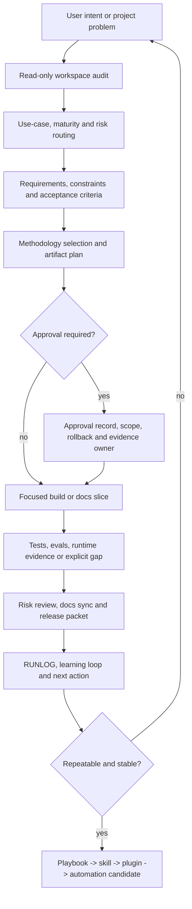

# Product-Agent OS

Product-Agent OS - local Codex plugin for turning Codex App, CLI, IDE extension, subagents, skills, `AGENTS.md`, memory, sandbox, approvals, MCP and agent workflows into a governed product engineering system.

Product-Agent OS full stack keeps product context, requirements, architecture boundaries, documentation, verification, ownership, release evidence and the learning loop in explicit artifacts. Codex writes and verifies focused slices; Product-Agent OS defines the operating order: understand the project first, record risk and boundaries, then change files.

Source boundary: this README is the compact product and operator entrypoint. Detailed implementation history and source-backed ledgers live in the owning artifacts listed in [Where History Lives](#where-history-lives).

## Why Product-Agent OS

Product-Agent OS is for the moment when a Codex session becomes too important to live only in chat. It turns a messy or high-stakes workspace into a reviewable delivery route: what the project is, what is risky, which files matter, which checks prove progress, what needs approval and what the next safe slice should be.

Use it when you want Codex to keep momentum without losing product intent, engineering discipline or source-of-truth boundaries. It blocks unsafe completion claims so safe work can move faster.

| Plain workflow pain | Product-Agent OS outcome |
| --- | --- |
| "Just implement it" hides missing context. | The first move is a read-only audit with risks, gaps and a bounded next action. |
| A long thread becomes the only plan. | Requirements, plan, tests, evals, handoff and learning move into durable artifacts. |
| Subagents can collide in the same files. | Ownership, forbidden files, expected evidence and stop conditions are explicit before parallel work. |
| Verification is reconstructed after coding. | Checks, evals, runtime evidence, rollback and owner evidence are part of the route. |
| Safety feels like a blocker. | Approval boundaries make risky actions explicit while local deterministic work continues. |

## What It Solves

In real projects, the bottleneck is rarely only code generation speed. The usual failure is context control:

- requirements stay in chat and disappear between sessions;
- architecture decisions are not connected to files, commands and owners;
- several agent workers can edit the same area without ownership;
- tests, evals, rollback and release evidence are defined after the change;
- AI/RAG quality is judged by intuition instead of baseline and rerun evidence;
- security, privacy, data and external-write risks appear late;
- dashboards and generated views are mistaken for proof;
- "done" is claimed without current command, eval or runtime evidence.

Product-Agent OS moves work from chat into reviewable artifacts: requirements, plan, test/eval matrix, source context, handoff packets, risk review, docs sync, release packet and learning loop.

## What You Get After The First Run

A good first run should not dump a methodology lecture or start rewriting the repo. It should return a compact operating packet:

| Output | Why it matters |
| --- | --- |
| Lifecycle state | Shows whether the workspace needs intake, requirements, planning, implementation, verification, review, release or learning. |
| Risk map | Names missing source evidence, external systems, data, security, AI/RAG, release or ownership risks. |
| Next smallest action | Gives one useful step that can be executed or approved without broad refactor. |
| Minimum artifacts | Identifies the files or packets needed before coding, review, release or automation. |
| Verification route | Lists exact commands, evals, runtime checks, screenshots, logs, owner review or accepted gaps. |
| Approval boundary | Separates read-only work, staged proposals and actions that need explicit permission. |
| Evidence gaps | Prevents readiness, fixed, works or release claims from detection-only evidence. |

The first useful artifact can be as small as a route summary, or as concrete as staged `REQUIREMENTS.md`, `PLAN.md`, `TEST.md`, `EVALS.md`, `RUNLOG.md` and `.codex/` proposals.

## Quick Start

If the plugin is available in Codex, start with a workspace route:

```text
Use Product-Agent OS to audit this workspace and propose the next safe product-engineering step.
```

Recommended first prompt:

```text
Use Product-Agent OS to run a read-only first-run audit. Return lifecycle state, risk map, next smallest action, required artifacts, checks, approvals and evidence gaps. Do not write files yet.
```

Good starter prompts:

```text
Use Product-Agent OS to turn this repo into a product-ready Codex project.
```

```text
Use Product-Agent OS for this feature: write requirements, plan build slices, define tests/evals, then execute only the first safe slice.
```

```text
Use Product-Agent OS to rescue this bug: reproduce, find root cause, plan regression coverage, implement the fix, and record evidence.
```

```text
Use Product-Agent OS to prepare PR/release readiness: risks, tests, docs impact, rollback, release notes and unresolved gaps.
```

```text
Use Product-Agent OS to build a project code graph and show read order, hotspots, affected tests and safe next action.
```

## Output Preview

When Product-Agent OS stages project infrastructure, the output is designed to be inspectable before it touches the target workspace:

```text
AGENTS.md       -> durable project rules, safety and ownership boundaries
REQUIREMENTS.md -> scope, non-goals, constraints and acceptance scenarios
PLAN.md         -> slices, owned files, commands, rollback and stop conditions
TEST.md         -> deterministic checks, runtime checks and escalation rules
EVALS.md        -> subjective, AI/RAG and long-horizon quality gates
RUNLOG.md       -> current-cycle evidence, failures, residual risks and next action
.codex/agents   -> project-scoped role proposals
.codex/workflows -> repeatable workflow playbooks
.codex/artifact-templates -> reviewable packets for product, architecture, data, AI, security and release work
```

Generated status, graph and cockpit views can help orientation, but the source files, control-plane artifacts, command evidence and owner decisions remain authoritative.

## Codex Vs Product-Agent OS

| Surface | Best at | Product-Agent OS adds |
| --- | --- | --- |
| Codex App | Ambiguous product and engineering work with steering. | Durable control plane, first-run route, source policy, approval map and evidence discipline. |
| CLI | Local implementation, tests and repo tasks. | Staged infrastructure, deterministic checks, runtime route packets and safe merge planning. |
| IDE extension | In-editor code changes and review. | File ownership, handoff context, acceptance scenarios and completion evidence. |
| Subagents | Independent slices with clear ownership. | Role design, owned/forbidden files, expected evidence and stop conditions. |
| Skills | Repeatable methods. | Promotion path from manual success to playbook, skill, plugin and automation candidate. |

Codex still does the engineering work. Product-Agent OS keeps the work product-shaped, source-backed and reviewable.

## Implementation Depth

The current repository is not just a README around prompts. It includes a local implementation surface with:

- 11 packaged lifecycle skills;
- 20+ workflow templates for first-run intake, bug rescue, PR review, AI/RAG eval regression, data migration, release packaging and related routes;
- 142 artifact templates for product, architecture, requirements/domain, frontend, backend, API, database, AI/RAG, security, release, agentic workflow and governance packets;
- 91 local fixtures for routing, false-positive, approval-bound and regression coverage;
- 65 Product-Agent OS test files;
- deterministic fixture and transcript eval runners;
- project graph, cockpit, status dashboard, agent/skill metrics and live-governance staging modules.

These numbers are implementation depth signals, not readiness claims for a target project. A target project still needs current source reads, checks, owner decisions and accepted gaps.

## Before And After

| Before Product-Agent OS | After Product-Agent OS |
| --- | --- |
| "Make this repo production-ready." | Read-only audit, lifecycle state, risks, minimum artifacts and the first safe slice. |
| "Fix this bug." | Reproduction evidence, root-cause route, regression check, fix boundary and RUNLOG evidence. |
| "Use subagents on this." | Ownership map, handoff packet, forbidden files, expected evidence and sequential fallback. |
| "Improve the AI quality." | Baseline, dataset policy, prompt/model/tool contract, eval threshold, rerun evidence and residual risk. |
| "Ship it." | Release scope, artifact manifest, checks, rollback, approval boundary and unresolved gaps. |

## Current Implementation Status

The current implementation is a checked-in local Codex plugin package under `plugins/product-agent-os/`. It includes:

- a Codex plugin manifest at `plugins/product-agent-os/.codex-plugin/plugin.json`;
- packaged lifecycle skills under `plugins/product-agent-os/skills/`;
- staged infrastructure templates under `plugins/product-agent-os/assets/templates/`;
- deterministic Python tooling under `plugins/product-agent-os/scripts/`;
- fixture and transcript eval assets under `plugins/product-agent-os/assets/`;
- operator docs under `docs/product-agent-os/` and `docs/product-agent/`;
- unit and contract tests under `tests/product_agent_os/`.

Implemented surfaces are local and deterministic by default. The package does not require a separate OpenAI API key for its local tooling, does not run as a standalone Agents SDK app, does not publish itself, does not start live systems, does not call external providers and does not mutate target workspaces unless an explicit approval path is used.

The shipped implementation should be read as a governed local operating system for Codex work, not as an autonomous production deployment platform.

## Operating Loop



Normal cycle:

1. **Audit** - read the workspace without writing.
2. **Route** - classify use case, maturity and risk profile.
3. **Plan** - record scope, non-goals, acceptance, ownership, verification and rollback.
4. **Stage** - create proposals only in a safe staging path.
5. **Approve** - require explicit permission for target writes, external action, release, secrets, production data and automation.
6. **Build** - execute one focused slice.
7. **Verify** - run current checks, evals or runtime evidence, or record an explicit gap.
8. **Review** - inspect risk, docs impact and release readiness.
9. **Learn** - move stable lessons into docs, skills or automation candidates.

## Capability Map

```mermaid
flowchart LR
    subgraph Control["Control Plane"]
        A1["AGENTS.md"]
        A2["REQUIREMENTS.md"]
        A3["PLAN.md"]
        A4["TEST.md"]
        A5["EVALS.md"]
        A6["RUNLOG.md"]
    end

    subgraph Skills["Lifecycle Skills"]
        B1["Discovery"]
        B2["Requirements"]
        B3["Planning"]
        B4["Agent team"]
        B5["Tests and evals"]
        B6["Docs"]
        B7["Review and release"]
        B8["Learning and automation"]
    end

    subgraph Engines["Local Engines"]
        C1["Infrastructure renderer"]
        C2["Safe merge planner"]
        C3["Methodology audit"]
        C4["Project code graph"]
        C5["Status dashboard"]
        C6["Fixture and transcript evals"]
        C7["Compatibility validators"]
    end

    Control --> Skills
    Skills --> Engines
    Engines --> Control
```



## Core Capabilities

| Capability | What it does | Primary owner |
| --- | --- | --- |
| Workspace discovery | Reads stack, manifests, docs, tests, CI/runtime hints, data/API/AI surfaces and risk signals without writing. | `workspace-discovery-auditor` |
| Requirements and acceptance | Turns an idea, bug or product request into scope, non-goals, acceptance scenarios and owner questions. | `requirements-author` |
| Planning | Splits work into bounded slices with files, commands, rollback, evidence owner and stop conditions. | `implementation-planner` |
| Agent team design | Creates roles around ownership, owned/forbidden files, handoff artifacts and verification. | `agent-team-designer` |
| Test/eval routing | Selects deterministic tests, subjective evals, AI evals, runtime checks and manual QA evidence. | `test-eval-designer` |
| Docs and source policy | Aligns docs, source registry, glossary, traceability, unsupported claims and accepted gaps. | `docs-maintainer` |
| System file hygiene | Reviews control-plane files, agents, skills, workflows, hooks, evals, automation candidates and plugin package files for size, duplicates, stale evidence, secrets and active schedules. | `docs-maintainer`, `automation-promoter` |
| Risk and release | Reviews behavioral regressions, missing tests, release scope, rollback and publish boundary. | `risk-reviewer`, `pr-release-operator` |
| Learning loop | Moves repeated success and failure patterns into playbooks, skills, plugin updates or automation candidates. | `learning-loop-maintainer`, `automation-promoter` |

The methodology intelligence layer chooses only the product, architecture, quality, AI, security, data and release gates that reduce real project risk. It should not force heavy ceremony on small or mechanical work.

## Implemented Technical Surface

| Surface | Implemented form | Boundary |
| --- | --- | --- |
| Plugin package | `.codex-plugin/plugin.json`, `.mcp.json`, skills, templates, scripts, fixtures and docs. | Package presence is not installation, publication or runtime activation. |
| Lifecycle skills | Skills for orchestration, discovery, requirements, planning, agent teams, test/eval design, docs, risk, release, learning and automation promotion. | Skills guide and stage work; approvals and project instructions still win. |
| Infrastructure renderer | `render_infrastructure.py` stages `AGENTS.md`, control-plane files, `.codex/config.toml`, agents, hooks, workflows, artifact templates, evals, PR/release files and automation candidates. | Writes to an explicit stage directory unless an approved merge path is used. |
| Safe merge tooling | `merge_infrastructure.py` validates stage manifests, digests, workspace binding, path safety, approved targets and rollback data. | Target writes require an approval record; rollback refuses stale targets. |
| Codex-only runtime | `run_codex_runtime_runner.py` reads local context, infers lifecycle state, validates route packets, redacts output and returns deterministic route status. | It does not call a model, start a server or hide a standalone Agents SDK runtime. |
| Methodology audit | `run_methodology_audit.py` and `product_agent_os/methodology_*` map workspace evidence to applicability, owner questions, recommendations and source-artifact routing. | Detection creates `present_unverified`; readiness needs evidence or accepted gaps. |
| Fixture evals | `run_fixture_eval.py` checks scenario fixtures, methodology gates, approval boundaries and false-positive routing. | Local deterministic evidence only. |
| Transcript evals | `run_transcript_eval.py` replays synthetic or redacted sessions, checks expected/forbidden terms and privacy errors. | No external systems or model calls. |
| Source and policy validators | Validators cover control plane, agents, hooks, source policy, automation candidates, compatibility, system hygiene and planning matrices. | Validation is evidence for shape and policy, not proof of product behavior. |
| Status projection | `render_status_dashboard.py` stages `.codex/product-agent-os/status.html` and `.codex/product-agent-os/status.json`. | Dashboard is a generated view, not source of truth. |
| Agent/skill metrics loop | `render_agent_skill_metrics_report.py` and metrics modules stage redacted scorecards, reports and modernization candidates. | Staged evidence only; no live eval/model/API calls, no active schedules, no self-applied updates. |
| Project code graph | `scan_project_code_graph.py` stages graph JSON/JSONL, cockpit HTML/JSON, query packets, search index and extension evidence. | Generated graph artifacts are orientation evidence, not canonical facts. |
| Retrieval and proposal gates | Modules cover static search, local backend store, semantic retrieval, embedding/reranker provider gates, hybrid retrieval and LLM proposal packets. | Provider-backed and live surfaces stay approval-bound and fallback to graph-only or local deterministic modes. |
| Live governance gates | Modules cover approval packets, data classification, redaction, cache, budget, runtime, review ledger, mutation dry-run, audit/security/observability, real-testing readiness and runtime QA. | Live server, browser automation, provider calls, canonical graph mutation and git actions require specific approval. |

## Packaged Skills

The plugin currently packages these lifecycle skills:

| Skill | Purpose |
| --- | --- |
| `project-lifecycle-orchestrator` | Determine lifecycle state and the smallest safe next action. |
| `workspace-discovery-auditor` | Inspect a workspace without writes and return stack, risk and evidence signals. |
| `requirements-author` | Capture scope, non-goals, acceptance scenarios and owner questions. |
| `implementation-planner` | Produce executable slices with files, commands, rollback, evidence owner and stop conditions. |
| `agent-team-designer` | Define role ownership, file boundaries, handoff packets and sequential fallback. |
| `test-eval-designer` | Choose deterministic checks, AI evals, subjective gates and manual QA evidence. |
| `risk-reviewer` | Review unsupported claims, missing evidence, behavioral risk and release readiness. |
| `docs-maintainer` | Keep source registry, docs, glossary, traceability and accepted gaps aligned. |
| `pr-release-operator` | Prepare PR, release, rollout, rollback and residual-risk packets. |
| `learning-loop-maintainer` | Convert repeated lessons and failures into durable guidance. |
| `automation-promoter` | Create candidate-only automation readiness packets after manual success evidence. |

Codex loads skills through progressive disclosure. The model sees names and descriptions first; the full `SKILL.md` should be loaded only when the task matches or the user invokes it.

## Use-Case Routing

Product-Agent OS first classifies the work, then chooses the lightest sufficient route:

| Use case | Typical first artifact | Stronger gates |
| --- | --- | --- |
| Web/front-end | Component state matrix, visual QA plan, browser checks. | Playwright, responsive states, accessibility, console/runtime evidence. |
| Native/mobile | Platform build/run plan, simulator flow, permission assumptions. | Screenshots, logs, signing/update risk. |
| Desktop | OS-specific run path, file permission review, local storage boundary. | App logs, GUI behavior, packaging risk. |
| Backend/API | Service/API contract, error/auth matrix. | Integration tests, migration, observability, rollback. |
| Data | Schema/data inventory, migration plan, lineage. | Backup/restore, data quality, production access approval. |
| AI/RAG | AI behavior spec, prompt/model decision, eval baseline. | Dataset policy, grounding, cost/latency, safety. |
| Docs | Docs tooling decision, source registry impact. | `Source status:`, link/nav checks, strict build when needed. |
| PR/review | Findings by severity, residual risk. | Missing tests, contract risk, release notes. |
| Automation | Automation candidate. | Manual success log, owner/cadence, permissions, rollback. |

The current classifier also covers greenfield idea shaping, bug rescue, complex system acceleration, legacy onboarding, API migration, AI/RAG eval regression, native/mobile work, desktop local-first work, data migration, security-sensitive change, CI stabilization, release packaging, docs-only work, standard feature work and maintenance.

## Methodology Intelligence And Auto-Selection

Product-Agent OS treats methodology as project-specific risk routing, not as a fixed checklist. It scans the user's workspace in read-only mode, combines repository evidence with user intent, classifies maturity and complexity, then activates only the methods that reduce real project risk.

The methodology packet includes applicable domains, missing evidence, owner questions, recommendations, priorities, synthesis and the next safe action. It can route work through TDD, ATDD/BDD, DDD, ADD, ADRs, C4/arc42-style views, FSD, API contract-first delivery, risk-based testing, eval-driven AI work, security engineering, release operations and Codex agentic workflow governance.

### Project Scanning Principle

The scan is evidence-first and non-mutating. It reads files, directories and control-plane artifacts, but it does not write to the target workspace, call providers, activate hooks, run automation or treat generated views as proof.

| Scan layer | Examples of signals | How Product-Agent OS uses it |
| --- | --- | --- |
| Workspace inventory | Manifests, source folders, tests, docs, CI, release and config files. | Classifies simple, standard, complex or high-risk work and avoids heavy process for tiny tasks. |
| Stack and surface detection | Frontend, backend, native/mobile, desktop, API, database, AI/RAG, docs, automation, release. | Routes work to product, architecture, quality, data, AI, security and operations domains. |
| Contract evidence | OpenAPI, AsyncAPI, GraphQL, gRPC, JSON Schema, Pact, generated SDKs, webhooks. | Activates API contract-first, compatibility, error/auth and contract-test gates. |
| Data evidence | Schemas, migrations, ORM models, DB docs, data contracts, backfills. | Activates migration planning, data dictionary, rollback, backup/restore and access approval. |
| AI/RAG evidence | Prompts, evals, model decisions, tools, retrieval config, vector data, datasets. | Activates baseline evals, prompt/model/tool contracts, grounding, dataset and cost/latency checks. |
| Security and privacy evidence | Auth, secrets, PII, payments, permissions, compliance, SBOM, security review. | Activates threat surface, ASVS/SSDF/SAMM, authz negative tests, privacy and supply-chain review. |
| Codex control-plane evidence | `AGENTS.md`, `REQUIREMENTS.md`, `PLAN.md`, `TEST.md`, `EVALS.md`, `RUNLOG.md`, skills, subagents, MCP, hooks. | Activates model/reasoning policy, handoffs, ownership, approvals and automation maturity checks. |
| User intent | Feature, bug, release, migration, AI behavior, PR review, production readiness, regulated risk. | Adds intent-only risk when repo evidence is incomplete and asks owner questions instead of guessing. |

Detection alone is never a readiness claim. A detected signal becomes `present_unverified` until current evidence, owner review or an accepted gap promotes it. Missing applicable methodology becomes `applicable_missing`; risky actions can remain `approval_required`.

### Methodology Map

| Methodology or practice | When it activates | Example application in Product-Agent OS |
| --- | --- | --- |
| Product discovery and metric design | Product behavior, MVP, launch, growth, pricing, onboarding or value claims change. | Product hypothesis, value proposition, opportunity tree, metric spec, guardrails and owner signoff. |
| Requirements engineering | Behavior, workflow, rules, public contract, UI state, data flow or multi-slice scope is unclear. | Requirement registry, non-goals, acceptance scenarios, owner questions and requirement-to-check traceability. |
| ATDD / BDD acceptance scenarios | User-visible behavior or domain correctness needs shared examples. | Example scenarios linked to tests, evals, manual QA evidence or explicit gaps. |
| DDD | Domain language, bounded contexts, business rules, events, workflows or multi-team ownership matter. | Domain model, rules, ubiquitous language, context boundaries and domain-to-architecture traceability. Simple CRUD does not force DDD. |
| ADD / architecture-driven design | Quality attributes, runtime topology, contracts, persistence, deployment or trust boundaries change. | Architecture scope, context/container boundaries, tradeoffs, fitness checks and rollback assumptions. |
| ADR | A decision has alternatives, risk, non-goals, migration impact or future ownership cost. | Decision, rejected options, consequences, rollback path and evidence owner. |
| C4 / arc42-style architecture views | Context, container, component, deployment or runtime views are needed. | Architecture overview, diagrams, trust-boundary map and architecture review record. |
| TDD / Red-Green-Refactor | Behavior-changing code, shared logic, bug fixes, migrations, API/schema/UI logic or risky refactors are planned. | Test-first evidence where practical, explicit gap where not, and regression evidence linked to the slice. |
| Risk-based testing and QA | Ready, done, fixed, works or release claims need evidence. | Unit, integration, contract, runtime, visual, manual QA, CI and flaky-test evidence by blast radius. |
| FSD and frontend boundary discipline | Web UI structure, features, widgets, pages, shared components or frontend ownership boundaries exist. | Feature boundary review, state matrix, visual QA, accessibility, responsive checks and performance budget. |
| Component-driven UI | Reusable components, design states, Storybook-like evidence or UI regressions matter. | Component cards, state coverage, visual review, keyboard/focus contract and design-system impact notes. |
| Backend service design | Services, jobs, queues, observability, SLOs, consistency, modular boundaries or runtime failures matter. | Service overview, dependency failure matrix, health checks, job contracts, observability map and rollback plan. |
| API contract-first delivery | OpenAPI, AsyncAPI, GraphQL, gRPC, webhooks, generated clients or external consumers are involved. | API inventory, consumer map, error catalog, auth matrix, compatibility record and contract tests. |
| Data and migration discipline | Persistent data, schema changes, migrations, backfills, retention, classification or production access exist. | Database inventory, migration plan, data dictionary, backup/restore evidence, rollback feasibility and approvals. |
| Eval-driven AI / RAG development | Prompts, models, tools, retrieval, grounding, AI behavior, datasets or safety claims change. | AI behavior spec, baseline eval, prompt contract, model decision, RAG source inventory, rerun evidence and residual risk. |
| Security engineering | Auth, authorization, secrets, PII, payments, abuse, supply chain, compliance or external writes are in scope. | Threat surface, risk review, ASVS/SSDF/SAMM mapping, negative tests, secrets policy and privacy impact. |
| Release and operations readiness | PR, package, deploy, publish, rollout, CI/CD, production data or external systems are involved. | Release readiness, versioning, changelog, artifact manifest, rollout, rollback/recovery and runbook evidence. |
| Codex agentic workflow governance | Subagents, skills, MCP, hooks, memory, model choice, automation or long-running Codex work are used. | Control plane, model/reasoning policy, handoffs, owned/forbidden files, approvals and promotion path. |
| Scrum/Kanban-style sequencing | Staged delivery, WIP control, owner handoffs or release coordination are needed. | Scope, queue, next slice, stop conditions, evidence owner and rollback without heavyweight ceremony. |
| Definition of Done / evidence-before-completion | The agent is about to claim ready, done, fixed, works, verified or releasable. | Completion language is blocked until checks, evals, runtime evidence, owner review or accepted gaps exist. |

## Methodology And Readiness Gates

Product-Agent OS includes methodology gates that become active only when the project evidence makes them relevant:

- no-placeholder planning: exact files, owned/forbidden files, exact commands, expected outputs, rollback, evidence owner and placeholder scan;
- two-stage review: spec compliance before quality/risk for risky, public-contract, migration, security, data, release, parallel or external-system slices;
- fresh-context handoff: complete context, source constraints, ownership, expected evidence and stop conditions before subagents or parallel workers;
- acceptance scenario traceability: requirement -> scenario -> check -> evidence owner;
- conditional domain modeling for complex backend, workflow, enterprise, data-heavy, multi-service or multi-context work;
- conditional Feature-Sliced Design routing for applicable web UI work only;
- metric hardening for product behavior changes, including primary value metric, input metric, counter-metric, guardrail, privacy and owner signoff;
- evidence-before-completion before ready, completed, fixed, works or release claims;
- docs tooling selection for MkDocs, Docusaurus, Sphinx, Antora, Storybook, OpenAPI/AsyncAPI, DBML, SchemaSpy, TypeDoc/JSDoc/Javadoc/XML docs, Vale, markdownlint, Mermaid, PlantUML and Structurizr DSL when detected;
- Codex / agentic workflow governance for source-of-truth boundaries, model/reasoning policy, memory as recall only, MCP permission review, hook activation approval and automation maturity.

Readiness statuses are explicit: `not_applicable`, `applicable_missing`, `present_unverified`, `present_verified`, `proposal_staged`, `explicit_gap_accepted` and `approval_required`. Detection alone can only produce `present_unverified`.

## No Forced Ceremony

Product-Agent OS should make real risk visible without turning every request into a heavyweight process. The methodology layer uses applicability and false-positive guards:

- simple docs edits do not need a full product, architecture and release process unless they change public contracts or publishing;
- simple CRUD does not force domain-driven design;
- backend and native/mobile repositories do not imply Feature-Sliced Design;
- docs-light work does not force a heavy docs portal;
- hosted docs, CI activation, DB introspection, production data and provider calls stay approval-required;
- generated artifacts stay labeled as orientation or staged evidence until source or owner evidence promotes the claim.

This is the product stance: use stronger methodology when risk justifies it, and keep small work small.

## Who It Fits Best

Product-Agent OS is strongest when the work is valuable enough that losing context would be expensive:

| Situation | Why it helps |
| --- | --- |
| A messy repo with unclear entry points | Produces read order, hotspots, run commands, evidence gaps and safe first slice. |
| A product feature that may expand in scope | Keeps value, non-goals, acceptance, files, checks and rollback connected. |
| A bug with uncertain root cause | Forces reproduction and regression evidence before a fix claim. |
| A team using subagents or parallel workers | Makes file ownership, handoff context and stop conditions explicit. |
| AI/RAG behavior changes | Requires baseline, dataset policy, eval threshold, rerun evidence and residual risk. |
| Release or PR readiness | Separates review findings, current checks, artifact manifest, rollback and approval boundary. |

## Product Scenarios By Role

| Role | Main value | Output artifacts |
| --- | --- | --- |
| Founder / solo builder | Move from idea to a releasable slice without chaos. | Product brief, value proposition, first-run intake, release readiness. |
| Product Manager | See value, scope, metric, owner decisions and accepted gaps. | `REQUIREMENTS.md`, acceptance scenarios, metric spec, launch packet. |
| Developer | Get files, commands, rollback and tests before coding. | `PLAN.md`, build slice, regression evidence, RUNLOG update. |
| Tech Lead / Architect | Record boundaries, tradeoffs and ownership. | ADR, architecture overview, trust-boundary map, handoff contract. |
| QA / Tester | Tie quality to risk instead of a random test list. | `TEST.md`, `EVALS.md`, quality strategy, manual QA packet. |
| AI Engineer | Avoid prompt/model/RAG changes without baseline and rerun evidence. | AI behavior spec, prompt contract, model decision record, RAG eval report. |
| Docs Maintainer | Keep docs, source registry, glossary and traceability aligned. | Docs packet, source registry updates, unsupported claims log. |
| Release Operator | Avoid release without scope, rollback and evidence. | PR body, release notes, artifact manifest, rollout and rollback plan. |
| Security / Privacy Owner | Identify trust boundaries, data, secrets and external writes. | Threat surface, privacy impact, approval record, supply-chain review. |

## Artifacts

| Family | Examples | When created |
| --- | --- | --- |
| Control plane | `AGENTS.md`, `REQUIREMENTS.md`, `PLAN.md`, `TEST.md`, `EVALS.md`, `RUNLOG.md` | For long-running or production work. |
| Product | `product-brief.md`, `value-proposition.md`, `opportunity-tree.md`, `metric-spec.md` | When value, target user, metric or launch hypothesis is unclear. |
| Requirements/domain | `requirement-registry.md`, `acceptance-scenarios.md`, `business-rules.md`, `domain-modeling.md` | When behavior or domain correctness matters. |
| Architecture | `architecture-overview.md`, `adr.md`, `trust-boundary-map.md`, C4/arc42 views | When boundaries, public contracts, runtime topology or ownership risk exist. |
| Quality/testing/evals | `quality-strategy.md`, `test-eval-matrix.md`, `eval-run-report.md`, `flaky-test-policy.md` | When readiness or completion claims need evidence. |
| AI/RAG | `ai-behavior-spec.md`, `prompt-contract.md`, `model-decision-record.md`, `rag-eval-report.md` | When prompts, models, tools, retrieval, grounding or safety change. |
| Delivery/release | `release-readiness.md`, `release-artifact-manifest.md`, `rollout-plan.md`, rollback packet | For PR, package, deployment, publication or release decisions. |
| Agentic workflow | `agent-task-packet.md`, `handoff-contract.md`, `worktree-ownership.md`, `automation-candidate.md` | For subagents, skills, parallelism and repeatable workflows. |
| System hygiene | `system-file-hygiene-report.md`, `system-file-hygiene-audit.md` | For scheduled-candidate or size-triggered review without active automation. |

The renderer also packages artifact templates for API contracts, integration catalogs, generated SDK manifests, database inventories, migration plans, data contracts, privacy records, supply-chain review, SBOM manifest, CI permissions, audit logging, AI security, compliance overlays, vulnerability response, approval records, release readiness, behavior eval cases, model/reasoning policy, MCP permission review, hook governance, skill promotion, agent eval workflows and Codex compatibility.

## Documentation And Evidence

Documentation in Product-Agent OS is not a separate Markdown folder; it is part of the delivery loop.

- `docs-maintainer` links claims to sources, owners, acceptance scenarios and evidence.
- `Source status:` separates official docs, local evidence, community claims and experiments.
- `docs/sources/registry.md` stores the source-backed claim index.
- Generated graph, dashboard, status and cockpit artifacts are orientation evidence, not source of truth.
- README gives the product entrypoint and commands, but it does not store the historical execution ledger.
- Proof for claims means current command, eval, runtime or owner evidence, not the existence of a file or dashboard.

## Guided Questions And Status

Guided question protocol keeps the first response compact: one blocking question maximum, only when the next step would be risky without the answer.

Status snapshot and dashboard help orientation, but they do not become proof:

- `.codex/product-agent-os/status.html`
- `.codex/product-agent-os/status.json`
- dashboard is a generated view
- generated view only
- underlying artifacts remain source material
- no success claim from stale evidence

The status layer projects route, lifecycle state, evidence gaps, question queue, system hygiene status, graph status and agent/skill metrics references into generated artifacts. It must keep source-boundary labels visible and must avoid completion language when evidence is stale or missing.

## Project Code Graph

Project Code Graph is for large or unclear repositories:

- turns a codebase into a source-backed orientation layer before build, review or migration work;
- builds a file/module/function/docs/schema/diagram graph;
- adds Python AST overlays, import/call/test edges and unresolved-call summaries where applicable;
- adds docs/contracts/schema overlays for Markdown, OpenAPI/Swagger, AsyncAPI, DBML, SQL, JSON, YAML, Mermaid and PlantUML;
- shows read order, hotspots, impact, affected tests and bounded query packets;
- can stage offline cockpit HTML/JSON and search/index/retrieval artifacts;
- supports query modes such as `neighbors`, `path`, `trace`, `impact`, `affected_tests`, `changed_since`, `why_changed`, `read_order`, `hotspots`, `node`, `status` and `search`;
- does not replace reading source files before claims;
- does not mutate canonical graph source without separate approval and rollback evidence.

Generated graph artifacts are not source of truth. Graph JSON/JSONL, cockpit HTML/JSON, static search indexes, local backend stores, semantic indexes, LLM proposal packets and extension closure reports are orientation evidence and cache-bound generated views.

For a user, the value is practical: know what to read first, where change risk clusters, which tests may be affected, which assumptions are stale and where source reads are still required before claiming implementation or review confidence.

## Live Runtime And Retrieval Boundaries

The implementation includes approval-bound surfaces for live and provider-assisted work:

- local read-only runtime contracts that are disabled by default;
- data classification, redaction, credential boundary, cache policy, budget policy and fallback rules;
- embedding provider gate and eval baseline;
- cross-encoder reranker gate and hybrid retrieval pipeline;
- LLM proposal provider gate with structured JSON, provenance, uncertainty and unsupported-claim labels;
- human review ledger and proposal diff preview;
- canonical mutation dry-run, append-only journal and rollback proof;
- audit, security, privacy, observability and handoff packets;
- real-testing readiness, target consent, pilot harness and Codex surface smoke;
- runtime browser QA, performance budget and stabilization ledger.

Without a complete approval packet, these surfaces remain `approval_required`, `blocked` or degraded to graph-only fallback. Live server launch, browser automation, provider/API calls, canonical graph mutation, git stage/commit/push/PR and external writes require explicit scope, owner, rollback and current verification evidence.

## Self-Verification And Modernization Loop

Self-Verification And Modernization Loop is a self-verification metrics loop for signals about how agents, skills, prompt/policy packs, router/tool policies and harness versions behave.

Technical surface: `agent_skill_metrics_loop`, redacted reports, scorecard ledger, modernization candidates and approval boundary. These outputs are staged evidence only: no live eval/model/API calls, no active schedules, no self-applied updates.

Workflow promotion only moves in this order:

```text
manual thread -> playbook -> skill -> plugin -> automation candidate
```

## System File Hygiene

The system file hygiene audit is read-only. It checks root control-plane files, nested `AGENTS.md`, `.codex/config.toml`, MCP config, `.codex/agents`, `.codex/skills`, workflows, artifact templates, automation candidates, hooks, evals, PR/release files, docs source-control files, GitHub workflow files, CODEOWNERS, security files and checked-in plugin control files.

It reports size limits, duplicate headings, mojibake/BOM markers, secret-like literals, historical ledger leakage and active schedule markers inside automation candidates. It does not compact files, create schedules, activate hooks, mutate GitHub Actions or write to external systems by itself.

## Safety And Boundaries

- No separate OpenAI API key is required for local deterministic Product-Agent OS tooling.
- Secrets, tokens, private keys, private customer data, raw private chats and absolute user-specific paths must not enter prompts, docs, templates, fixtures or examples.
- Generated views are orientation evidence, not source of truth.
- Live server, browser automation, external provider calls, canonical graph mutation, git stage/commit/push/PR and plugin publication require explicit scope and approval.
- Existing user files are preserved outside managed sections.
- Community claims do not become project rules without `trust_level` and `verification_status`.
- Official OpenAI docs remain source of truth for Codex App, CLI, IDE extension, subagents, skills, `AGENTS.md`, memory, sandbox, approvals, MCP and Agents SDK behavior.
- Detection is not verification; current evidence is required before saying "works", "fixed", "ready", "complete" or "releaseable".

## Repository Layout

| Path | Purpose |
| --- | --- |
| `plugins/product-agent-os/` | Working local Codex plugin package. |
| `plugins/product-agent-os/.codex-plugin/plugin.json` | Plugin manifest. |
| `plugins/product-agent-os/.mcp.json` | Packaged MCP declaration boundary. |
| `plugins/product-agent-os/skills/` | Lifecycle skills used by Codex. |
| `plugins/product-agent-os/assets/templates/` | Control-plane, workflow, artifact, eval, agent, hook and PR/release templates. |
| `plugins/product-agent-os/assets/fixtures/` | Local project fixtures for deterministic eval and routing checks. |
| `plugins/product-agent-os/assets/eval-fixtures/` | Transcript/session eval fixtures. |
| `plugins/product-agent-os/scripts/` | Renderer, merge tooling, validators, fixture evals, transcript evals, project graph tooling and runtime contract runner. |
| `plugins/product-agent-os/scripts/product_agent_os/` | Python implementation modules for discovery, methodology, graph, runtime, status, metrics, safety and validation. |
| `docs/product-agent-os/` | Product-Agent OS operator docs for capabilities, scenarios, evals and compatibility. |
| `docs/product-agent/` | Product-agent concepts, lifecycle, roles and plugin spec. |
| `docs/methodologies/` | Methodology research across product, architecture, quality, AI, security, data and release domains. |
| `docs/diagrams/` | Implementation atlas for product delivery, runtime choices, agent teams and verification. |
| `docs/sources/` | Source-backed registry, internal evidence packets and historical ownership. |
| `tests/product_agent_os/` | Unit and contract tests for plugin behavior and docs contracts. |
| `site/` | Tracked MkDocs HTML output. |

## Quick Commands

```powershell
# Read-only infrastructure proposal
python plugins\product-agent-os\scripts\render_infrastructure.py <workspace> --dry-run

# Stage proposed artifacts outside the target workspace
python plugins\product-agent-os\scripts\render_infrastructure.py <workspace> --stage C:\tmp\product-agent-os-stage

# Review merge plan before applying staged artifacts
python plugins\product-agent-os\scripts\merge_infrastructure.py <workspace> C:\tmp\product-agent-os-stage --plan

# Apply only with explicit approval record
python plugins\product-agent-os\scripts\merge_infrastructure.py <workspace> C:\tmp\product-agent-os-stage --apply --approval-file <approval.json>

# Methodology audit
python plugins\product-agent-os\scripts\run_methodology_audit.py <workspace> --report
python plugins\product-agent-os\scripts\run_methodology_audit.py <workspace> --json

# Project code graph and generated views
python plugins\product-agent-os\scripts\scan_project_code_graph.py <workspace> --dry-run
python plugins\product-agent-os\scripts\scan_project_code_graph.py <workspace> --stage C:\tmp\product-agent-os-graph

# Project code graph query against a staged graph
python plugins\product-agent-os\scripts\scan_project_code_graph.py <workspace> --query status --graph C:\tmp\product-agent-os-graph\.codex\product-agent-os\project-code-graph.json

# Project code graph generated extension surfaces
python plugins\product-agent-os\scripts\scan_project_code_graph.py <workspace> --build-index --stage C:\tmp\product-agent-os-graph --graph C:\tmp\product-agent-os-graph\.codex\product-agent-os\project-code-graph.json
python plugins\product-agent-os\scripts\scan_project_code_graph.py <workspace> --build-backend --stage C:\tmp\product-agent-os-graph --graph C:\tmp\product-agent-os-graph\.codex\product-agent-os\project-code-graph.json --backend-approval approval.json
python plugins\product-agent-os\scripts\scan_project_code_graph.py <workspace> --build-semantic-index --stage C:\tmp\product-agent-os-graph --graph C:\tmp\product-agent-os-graph\.codex\product-agent-os\project-code-graph.json --semantic-approval approval.json
python plugins\product-agent-os\scripts\scan_project_code_graph.py <workspace> --build-llm-proposals --stage C:\tmp\product-agent-os-graph --graph C:\tmp\product-agent-os-graph\.codex\product-agent-os\project-code-graph.json --llm-approval approval.json
python plugins\product-agent-os\scripts\scan_project_code_graph.py <workspace> --verify-extensions --stage C:\tmp\product-agent-os-graph --graph C:\tmp\product-agent-os-graph\.codex\product-agent-os\project-code-graph.json --verification-evidence evidence.json

# Status dashboard
python plugins\product-agent-os\scripts\render_status_dashboard.py <workspace> --stage C:\tmp\product-agent-os-status

# Agent/skill metrics report
python plugins\product-agent-os\scripts\render_agent_skill_metrics_report.py <workspace> --stage C:\tmp\product-agent-os-metrics

# System file hygiene audit
python plugins\product-agent-os\scripts\validate_system_file_hygiene.py <workspace> --trigger soft_size_review

# Codex-only runtime contract
python plugins\product-agent-os\scripts\run_codex_runtime_runner.py <workspace> --contract
```

## Verification

```powershell
python tools\check_docs.py
python plugins\product-agent-os\scripts\validate_codex_compatibility.py
python plugins\product-agent-os\scripts\run_fixture_eval.py
python plugins\product-agent-os\scripts\run_transcript_eval.py plugins\product-agent-os\assets\eval-fixtures\transcripts\product-agent-os-synthetic-sessions.json
```

For docs, source-registry, control-plane or test-contract edits in this repository, use:

```powershell
python -m unittest tests.product_agent_os.test_product_agent_os_docs -v
python tools\check_docs.py
git diff --check
```

Strict MkDocs build is required when navigation, Markdown extensions, i18n, Mermaid, search/sitemap behavior or generated `site/` evidence changes:

```powershell
python -m mkdocs build --strict
```

For plugin/runtime changes, run focused tests first, then route through `TEST.md` for full unittest, fixture eval, transcript eval and Codex compatibility checks.

## Where History Lives

README does not store execution history, long marker banks or verification ledgers. Ownership is distributed like this:

| Information class | Owning surface |
| --- | --- |
| Durable project rules | `AGENTS.md` |
| Current scope and acceptance | `REQUIREMENTS.md` |
| Current sequencing and rollback | `PLAN.md` |
| Current verification routing | `TEST.md` |
| Current eval rubrics and quality gates | `EVALS.md` |
| Current-cycle handoff and residual risks | `RUNLOG.md` |
| Source-backed historical claims | `docs/sources/registry.md` |
| Internal evidence packets and long-form history | `docs/sources/` |
| Installation/package details | `plugins/product-agent-os/README.md` |

## What Product-Agent OS Is Not

- It is not a replacement for product ownership, domain expertise, security review or legal review.
- It does not make every methodology mandatory.
- It does not silently write into target projects.
- It does not activate hooks, GitHub Actions, schedules, recurring automations, publishing or external writes without approval.
- It does not treat files, folders, dashboards or prompt intent as proof of readiness.
- It does not use chat memory as source of truth.
- It is not a standalone Agents SDK app.
- It is not a live graph server, hosted documentation service, provider gateway or release bot by default.

## Product Direction

Product-Agent OS is moving toward a methodology-aware operating system for AI-assisted product delivery:

- first-run project intelligence;
- methodology selection across product, architecture, requirements/domain, frontend, backend, API, data, AI/RAG, security/privacy/compliance, delivery/release/operations, docs and Codex/agentic workflow;
- staged documentation and artifact generation;
- agent team design;
- eval-driven quality;
- safety and approval boundaries;
- source-backed graph orientation and generated cockpit views;
- local deterministic runtime, status and metrics projections;
- release and learning loops;
- automation only after manual success evidence.

The end state is simple: a user can connect Product-Agent OS to a messy project and get a credible path toward a product that can be reviewed, tested, released and explained.
