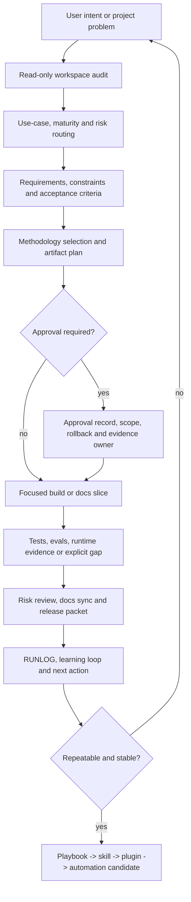

# Product-Agent OS

Product-Agent OS - локальный Codex plugin для превращения Codex App, CLI, IDE extension, subagents, skills, `AGENTS.md`, memory, sandbox, approvals, MCP и agent workflows в управляемую product engineering систему.

Product-Agent OS full stack держит контекст продукта, требования, архитектурные границы, документацию, проверки, ownership, release evidence и learning loop. Codex пишет и проверяет рабочие slice, а Product-Agent OS задает порядок: сначала понять проект, затем зафиксировать риск и только потом менять файлы.

## Что Он Решает

На реальных проектах проблема редко только в скорости генерации кода. Обычно ломается контекст:

- требования остаются в чате и теряются между сессиями;
- архитектурные решения не связаны с файлами, командами и владельцами;
- несколько agent workers могут трогать одни и те же зоны без ownership;
- tests, evals, rollback и release evidence появляются после изменения;
- AI/RAG качество оценивается на глаз;
- security, privacy, data и external-write риски вспоминаются поздно;
- dashboards и сгенерированные views принимаются за proof;
- "готово" звучит без текущего command/eval/runtime evidence.

Product-Agent OS переводит работу из чата в проверяемые артефакты: requirements, plan, test/eval matrix, source context, handoff packets, risk review, docs sync, release packet и learning loop.

## Быстрый Старт

Если плагин доступен в Codex, начинайте с маршрута работы:

```text
Use Product-Agent OS to audit this workspace and propose the next safe product-engineering step.
```

Для русского workflow:

```text
Используй Product-Agent OS: проведи read-only audit проекта, определи уровень сложности, предложи artifacts, проверки, risks, approvals и следующий focused slice.
```

Хорошие стартовые запросы:

```text
Use Product-Agent OS to turn this repo into a product-ready Codex project.
```

```text
Use Product-Agent OS for this feature: write requirements, plan build slices, define tests/evals, then execute only the first safe slice.
```

```text
Use Product-Agent OS to rescue this bug: reproduce, find root cause, plan regression coverage, implement the fix, and record evidence.
```

```text
Use Product-Agent OS to prepare PR/release readiness: risks, tests, docs impact, rollback, release notes and unresolved gaps.
```

```text
Use Product-Agent OS to build a project code graph and show read order, hotspots, affected tests and safe next action.
```

## Operating Loop



Нормальный цикл:

1. **Audit** - читать workspace без записи.
2. **Route** - классифицировать use-case, maturity и risk profile.
3. **Plan** - зафиксировать scope, non-goals, acceptance, ownership, verification и rollback.
4. **Stage** - создать proposals только в безопасном staging path.
5. **Approve** - требовать явное разрешение для записи, external action, release, secret, production data и automation.
6. **Build** - выполнить один focused slice.
7. **Verify** - запустить текущие checks/evals/runtime evidence или записать explicit gap.
8. **Review** - проверить risk, docs impact и release readiness.
9. **Learn** - перенести устойчивый опыт в docs, skills или automation candidates.

## Capability Map

```mermaid
flowchart LR
    subgraph Control["Control Plane"]
        A1["AGENTS.md"]
        A2["REQUIREMENTS.md"]
        A3["PLAN.md"]
        A4["TEST.md"]
        A5["EVALS.md"]
        A6["RUNLOG.md"]
    end

    subgraph Skills["Lifecycle Skills"]
        B1["Discovery"]
        B2["Requirements"]
        B3["Planning"]
        B4["Agent team"]
        B5["Tests and evals"]
        B6["Docs"]
        B7["Review and release"]
        B8["Learning and automation"]
    end

    subgraph Engines["Local Engines"]
        C1["Infrastructure renderer"]
        C2["Safe merge planner"]
        C3["Methodology audit"]
        C4["Project code graph"]
        C5["Status dashboard"]
        C6["Fixture and transcript evals"]
        C7["Compatibility validators"]
    end

    Control --> Skills
    Skills --> Engines
    Engines --> Control
```



## Core Capabilities

| Capability | Что делает | Основной owner |
| --- | --- | --- |
| Workspace discovery | Читает stack, manifests, docs, tests, CI/runtime hints, data/API/AI surfaces и risk signals без записи. | `workspace-discovery-auditor` |
| Requirements and acceptance | Превращает идею, bug или product request в scope, non-goals, acceptance scenarios и questions for owner. | `requirements-author` |
| Planning | Делит работу на bounded slices с files, commands, rollback, evidence owner и stop conditions. | `implementation-planner` |
| Agent team design | Создает roles вокруг ownership, owned/forbidden files, handoff artifacts и verification. | `agent-team-designer` |
| Test/eval routing | Подбирает deterministic tests, subjective evals, AI evals, runtime checks и manual QA evidence. | `test-eval-designer` |
| Docs and source policy | Синхронизирует docs, source registry, glossary, traceability, unsupported claims и accepted gaps. | `docs-maintainer` |
| System file hygiene | Проверяет control-plane, agents, skills, workflows, hooks, evals, automation candidates и plugin package files на size, duplicates, stale evidence, secrets and active schedules. | `docs-maintainer`, `automation-promoter` |
| Risk and release | Проверяет behavioral regressions, missing tests, release scope, rollback and publish boundary. | `risk-reviewer`, `pr-release-operator` |
| Learning loop | Переносит repeated success/failure в playbooks, skills, plugin updates или automation candidates. | `learning-loop-maintainer`, `automation-promoter` |

methodology intelligence выбирает только те product, architecture, quality, AI, security, data и release gates, которые закрывают реальный риск проекта.

## Use-Case Routing

Product-Agent OS сначала классифицирует задачу, затем выбирает самый легкий достаточный route:

| Use case | Типичный first artifact | Усиленные gates |
| --- | --- | --- |
| Web/front-end | component state matrix, visual QA plan, browser checks | Playwright, responsive states, accessibility, console/runtime evidence |
| Native/mobile | platform build/run plan, simulator flow, permission assumptions | screenshots, logs, signing/update risk |
| Desktop | OS-specific run path, file permission review, local storage boundary | app logs, GUI behavior, packaging risk |
| Backend/API | service/API contract, error/auth matrix | integration tests, migration, observability, rollback |
| Data | schema/data inventory, migration plan, lineage | backup/restore, data quality, production access approval |
| AI/RAG | AI behavior spec, prompt/model decision, eval baseline | dataset policy, grounding, cost/latency, safety |
| Docs | docs tooling decision, source registry impact | `Source status:`, link/nav checks, strict build when needed |
| PR/review | findings by severity, residual risk | missing tests, contract risk, release notes |
| Automation | automation candidate | manual success log, owner/cadence, permissions, rollback |

## Product Scenarios By Role

| Роль | Основная польза | Выходные артефакты |
| --- | --- | --- |
| Founder / solo builder | Быстро перейти от идеи к releaseable slice без хаоса. | Product brief, value proposition, first-run intake, release readiness. |
| Product Manager | Видеть value, scope, metric, owner decisions and accepted gaps. | `REQUIREMENTS.md`, acceptance scenarios, metric spec, launch packet. |
| Developer | Получить файлы, команды, rollback и tests before coding. | `PLAN.md`, build-slice, regression evidence, RUNLOG update. |
| Tech Lead / Architect | Зафиксировать boundaries, tradeoffs and ownership. | ADR, architecture overview, trust-boundary map, handoff contract. |
| QA / Tester | Привязать качество к риску, а не к случайному списку тестов. | `TEST.md`, `EVALS.md`, quality strategy, manual QA packet. |
| AI Engineer | Не менять prompts/models/RAG без baseline and rerun evidence. | AI behavior spec, prompt contract, model decision record, RAG eval report. |
| Docs Maintainer | Держать docs, source registry, glossary and traceability aligned. | Docs packet, source registry updates, unsupported claims log. |
| Release Operator | Не выпускать без release scope, rollback and evidence. | PR body, release notes, artifact manifest, rollout and rollback plan. |
| Security / Privacy Owner | Выделить trust boundaries, data, secrets and external writes. | Threat surface, privacy impact, approval record, supply-chain review. |

## Артефакты

| Family | Examples | Когда создаются |
| --- | --- | --- |
| Control plane | `AGENTS.md`, `REQUIREMENTS.md`, `PLAN.md`, `TEST.md`, `EVALS.md`, `RUNLOG.md` | Для long-running или production work. |
| Product | `product-brief.md`, `value-proposition.md`, `opportunity-tree.md`, `metric-spec.md` | Когда value, target user, metric или launch hypothesis unclear. |
| Requirements/domain | `requirement-registry.md`, `acceptance-scenarios.md`, `business-rules.md`, `domain-modeling.md` | Когда behavior/domain correctness matters. |
| Architecture | `architecture-overview.md`, `adr.md`, `trust-boundary-map.md`, C4/arc42 views | Когда есть boundaries, public contracts, runtime topology или ownership risk. |
| Quality/testing/evals | `quality-strategy.md`, `test-eval-matrix.md`, `eval-run-report.md`, `flaky-test-policy.md` | Когда readiness/completion claim требует evidence. |
| AI/RAG | `ai-behavior-spec.md`, `prompt-contract.md`, `model-decision-record.md`, `rag-eval-report.md` | Когда меняются prompts, models, tools, retrieval, grounding или safety. |
| Delivery/release | `release-readiness.md`, `release-artifact-manifest.md`, `rollout-plan.md`, rollback packet | Для PR, package, deployment, publication или release decision. |
| Agentic workflow | `agent-task-packet.md`, `handoff-contract.md`, `worktree-ownership.md`, `automation-candidate.md` | Для subagents, skills, parallelism and repeatable workflows. |
| System hygiene | `system-file-hygiene-report.md`, `system-file-hygiene-audit.md` | Для scheduled-candidate или size-triggered review без active automation. |

## Documentation And Evidence

Документация в Product-Agent OS не является отдельной "папкой Markdown"; она часть delivery loop.

- `docs-maintainer` связывает claims с sources, owners, acceptance scenarios and evidence.
- `Source status:` отделяет official docs, local evidence, community claims and experiments.
- `docs/sources/registry.md` хранит source-backed claim index.
- Generated graph/dashboard/status/cockpit artifacts являются orientation evidence, not source of truth.
- README дает продуктовый вход и команды, но не хранит исторический ledger выполнения.
- Proof для claims - текущие command/eval/runtime/owner evidence, а не наличие файла или dashboard.

## Guided Questions And Status

Guided question protocol держит first response компактным: one blocking question maximum, только если без ответа следующий шаг рискован.

Status snapshot и dashboard помогают ориентироваться, но не становятся proof:

- `.codex/product-agent-os/status.html`
- `.codex/product-agent-os/status.json`
- dashboard is a generated view
- generated view only
- underlying artifacts remain source material
- no success claim from stale evidence

## Project Code Graph

Project code graph нужен для больших или неясных репозиториев:

- строит file/module/function/docs/schema/diagram graph;
- показывает read order, hotspots, impact, affected tests and query packets;
- может stage offline cockpit HTML/JSON и search/index/retrieval artifacts;
- не заменяет чтение source files перед claims;
- не мутирует canonical graph source без отдельного approval and rollback evidence.

## Self-Verification And Modernization Loop

Self-Verification And Modernization Loop - это self-verification metrics loop для signals о том, как работают agents, skills, prompt/policy packs, router/tool policies and harness versions.

Техническая surface: `agent_skill_metrics_loop`, redacted reports, scorecard ledger, modernization candidates and approval boundary. Эти outputs являются staged evidence only: no live eval/model/API calls, no active schedules, no self-applied updates.

Продвижение workflow идет только так:

```text
manual thread -> playbook -> skill -> plugin -> automation candidate
```

## Safety And Boundaries

- No separate OpenAI API key is required for local deterministic Product-Agent OS tooling.
- Secrets, tokens, private keys, private customer data, raw private chats and absolute user-specific paths must not enter prompts, docs, templates, fixtures or examples.
- Generated views are orientation evidence, not source of truth.
- Live server, browser automation, external provider calls, canonical graph mutation, git stage/commit/push/PR and plugin publication require explicit scope and approval.
- Existing user files are preserved outside managed sections.
- Community claims do not become project rules without `trust_level` and `verification_status`.
- Official OpenAI docs remain source of truth for Codex App, CLI, IDE extension, subagents, skills, `AGENTS.md`, memory, sandbox, approvals, MCP and Agents SDK behavior.
- Detection is not verification; current evidence is required before saying "works", "fixed", "ready", "complete" or "releaseable".

## Repository Layout

| Path | Purpose |
| --- | --- |
| `plugins/product-agent-os/` | Working local Codex plugin package. |
| `plugins/product-agent-os/.codex-plugin/plugin.json` | Plugin manifest. |
| `plugins/product-agent-os/skills/` | Lifecycle skills used by Codex. |
| `plugins/product-agent-os/assets/templates/` | Control-plane, workflow, artifact, eval, agent, hook and PR/release templates. |
| `plugins/product-agent-os/scripts/` | Renderer, merge tooling, validators, fixture evals, transcript evals and runtime contract runner. |
| `docs/product-agent-os/` | Product-Agent OS operator docs for capabilities, scenarios, evals and compatibility. |
| `docs/product-agent/` | Product-agent concepts, lifecycle, roles and plugin spec. |
| `docs/methodologies/` | Methodology research across product, architecture, quality, AI, security, data and release domains. |
| `docs/diagrams/` | Implementation atlas for product delivery, runtime choices, agent teams and verification. |
| `docs/sources/` | Source-backed registry, internal evidence packets and historical ownership. |
| `tests/product_agent_os/` | Unit and contract tests for plugin behavior and docs contracts. |
| `site/` | Tracked MkDocs HTML output. |

## Quick Commands

```powershell
# Read-only infrastructure proposal
python plugins\product-agent-os\scripts\render_infrastructure.py <workspace> --dry-run

# Stage proposed artifacts outside the target workspace
python plugins\product-agent-os\scripts\render_infrastructure.py <workspace> --stage C:\tmp\product-agent-os-stage

# Review merge plan before applying staged artifacts
python plugins\product-agent-os\scripts\merge_infrastructure.py <workspace> C:\tmp\product-agent-os-stage --plan

# Apply only with explicit approval record
python plugins\product-agent-os\scripts\merge_infrastructure.py <workspace> C:\tmp\product-agent-os-stage --apply --approval-file <approval.json>

# Methodology audit
python plugins\product-agent-os\scripts\run_methodology_audit.py <workspace> --report
python plugins\product-agent-os\scripts\run_methodology_audit.py <workspace> --json

# Project code graph and generated views
python plugins\product-agent-os\scripts\scan_project_code_graph.py <workspace> --dry-run
python plugins\product-agent-os\scripts\scan_project_code_graph.py <workspace> --stage C:\tmp\product-agent-os-graph

# Status dashboard
python plugins\product-agent-os\scripts\render_status_dashboard.py <workspace> --stage C:\tmp\product-agent-os-status

# Codex-only runtime contract
python plugins\product-agent-os\scripts\run_codex_runtime_runner.py <workspace> --contract
```

## Verification

```powershell
python tools\check_docs.py
python plugins\product-agent-os\scripts\run_fixture_eval.py
python plugins\product-agent-os\scripts\run_transcript_eval.py plugins\product-agent-os\assets\eval-fixtures\transcripts\product-agent-os-synthetic-sessions.json
python plugins\product-agent-os\scripts\validate_codex_compatibility.py
```

Strict MkDocs build is required when navigation, Markdown extensions, i18n, Mermaid, search/sitemap or generated `site/` evidence changes.

## Где Живёт История

README не хранит историю выполнения, длинные marker banks и verification ledgers. Ownership распределен так:

| Information class | Owning surface |
| --- | --- |
| Durable project rules | `AGENTS.md` |
| Current scope and acceptance | `REQUIREMENTS.md` |
| Current sequencing and rollback | `PLAN.md` |
| Current verification routing | `TEST.md` |
| Current eval rubrics and quality gates | `EVALS.md` |
| Current-cycle handoff and residual risks | `RUNLOG.md` |
| Source-backed historical claims | `docs/sources/registry.md` |
| Internal evidence packets and long-form history | `docs/sources/` |
| Installation/package details | `plugins/product-agent-os/README.md` |

## What Product-Agent OS Is Not

- It is not a replacement for product ownership, domain expertise, security review or legal review.
- It does not make every methodology mandatory.
- It does not silently write into target projects.
- It does not activate hooks, GitHub Actions, schedules, recurring automations, publishing or external writes without approval.
- It does not treat files, folders, dashboards or prompt intent as proof of readiness.
- It does not use chat memory as source of truth.
- It is not a standalone Agents SDK app.

## Product Direction

Product-Agent OS is moving toward a methodology-aware operating system for AI-assisted product delivery:

- first-run project intelligence;
- 12-domain methodology selection;
- staged documentation and artifact generation;
- agent team design;
- eval-driven quality;
- safety and approval boundaries;
- release and learning loops;
- automation only after manual success evidence.

The end state is simple: a user can connect Product-Agent OS to a messy project and get a credible path toward a product that can be reviewed, tested, released and explained.
