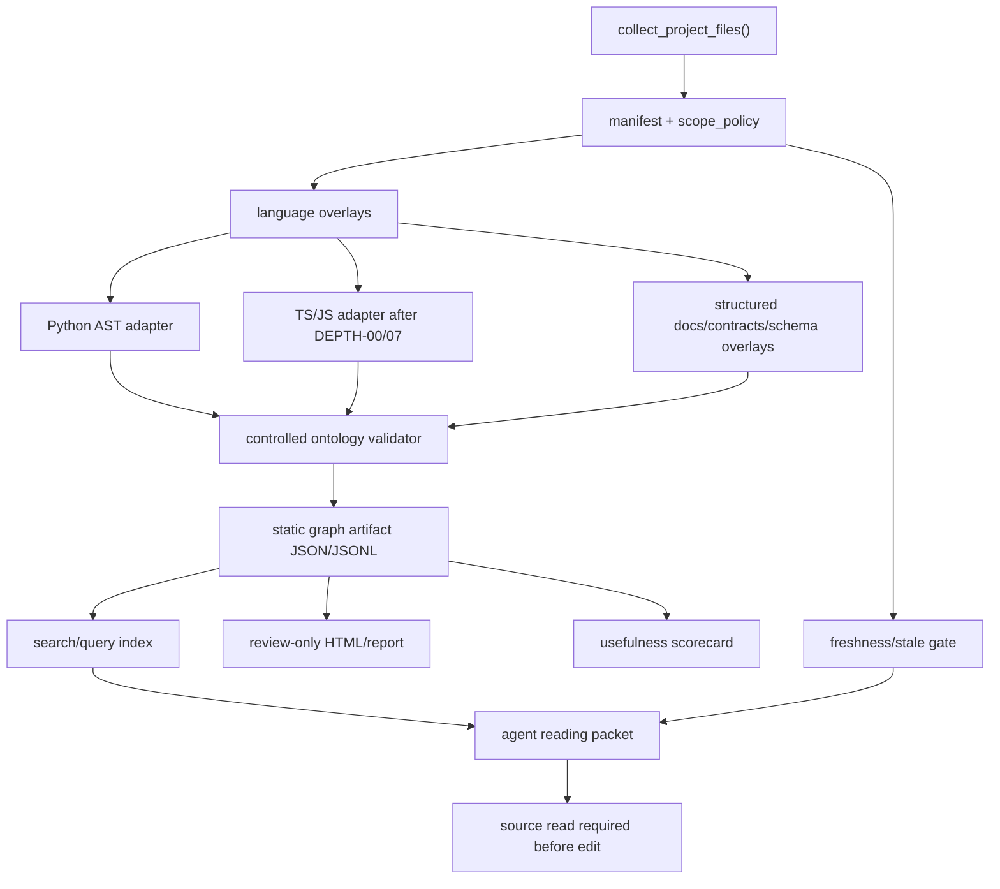

# Batch 39 S4 Graph-Scope Repository Research

Source status: mixed - current local documentation/source inspection plus public GitHub repository inspection on 2026-06-18.

Status: draft_research_completed
Created: 2026-06-18
Owner workspace: `codex_docs`
Scope: research-only, source-backed architectural and technical analysis for the Product-Agent OS project research layer.
Non-goals: no dependency installation, no vendoring, no external runtime launch, no MCP activation, no hooks, no browser automation, no provider/model calls, no target workspace mutation, no git action, no release/readiness claim.

## Research Request

Investigate external repositories for concepts and technologies that can inform the Product-Agent OS project research layer and graph-scope roadmap:

- `safishamsi/graphify`
- `getzep/graphiti`
- `colbymchenry/codegraph`
- `Egonex-AI/Understand-Anything`
- `Egonex-AI/Understand-Anything` was listed twice by the owner; this report treats it as one unique repository and still applies the required two-pass review.

Each unique repository was inspected twice:

1. Architecture and implementation pass.
2. Product-requirement fit pass against Batch 39 S4 graph-scope requirements.

## Local Product Requirements Checklist

The local requirements are taken from `docs/superpowers/plans/2026-05-27-track-10-guided-questions-status-dashboard.md`, `PLAN.md`, `TEST.md`, `RUNLOG.md`, `EVALS.md`, `prod_test.md`, and the current graph implementation under `plugins/product-agent-os/scripts/product_agent_os/`.

### Current Product-Agent OS Graph Baseline

- `project_graph_manifest.py` builds bounded file metadata, fingerprints, language classification, freshness, provenance and `scope_policy`.
- `project_graph_adapters.py` already extracts Python packages, modules, classes, functions, methods, imports, direct/local calls, test links and unresolved calls.
- `project_graph_chunking.py` already extracts structured overlays for Markdown headings, diagrams, OpenAPI operations, AsyncAPI channels, DBML/SQL tables and JSON/YAML top-level keys.
- `project_graph_ontology.py` currently allows core node types such as `workspace`, `package`, `module`, `file`, `class`, `function`, `method`, `test`, `contract`, `schema`, `diagram`, `control_plane`; edge types such as `contains`, `imports`, `calls`, `exports`, `tests`, `verifies`, `documents`, `renders`, `generates`, `configures`, `owns`, `references`, `impacts`; confidence values `verified`, `inferred`, `heuristic`, `unsupported`, `accepted_gap`; and status values `current`, `stale`, `generated`, `unsupported`, `invalidated`, `superseded`, `accepted_gap`.
- TypeScript and JavaScript are currently classified but still `file_only` in the local ontology and adapter summary.
- Query packets already support `neighbors`, `path`, `node`, `status`, `search`, `hotspots`, `read_order`, `trace`, `impact`, `affected_tests`, `changed_since`, and `why_changed`, but these packets are still graph-artifact orientation, not source truth.
- Local graph artifacts must exclude raw source bodies, avoid unsafe/absolute paths, enforce node/edge/observation limits, validate redaction, and carry generated-view boundaries.

### Batch 39 S4 Graph-Scope Requirements

| Requirement | Local meaning for this research |
| --- | --- |
| `B39-S4-GRAPH-DEPTH-00` | Decide ontology and framework taxonomy before parser expansion. Needed terms may include `component`, `hook`, `api_route`, `store`, `event_handler`, `api_client`, but compatibility and query behavior must be explicit. |
| `B39-S4-GRAPH-DEPTH-01` | Add synthetic mixed Python + TypeScript fixture before real-target tuning. Expected graph must cover backend symbols, frontend entities, imports/exports, contracts, schemas, tests and unresolved edges. |
| `B39-S4-GRAPH-DEPTH-02` | Add minimal TypeScript/JavaScript entity adapter after ontology and parser-dependency decisions. Must label framework semantics separately from generic TS/JS syntax. |
| `B39-S4-GRAPH-DEPTH-03` | Retest SOL read-only graph usefulness after synthetic correctness. Metrics must compare against previous S4 summaries without target mutation. |
| `B39-S4-GRAPH-DEPTH-04` | Add bounded agent reading packet: target entity, related entities, read order, source spans, confidence, unresolved edges, affected tests, stale/freshness status and must-read-source warnings. |
| `B39-S4-GRAPH-DEPTH-05` | Add conservative cross-language linker planning. Links must be based on explicit evidence, not route/name guesses. |
| `B39-S4-GRAPH-DEPTH-06` | Add usefulness scorecard for agent navigation: symbol recall, top-k/MRR, affected-test precision, false positives, reading-scope reduction, unsupported-language rate, stale-block behavior and real-target deltas. |
| `B39-S4-GRAPH-DEPTH-07` | Stage TypeScript parser dependency decision: stdlib tokenizer vs vendored local parser vs existing dependency reuse vs deferred parser support. New install/vendoring requires exact approval. |

### Cross-Cutting Constraints From Documentation

- Graph finds and narrows. Source confirms. Tests verify.
- Generated graph, HTML, reports and dashboards are orientation evidence only.
- Stale or ambiguous graph output must block action-oriented claims.
- No external provider, MCP, browser, live runtime, target mutation, canonical graph mutation, hooks, automation or git action without exact approval.
- No raw source, secrets, private data, raw private chat logs or absolute user-specific paths in persisted research artifacts.
- Parser and graph extension work must be TDD-first and must preserve redaction, bounded packets and no-readiness wording.

## Executive Findings

1. `colbymchenry/codegraph` is the closest architectural fit for the missing Product-Agent OS graph layer: local-first indexing, tree-sitter/WebAssembly parser strategy, multi-language entity extraction, framework-aware routes, impact queries, staleness signaling, agent-facing tools and explicit eval metrics map directly to `B39-S4-GRAPH-DEPTH-02`, `03`, `04`, `05`, `06`, and `07`.
2. `getzep/graphiti` is not a direct code-graph implementation, but it is the strongest reference for temporal provenance, fact validity, hybrid search, graph-distance reranking, learned/prescribed ontology and source episode modeling. It should influence our freshness/provenance model and scorecard, not our local scanner runtime.
3. `safishamsi/graphify` is useful as a staged pipeline and artifact/export model: `detect -> extract -> build_graph -> cluster -> analyze -> report -> export`, schema validation before graph build, confidence labels, query-first assistant guidance, multiple export targets and security validation. Its provider-backed extraction, hook install, query logging and MCP modes do not fit our default approval boundary.
4. `Egonex-AI/Understand-Anything` is strongest for user-facing understanding: guided tours, layer/domain analysis, multi-agent role split, graph completeness review, interactive dashboard and onboarding-oriented graph UX. It also validates the split between deterministic tree-sitter facts and LLM semantic interpretation, but its semantic layer must remain optional/approval-bound for Product-Agent OS.
5. No repository should be adopted wholesale. The right Product-Agent OS direction is a clean-room local implementation that borrows patterns: controlled ontology, local parser decision packet, deterministic structural extraction, explicit confidence, stale graph blocking, compact reading packets, impact/search scorecard and optional generated HTML as review-only output.

## Repository Research

### 1. `safishamsi/graphify`

Sources inspected:

- GitHub repository page: `https://github.com/safishamsi/graphify`
- Raw architecture document: `https://raw.githubusercontent.com/safishamsi/graphify/main/ARCHITECTURE.md`
- Raw package metadata: `https://raw.githubusercontent.com/safishamsi/graphify/main/pyproject.toml`
- Raw extractor sample: `https://raw.githubusercontent.com/safishamsi/graphify/main/graphify/extract.py`

#### Pass 1 - Architecture And Implementation

Observed architecture:

- Graphify presents itself as an assistant skill backed by a Python library. The architecture file describes a simple functional pipeline: detection, extraction, graph build, clustering, analysis, report and export.
- Stages communicate through plain Python dictionaries and NetworkX graphs, with a stated side-effect boundary around `graphify-out/`.
- Module responsibilities are clear: file collection, extraction, graph building, clustering, analysis, report rendering, export, ingestion, semantic cache, security validation, schema validation, serving and watching.
- The extraction schema is intentionally simple: nodes carry IDs, labels and source location; edges carry source, target, relation and confidence.
- Confidence labels distinguish explicit extraction, inferred relationships and ambiguous relationships.
- Adding a language extractor is documented as adding an extractor, registering suffixes, adding a parser dependency, and adding fixtures/tests.
- Package metadata shows a Python package with `networkx`, `graspologic`, `tree-sitter` and multiple tree-sitter language packages as core dependencies.
- The public README describes output artifacts as `graph.html`, `GRAPH_REPORT.md` and `graph.json`, plus export modes such as call-flow HTML, Obsidian vault, SVG, GraphML and Neo4j/FalkorDB export.
- It supports query/path/explain commands, update mode, directed graphs, watch mode, MCP stdio server mode and optional extras for document, SQL, database, media, vector/provider and graph database integrations.
- The README explicitly says code-only corpora can work without a key, while docs/PDF/images require an LLM call.
- It records query logs by default under a user cache path, with an environment variable to opt out.
- Security notes include URL validation, file redirect blocking, size/timeout caps, graph path confinement, label sanitization and pure unit tests.

Architectural strengths for us:

- The pipeline shape is excellent for Product-Agent OS because it cleanly separates collect, extract, validate, analyze and export. This matches our need to keep graph construction, query packets and HTML review artifacts separate.
- The schema-validation-before-build pattern maps well to `project_graph_ontology.py`.
- Confidence labels align with our existing `verified`, `inferred`, `heuristic`, `unsupported`, `accepted_gap` policy.
- Export diversity reinforces the idea that HTML/wiki/report artifacts are views over a graph, not source truth.
- The "add language extractor through fixture + tests" workflow supports our TDD-first adapter roadmap.

Architectural risks for us:

- Direct dependency adoption would conflict with `B39-S4-GRAPH-DEPTH-07` because Graphify assumes tree-sitter packages as dependencies. Our parser dependency decision must be explicit and approval-bound.
- Its optional LLM/provider path conflicts with our default no-provider/no-live-call policy.
- Hook install, watch mode and MCP server mode are useful concepts but cannot be auto-activated in Product-Agent OS.
- Query logging to a user cache is a privacy and artifact-boundary risk for our product requirements unless redesigned as redacted, workspace-local, opt-in evidence.
- Node schema is too broad/simple for our controlled ontology. It does not natively preserve our `source_boundary`, observation IDs, redaction status, graph artifact freshness and no-proof wording.

#### Pass 2 - Fit Against Product-Agent OS Requirements

| Local requirement | Fit | Observation |
| --- | --- | --- |
| `DEPTH-00` ontology | Medium | Confidence taxonomy and relation labels are useful, but node/edge terms are not enough for Product-Agent OS framework taxonomy. |
| `DEPTH-01` synthetic fixture | High | Language extractor process explicitly calls for fixtures and tests. Good process model. |
| `DEPTH-02` TS/JS adapter | Medium | Tree-sitter TS/JS extractor pattern is relevant, but its direct parser dependencies require a separate decision. |
| `DEPTH-03` SOL retest | Low | Graphify can inspire comparison artifacts, but it does not solve our read-only SOL evidence contract by itself. |
| `DEPTH-04` agent reading packet | Medium | Query-first assistant guidance is relevant; Product-Agent OS needs a stricter packet with stale/freshness, source-read-before-edit and unsupported-claim fields. |
| `DEPTH-05` cross-language linker | Medium | It has call-flow/export ideas, but conservative cross-language link evidence needs our own explicit rules. |
| `DEPTH-06` usefulness scorecard | Medium | It includes benchmark/token comparison concepts, but our scorecard needs recall, MRR, false positives and affected-test precision. |
| `DEPTH-07` parser decision | High as a warning | Shows why parser dependency choice must be explicit; many parser packages improve coverage but increase supply-chain surface. |

What to borrow:

- Stage pipeline: `manifest -> overlays -> validate -> index -> query packet -> report/export`.
- Explicit extractor contract per language.
- Confidence labels and ambiguity inventory.
- Report/export as review-only artifacts.
- Security checks for URL/path/label, adapted to our no-external-default policy.

What not to borrow directly:

- Auto-installed skills/hooks/MCP.
- Default query logging outside workspace.
- Provider-backed document extraction as a default.
- Graph database push/export as a default execution path.
- Broad parser dependency list without `DEPTH-07`.

### 2. `getzep/graphiti`

Sources inspected:

- GitHub repository page: `https://github.com/getzep/graphiti`
- Raw package metadata: `https://raw.githubusercontent.com/getzep/graphiti/main/pyproject.toml`
- Raw node model: `https://raw.githubusercontent.com/getzep/graphiti/main/graphiti_core/nodes.py`
- Raw edge model: `https://raw.githubusercontent.com/getzep/graphiti/main/graphiti_core/edges.py`
- Raw MCP server README: `https://raw.githubusercontent.com/getzep/graphiti/main/mcp_server/README.md`

#### Pass 1 - Architecture And Implementation

Observed architecture:

- Graphiti is a framework for temporal context graphs for AI agents, not a static source-code graph scanner.
- Its README emphasizes temporal changes, provenance, prescribed and learned ontology, hybrid search, graph-distance reranking and agent memory.
- The repository has `graphiti_core`, `mcp_server`, `server`, `examples`, tests and specs.
- Quickstart flow requires a graph database driver such as Neo4j, Amazon Neptune, FalkorDB or Kuzu, then initializes indices/constraints, adds episodes and searches relationships/nodes.
- Package metadata shows `graphiti-core` depends on Pydantic, Neo4j, OpenAI, tenacity, numpy, dotenv and PostHog. Optional extras add Anthropic, Groq, Gemini, FalkorDB, Kuzu, Neptune, tracing, sentence-transformers and Voyage.
- The raw node model defines several node families: episodic, entity, community and saga. Episodic nodes carry source type, content, source description, valid time, entity edges and metadata. Entity/community nodes can carry embeddings and summaries.
- The raw edge model defines graph edges with UUID, group ID, source/target UUID and created time, with provider-specific storage behavior.
- The MCP server exposes operations for episode management, entity/relationship handling, semantic and hybrid search, group management and maintenance.
- Graphiti defaults to OpenAI inference/embeddings and expects database/runtime services in normal quickstart paths, while optional providers and local OpenAI-compatible endpoints are possible.
- Concurrency controls exist because ingestion pipelines can hit provider rate limits.

Architectural strengths for us:

- Temporal modeling is very relevant to our stale graph/freshness problem. Product-Agent OS currently has manifest freshness and `changed_since`/`why_changed`; Graphiti's episode/fact validity idea suggests a stronger distinction between observation time, source valid time and scan time.
- Provenance as first-class graph state maps to our observation records and can improve `DEPTH-04` reading packets.
- Hybrid search plus graph-distance reranking is useful as an optional future extension for top-k/MRR and agent navigation metrics.
- Prescribed vs learned ontology is a useful framing for `DEPTH-00`: our core source-code ontology should be prescribed; semantic/domain tags should be learned or heuristic and must carry confidence.
- Group IDs/partitions are relevant for multi-root or imported-corpus scope handling.
- The MCP server shape is useful as a future external integration pattern, but only after exact approval gates.

Architectural risks for us:

- Graphiti's normal stack is heavier than our Batch 39 constraints: database services, provider calls, embeddings and MCP/REST server are outside default Product-Agent OS graph-scope.
- It stores raw episode content in its model; Product-Agent OS graph artifacts must exclude raw source bodies.
- Learned ontology can produce useful semantics, but for our static graph it must never be treated as verified source structure.
- Hybrid search/reranking may improve discovery but creates evidence and reproducibility questions unless backed by deterministic eval artifacts.
- PostHog dependency in package metadata is incompatible with our default no-telemetry posture if adopted directly.

#### Pass 2 - Fit Against Product-Agent OS Requirements

| Local requirement | Fit | Observation |
| --- | --- | --- |
| `DEPTH-00` ontology | High | Strong conceptual reference for prescribed vs learned ontology and temporal fact modeling. Must be adapted to controlled static ontology. |
| `DEPTH-01` synthetic fixture | Medium | Episode/fact fixtures can inspire temporal/freshness cases, but not language parser fixtures. |
| `DEPTH-02` TS/JS adapter | Low | Not a code parser reference. |
| `DEPTH-03` SOL retest | Low | Does not fit read-only local source graph scanning without major stack changes. |
| `DEPTH-04` agent reading packet | High | Provenance, group, validity and search result ranking concepts are directly useful for packet fields. |
| `DEPTH-05` cross-language linker | Medium | Relationship provenance and confidence patterns help linker design, but Graphiti is semantic memory oriented rather than static source-edge oriented. |
| `DEPTH-06` usefulness scorecard | High | Hybrid search and reranking map to recall/MRR evaluation, but should remain local/deterministic first. |
| `DEPTH-07` parser decision | Low | Not relevant as parser implementation, but high as a warning against pulling in runtime/provider dependencies for graph intelligence. |

What to borrow:

- Temporal provenance vocabulary: `scan_time`, `source_valid_at`, `observed_at`, `superseded_by`, `invalidated_by`.
- Strict split between prescribed structural ontology and heuristic/learned semantic ontology.
- Graph-distance reranking as a future optional eval target.
- Group/partition model for target project vs imported corpus vs generated artifacts.
- Search recipes as named query modes, not ad-hoc prompts.

What not to borrow directly:

- Provider-backed ingestion.
- Graph database runtime as default.
- MCP/REST server as default.
- Raw content episode storage.
- Telemetry or external services.

### 3. `colbymchenry/codegraph`

Sources inspected:

- GitHub repository page: `https://github.com/colbymchenry/codegraph`
- Raw package metadata: `https://raw.githubusercontent.com/colbymchenry/codegraph/main/package.json`
- Raw DB schema and MCP instruction paths were checked where available: `https://raw.githubusercontent.com/colbymchenry/codegraph/main/src/db/schema.sql`, `https://raw.githubusercontent.com/colbymchenry/codegraph/main/src/mcp/server-instructions.ts`

#### Pass 1 - Architecture And Implementation

Observed architecture:

- CodeGraph positions itself as a pre-indexed code knowledge graph for agentic coding tools, with fewer tool calls, fewer tokens and local execution.
- Repository structure includes `src`, `docs`, `site`, `scripts`, tests, package metadata, installer scripts, telemetry documentation and assets.
- Install paths include a self-contained CLI or npm package. Package metadata shows TypeScript implementation with dependencies such as `web-tree-sitter`, `tree-sitter-wasms`, `ignore`, `picomatch`, `commander` and `jsonc-parser`.
- README describes project initialization through `codegraph init`, creating a local `.codegraph/` directory and building a graph.
- Auto-sync is a core product idea: native OS file events, debounce, incremental sync, connect-time catch-up and status reporting.
- It advertises support for 20+ languages, including TypeScript, JavaScript, Python, Go, Rust, Java, C#, PHP, Ruby, C/C++, Swift, Kotlin, Dart, Lua, R, Vue, Svelte, Astro and more.
- It claims framework-aware route recognition across many web frameworks and cross-language flows for iOS/React Native/Expo bridges.
- Agent-facing MCP tools include exploration, node details, symbol search, callers, callees, impact, files and status. Some tools are intentionally unlisted by default because evals showed agents rarely needed them when information arrived inline.
- In a workspace with no `.codegraph/` index, the MCP server announces itself inactive and lists no tools, keeping indexing a user decision.
- Library usage includes `searchNodes`, `getCallers`, `buildContext`, `getImpactRadius`, watch/unwatch and lower-level grammar/database exports.
- It reports benchmark-style evidence across repositories: file reads, grep/bash calls, tool calls, token totals, cost and time with/without CodeGraph.
- The README says the product is local-first and uses SQLite/no external services.

Architectural strengths for us:

- This is the closest fit for the missing `DEPTH-02` and `DEPTH-04` layers: local parser-backed code intelligence, symbol search, callers/callees, impact radius, context building and agent tool design.
- Staleness handling is directly relevant: during a debounce window, responses that reference pending files warn the agent to read source directly. This maps almost perfectly to our "graph narrows, source confirms" rule.
- Tool visibility is product-important: hide low-value tools by default, provide compact high-signal packets, expose deeper tools only when useful. That supports our agent reading packet design.
- The eval framing is exactly the product metric direction we need: reading-scope reduction, tool-call reduction, token reduction, time/cost deltas, per-repo comparison.
- Tree-sitter WASM strategy could be a strong candidate for `DEPTH-07`, especially if we decide against brittle stdlib regex/tokenizer parsing.
- Framework-aware routes and cross-language bridge concepts validate our need for `api_route`, `api_client`, `event_handler`, `component`, `hook`, and conservative linker terms.

Architectural risks for us:

- Direct dependency adoption would introduce a Node runtime, npm package boundary, SQLite storage and tree-sitter WASM artifacts; our current plugin is Python-first.
- The self-updating watcher and MCP server are not allowed by default in Product-Agent OS Batch 39. We can borrow stale-detection semantics without activating watchers.
- CodeGraph can return source snippets through tools; our persisted graph artifacts must not store raw source bodies.
- Framework-aware route claims need careful verification. We should not import broad framework semantics without fixtures and false-positive tests.
- Telemetry documentation exists in the repository; Product-Agent OS must stay no-telemetry by default.
- Its "zero config" product promise is attractive but may conflict with our explicit approval and evidence-led governance.

#### Pass 2 - Fit Against Product-Agent OS Requirements

| Local requirement | Fit | Observation |
| --- | --- | --- |
| `DEPTH-00` ontology | High | Route/framework/cross-language concepts justify extension terms, but Product-Agent OS should keep compatibility and confidence explicit. |
| `DEPTH-01` synthetic fixture | High | Multi-language fixture should emulate CodeGraph-like cases: TS components/hooks, route handlers, callers/callees, impacted tests and ambiguous names. |
| `DEPTH-02` TS/JS adapter | Very high | Best reference for parser-backed TS/JS entity extraction and language coverage. |
| `DEPTH-03` SOL retest | High | Provides a model for comparing tool calls, file reads, search usefulness and source-read reduction on real targets. |
| `DEPTH-04` agent reading packet | Very high | `buildContext`, `node`, `callers`, `impact` and inactive/stale behavior map directly to agent packet shape. |
| `DEPTH-05` cross-language linker | High | Framework routes and React Native bridge claims validate cross-language link planning, but we must implement conservative evidence rules. |
| `DEPTH-06` usefulness scorecard | Very high | Benchmark categories map directly to our scorecard. Add recall/MRR/false-positive/affected-test precision on top. |
| `DEPTH-07` parser decision | Very high | Tree-sitter WASM/local indexing is the strongest external candidate, but approval/supply-chain review is required before adopting or vendoring. |

What to borrow:

- Local-first, no-provider structural graph as the default.
- Stale/pending-file response banner semantics, adapted to our packet fields.
- Agent packet model: explore, node, search, callers, impact, status.
- Eval metrics: file reads avoided, grep/tool calls avoided, token/time/cost deltas, per-target comparison.
- Tree-sitter WASM as a parser option in the `DEPTH-07` decision packet.
- Framework-aware route extraction as explicit registered extension semantics, not generic TS parsing.

What not to borrow directly:

- Auto-sync watcher activation by default.
- MCP server activation by default.
- Source snippet persistence.
- Node/SQLite dependency without approval.
- Broad framework support claims before our synthetic and SOL evidence exists.

### 4. `Egonex-AI/Understand-Anything`

Sources inspected:

- GitHub repository page: `https://github.com/Egonex-AI/Understand-Anything`
- Raw package metadata: `https://raw.githubusercontent.com/Egonex-AI/Understand-Anything/main/package.json`
- Raw plugin package metadata: `https://raw.githubusercontent.com/Egonex-AI/Understand-Anything/main/understand-anything-plugin/package.json`

#### Pass 1 - Architecture And Implementation

Observed architecture:

- Understand Anything positions itself as an interactive knowledge graph for codebases, knowledge bases and docs, with a strong onboarding/learning framing.
- Repository structure includes platform plugin folders, `docs/superpowers`, dashboard/homepage assets, scripts, skill tests and a core plugin package.
- Package metadata describes a tool that combines LLM intelligence with static analysis to produce interactive dashboards for understanding codebases.
- It uses a monorepo-like Node/TypeScript setup with pnpm, TypeScript, Vitest and tree-sitter parser packages listed as built dependencies.
- The README describes platform compatibility across Claude Code, Codex, Cursor, Copilot, Gemini CLI and others.
- It allows committing graph JSON under `.understand-anything/` for team sharing, while excluding intermediate scratch artifacts and diff overlays.
- It describes a tree-sitter plus LLM hybrid: deterministic parsing extracts structural facts such as imports, exports, definitions, call sites and inheritance; LLM analysis adds summaries, tags, layer assignments, domain mapping, guided tours and language concept callouts.
- It uses a multi-agent pipeline with roles such as `project-scanner`, `file-analyzer`, `architecture-analyzer`, `tour-builder`, `graph-reviewer`, `domain-analyzer` and `article-analyzer`.
- File analyzers run in parallel batches, and incremental updates re-analyze changed files.
- The graph-reviewer validates completeness and referential integrity, with optional fuller LLM review.
- It explicitly frames graphs as teaching/onboarding tools, not just impressive visualization.

Architectural strengths for us:

- The static/semantic split is highly relevant: Product-Agent OS should make structural extraction deterministic and treat semantic/domain labels as optional heuristic overlays.
- The agent role split is a good design reference for future Product-Agent OS subagent/task ownership: scanner, file analyzer, architecture analyzer, graph reviewer and tour builder.
- Guided tours are a strong product idea for first-run artifacts: they can turn graph output into a "where should I start?" path for mass-user onboarding.
- Referential integrity review maps to our graph validation and no-dangling-edge tests.
- Commit/share policy for generated graph JSON highlights a useful team onboarding pattern, but Product-Agent OS must keep generated artifacts orientation-only and source-boundary-labeled.

Architectural risks for us:

- The LLM semantic layer conflicts with default Batch 39 no-provider/no-model-call constraints unless owner-approved.
- Parallel file-analyzer agents could duplicate source reads and create private-data exposure risks unless bounded by our redaction/source policy.
- Commit graph JSON by default is not aligned with Product-Agent OS release/git boundaries; our artifacts should stay local unless explicitly approved.
- Guided tours can create overconfident "understanding" claims unless every tour item points back to source spans and confidence.
- Multi-platform installers and plugin activation are outside current scope.

#### Pass 2 - Fit Against Product-Agent OS Requirements

| Local requirement | Fit | Observation |
| --- | --- | --- |
| `DEPTH-00` ontology | High | Layer/domain/tour concepts suggest semantic overlays should be separate from structural ontology. |
| `DEPTH-01` synthetic fixture | High | Fixture should include architecture-layer and guided-tour expectations as optional orientation output, with no proof claims. |
| `DEPTH-02` TS/JS adapter | Medium | Tree-sitter parser strategy is relevant, but implementation details are less exposed than CodeGraph. |
| `DEPTH-03` SOL retest | Medium | Useful for onboarding usefulness checks, but not enough for code-symbol precision. |
| `DEPTH-04` agent reading packet | High | Guided tours and role-specific outputs can shape read order and safe-next-action fields. |
| `DEPTH-05` cross-language linker | Medium | Domain/flow extraction is useful, but static cross-language links must be stricter than semantic summaries. |
| `DEPTH-06` usefulness scorecard | High | Teaching/onboarding usefulness suggests metrics beyond graph size: time-to-first-safe-action, "where to start" accuracy, read order usefulness. |
| `DEPTH-07` parser decision | Medium | Tree-sitter dependency surface reinforces parser decision needs, but does not by itself choose our parser. |

What to borrow:

- Static structural facts vs semantic explanation split.
- Agent role taxonomy for scanner/analyzer/reviewer/tour-builder.
- Guided read-order/tour concept for first-run artifacts.
- Referential integrity review as a graph validation layer.
- Team/onboarding framing for graph usefulness scorecard.

What not to borrow directly:

- LLM summaries as default graph facts.
- Plugin/installer activation.
- Git-committed generated graphs without approval.
- Multi-agent parallel analysis without explicit ownership and redaction packets.
- Dashboard UX as proof of correctness.

## Comparative Architecture Matrix

| Capability | Graphify | Graphiti | CodeGraph | Understand Anything | Product-Agent OS decision |
| --- | --- | --- | --- | --- | --- |
| Local deterministic code extraction | Medium | Low | High | Medium | Use deterministic local extraction as default. CodeGraph is strongest reference. |
| TS/JS entity extraction | Medium | Low | High | Medium | Implement our own adapter after `DEPTH-00/07`; use tree-sitter/WASM as candidate, not default. |
| Controlled ontology | Medium | High | Medium | Medium | Keep prescribed ontology core; add semantic overlays separately. |
| Framework semantics | Low/Medium | Low | High | Medium | Add registered terms and false-positive fixtures before claims. |
| Cross-language linking | Medium | Medium | High | Medium | Build conservative linker using explicit evidence only. |
| Temporal/freshness model | Medium | High | High | Medium | Combine manifest freshness with stale response blocking and temporal provenance fields. |
| Agent-facing packets | Medium | Medium/High | High | High | Build bounded packet, not raw graph dump or full source packet. |
| Search/ranking usefulness | Medium | High | High | Medium | Add recall/MRR/top-k/reading-scope metrics. |
| HTML/dashboard artifact | High | Low | Medium | High | Keep as review-only, not source truth. |
| Provider/model dependency | Optional but significant | Core/default | None claimed for core local graph | Hybrid/core for semantic layer | Default must stay no-provider; semantic layer approval-bound. |
| MCP/hooks/watchers | Present | Present | Present | Installer/plugin-driven | Borrow semantics only; activation approval-bound. |
| Raw source handling | May include source locations/logs | Episodic content can store raw content | Tools can return snippets | LLM may read original source | Persist only source spans/fingerprints, never raw source bodies. |
| Eval/benchmark pattern | Medium | Medium | High | Medium | CodeGraph benchmark categories are best match for `DEPTH-06`. |

## Architecture Implications For Product-Agent OS

### 1. Ontology Should Split Structural, Framework And Semantic Layers

Recommended ontology shape:

- Structural core: existing `package`, `module`, `file`, `class`, `function`, `method`, `test`, `contract`, `schema`, `diagram`.
- Frontend/framework extension: `component`, `hook`, `api_route`, `api_client`, `store`, `event_handler`.
- Relationship extension candidates: `imports`, `exports`, `calls`, `tests`, `references`, `renders`, `routes_to`, `handles`, `subscribes_to`, `emits`, `uses_schema`, `implements_contract`.
- Semantic overlay, not core truth: `architecture_layer`, `domain_area`, `guided_tour_step`, `concept`, `workflow_step`.

Decision:

- `component`, `hook`, `api_client`, `api_route`, `store`, and `event_handler` should be registered only if tests prove query/filter compatibility and no old graph packets break.
- Semantic overlay terms should not be mixed into verified structural ontology. They should carry `confidence=heuristic` or `unsupported` unless backed by deterministic source patterns.

### 2. Parser Decision Should Be A Real Architecture Decision, Not A Coding Detail

Candidate options:

| Option | Benefit | Risk | Recommendation |
| --- | --- | --- | --- |
| Stdlib tokenizer/regex | No new dependency, easy to audit | Brittle JSX/TSX/export parsing, false confidence | Accept only for minimal exports/imports if `DEPTH-07` rejects parser dependency. |
| Python tree-sitter packages | Good parsing, aligns with Graphify | Many parser packages, install/vendoring approval needed | Candidate if Python-only plugin dependency policy allows it later. |
| Node + tree-sitter WASM | Strong multi-language path, aligns with CodeGraph | Cross-runtime complexity, Node/npm supply-chain boundary | Best long-term technical candidate, but not for silent Batch 39 adoption. |
| Existing project dependency reuse | No new global dependency | Target-specific and unstable; may read target package state | Use only as target-local optional evidence, not core scanner default. |
| Defer parser support | Safe | Keeps SOL graph file-level for TS | Acceptable only if recorded as gap, not as implemented depth. |

Recommendation:

- For immediate Batch 39, stage `DEPTH-07` as an ADR-style decision packet before implementing `DEPTH-02`.
- If no approval for parser dependency exists, implement a conservative stdlib extractor with explicit unsupported syntax inventory and no framework-confidence claims.
- If approval is later granted, prefer tree-sitter-backed parsing with locked versions, license/hash notes, parser error fixtures and rollback.

### 3. Agent Reading Packet Should Be The Main Product Surface

The external repos converge on one point: agents do not need a beautiful full graph first; they need a compact answer to "what should I read next and why?"

Recommended packet fields for `DEPTH-04`:

```json
{
  "schema_version": 1,
  "write_policy": "read_only",
  "status": "ok|blocked|stale|partial",
  "query": {},
  "target_entity": {},
  "related_entities": [],
  "read_order": [],
  "source_spans": [],
  "confidence_summary": {},
  "unresolved_edges": [],
  "unsupported_languages": [],
  "affected_tests": [],
  "freshness": {
    "as_of_scan": "",
    "root_fingerprint": "",
    "stale_files": [],
    "stale_action": "read_source_directly_before_edit"
  },
  "source_boundary": "graph_artifact_only_raw_source_excluded",
  "generated_view_policy": "orientation_only_not_proof",
  "must_read_source_before_edit": true,
  "unsupported_claims": [
    "runtime_behavior",
    "security_readiness",
    "release_readiness"
  ],
  "safe_next_action": ""
}
```

This borrows CodeGraph's compact context and stale-warning logic, Graphiti's provenance mindset, Graphify's query-first guidance and Understand Anything's guided read-order framing.

### 4. Cross-Language Linker Must Be Separate From Extractors

Extractor responsibility:

- Identify local entities, source spans, imports, exports, call sites, route declarations, API client functions and tests.

Linker responsibility:

- Connect frontend API clients to backend handlers, OpenAPI operations, schemas/tables and affected tests only when explicit evidence exists.

Allowed evidence examples:

- Same OpenAPI `operationId` referenced by generated client and backend route annotation.
- Static import from a generated API client module with known source contract.
- Route path literal plus method literal that exactly match a backend route declaration.
- Test name or fixture path explicitly referencing the entity.

Rejected evidence examples:

- Similar names only.
- Same directory prefix only.
- Semantic summary only.
- LLM-inferred business flow only.
- Runtime behavior assumption without approved runtime evidence.

### 5. Usefulness Scorecard Should Include Product Metrics, Not Only Graph Metrics

External products emphasize speed, tool-call reduction, onboarding and agent context. Product-Agent OS should measure:

- Symbol recall on synthetic fixture.
- Top-k/MRR for known entity queries.
- False-positive rate for similar names/routes.
- Affected-test precision.
- Unsupported-language rate.
- Reading-scope reduction: files/spans recommended vs total project files.
- Source-read compliance: packet says what must be read before edit.
- Stale-block behavior: changed file causes graph packet to block or warn.
- Real-target delta for SOL: TS entity count, useful query hit rate, unsupported inventory shrinkage.
- Time-to-first-safe-action for onboarding artifacts.

## Recommended Changes To Current Task Matrix

The existing `B39-S4-GRAPH-DEPTH-00..07` matrix is directionally correct. Based on this research, the following refinements should be added when the matrix is next edited:

1. `DEPTH-00` should explicitly split ontology into `structural_core`, `framework_extension`, and `semantic_overlay`.
2. `DEPTH-07` should list tree-sitter WASM as a first-class parser option, alongside Python tree-sitter packages and stdlib tokenizer.
3. `DEPTH-01` synthetic fixture should include:
   - React component and hook.
   - API client function.
   - Backend handler.
   - OpenAPI operation.
   - Schema/table node.
   - Ambiguous route/name false-positive case.
   - Changed/stale file case.
4. `DEPTH-02` should explicitly require parser-error and unsupported-syntax inventory for JSX/TSX dynamic constructs.
5. `DEPTH-04` should be renamed or clarified as the primary agent product surface, not just a query output.
6. `DEPTH-05` should require rejected-link evidence in addition to positive-link evidence.
7. `DEPTH-06` should add tool-call/file-read/token/time deltas and time-to-first-safe-action to the scorecard.
8. `B39-TEST-M40` / graph extension approval-gate tests should explicitly include "no hidden parser install", "no watcher activation", "no MCP activation", "no provider call", and "no raw source snippet persistence".

## Technical Architecture Proposal

Recommended Product-Agent OS graph-scope architecture after this research:



Key principle:

- Static graph extraction is local, deterministic and redaction-safe.
- Semantic explanation, LLM summaries, MCP, watcher, provider calls and graph databases are optional future extension surfaces, not default Batch 39 behavior.

## Product Recommendation

Build the project research layer as a three-tier experience:

1. **Index layer**: local graph artifact with controlled ontology, source spans, fingerprints, confidence and freshness. This is Product-Agent OS infrastructure.
2. **Agent packet layer**: compact query/read-order/impact packets that tell agents what to inspect next and what claims remain unsupported. This is the main AI-agent product surface.
3. **Human review layer**: HTML/report/tour dashboard for onboarding and architectural review. This is useful UX, but never proof.

This matches the user's product requirement: AI agents should quickly locate relevant files, functions, modules and framework entities without rereading the whole project through standard tools, while still being forced to confirm source before edits or claims.

## Risks And Guardrails

| Risk | Why it matters | Guardrail |
| --- | --- | --- |
| Parser dependency creep | Tree-sitter improves quality but expands supply-chain/runtime surface. | `DEPTH-07` ADR, exact approval for install/vendoring, license/hash/rollback notes. |
| Overclaiming graph truth | External tools market graphs as understanding. Our docs forbid graph-as-proof. | Packets must say `orientation_only_not_proof` and `must_read_source_before_edit`. |
| Semantic hallucination | LLM/domain summaries can be useful but may invent architecture. | Semantic overlays optional, `heuristic`, source-linked, provider approval-bound. |
| Stale graph | Agents may edit based on old graph. | Freshness fingerprints, stale block, direct source-read warning. |
| Raw source leakage | Agent packet/report artifacts may accidentally persist source bodies. | Validator rejects raw source fields; snippets are not persisted in graph. |
| Framework false positives | Route/component detection can guess wrong. | Synthetic false-positive fixtures and confidence labels. |
| Watcher/MCP/hook side effects | External repos use auto-sync and assistant integration. | Borrow semantics only; no activation without exact approval. |
| Target mutation | SOL/Neural Flow retests are read-only by policy. | Store evidence in `codex_docs`; target workspaces remain read-only. |

## Final Recommendations For Batch 39 S4

Recommended execution order remains:

1. `B39-S4-GD-S0`: ontology + parser decision.
2. `B39-S4-GD-S1`: synthetic mixed Python/TypeScript fixture.
3. `B39-S4-GD-S2`: TS/JS adapter.
4. `B39-S4-GD-S3`: conservative cross-language linker.
5. `B39-S4-GD-S4`: read-only SOL retest.
6. `B39-S4-GD-S5`: agent reading packet + usefulness scorecard.

Research-adjusted priority:

- Highest-value borrowed concept: CodeGraph-style local pre-indexed agent packet with stale warning and impact/search metrics.
- Highest-risk borrowed concept: provider/LLM semantic graph extraction from Graphify/Graphiti/Understand Anything.
- Most useful product addition: guided read order/time-to-first-safe-action from Understand Anything, implemented as bounded packet fields before any dashboard polish.
- Most important technical decision: parser dependency strategy before TS/JS adapter work.

## Source Ledger

Local sources inspected:

- `docs/superpowers/plans/2026-05-27-track-10-guided-questions-status-dashboard.md`
- `PLAN.md`
- `TEST.md`
- `RUNLOG.md`
- `EVALS.md`
- `prod_test.md`
- `plugins/product-agent-os/scripts/product_agent_os/project_graph_ontology.py`
- `plugins/product-agent-os/scripts/product_agent_os/project_graph_adapters.py`
- `plugins/product-agent-os/scripts/product_agent_os/project_graph_queries.py`
- `plugins/product-agent-os/scripts/product_agent_os/project_graph_manifest.py`

External sources inspected:

- `https://github.com/safishamsi/graphify`
- `https://raw.githubusercontent.com/safishamsi/graphify/main/ARCHITECTURE.md`
- `https://raw.githubusercontent.com/safishamsi/graphify/main/pyproject.toml`
- `https://raw.githubusercontent.com/safishamsi/graphify/main/graphify/extract.py`
- `https://github.com/getzep/graphiti`
- `https://raw.githubusercontent.com/getzep/graphiti/main/pyproject.toml`
- `https://raw.githubusercontent.com/getzep/graphiti/main/graphiti_core/nodes.py`
- `https://raw.githubusercontent.com/getzep/graphiti/main/graphiti_core/edges.py`
- `https://raw.githubusercontent.com/getzep/graphiti/main/mcp_server/README.md`
- `https://github.com/colbymchenry/codegraph`
- `https://raw.githubusercontent.com/colbymchenry/codegraph/main/package.json`
- `https://raw.githubusercontent.com/colbymchenry/codegraph/main/src/db/schema.sql`
- `https://raw.githubusercontent.com/colbymchenry/codegraph/main/src/mcp/server-instructions.ts`
- `https://github.com/Egonex-AI/Understand-Anything`
- `https://raw.githubusercontent.com/Egonex-AI/Understand-Anything/main/package.json`
- `https://raw.githubusercontent.com/Egonex-AI/Understand-Anything/main/understand-anything-plugin/package.json`

## Verification Status

This artifact is inspection-only research. It does not claim implementation, parser support, target retest success, release readiness or production readiness.

Current local verification on 2026-06-18:

- `python -m unittest tests.product_agent_os.test_product_agent_os_docs -v` - 81 tests OK after moving this research artifact out of buildable `docs/` parity scope.
- `python tools\check_docs.py` - OK.
- `git diff --check` - exit 0; only pre-existing CRLF-to-LF warnings for S4 JSON retest artifacts.
