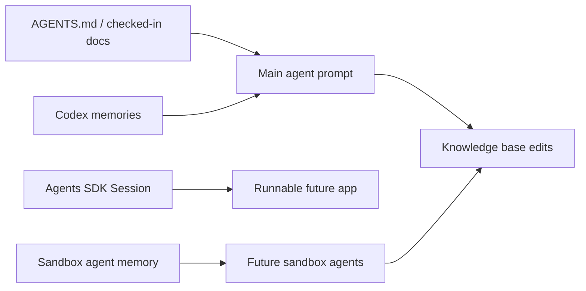

# Memory In Codex And Agents SDK

Source status: `official`  
Sources: [Codex memories](https://developers.openai.com/codex/memories), [Agents SDK sessions](https://openai.github.io/openai-agents-js/guides/sessions/), [Agents SDK sandbox agent memory](https://openai.github.io/openai-agents-js/guides/sandbox-agents/memory/), [AGENTS.md](https://developers.openai.com/codex/guides/agents-md).

## Three Different Memory Layers

| Layer | What it stores | Where to use it | Do not use as |
| --- | --- | --- | --- |
| `AGENTS.md` | Mandatory project instructions | Team rules, test commands, coding standards | Personal notes or transient state |
| Codex Memories | Useful local context from past threads | Preferences, recurring workflows, pitfalls | The only source of mandatory rules |
| Agents SDK Sessions | Conversation history for app-level agents | Multi-turn apps and agent runners | Long-term knowledge base |
| Sandbox Agent Memory | Lessons from prior sandbox-agent runs in workspace files | Repeated agent workflows and run summaries | Secret storage or unverifiable truth |

## Recommendations

- Put all mandatory rules in checked-in docs or `AGENTS.md`.
- Use Memories as a supporting recall layer.
- Use session memory for conversation continuity inside the application.
- Isolate sandbox memory with layouts when different agents should not share experience.
- Treat every memory artifact as retained data: do not store secrets, and review it before handoff.

## Memory Architecture For This Project

## Update Policy

1. If a rule must always be followed, it goes into `AGENTS.md` or docs.
2. If it is a personal user preference, it may go into memory.
3. If it is a conclusion from an experiment, it goes into `docs/insights/` with `experiment` status.
4. If memory conflicts with the current repository or official docs, trust the current state and sources.

## Memory vs Observability

Memory answers the question "what should be preserved for the next step or next session." Observability answers the question "why did the agent do this specific thing." Production agent systems need both layers:

- session memory stores conversation continuity;
- workspace memory stores lessons and run summaries;
- tracing stores tool calls, handoffs, latency, and failures;
- source registry stores the verifiable basis for claims.

Do not replace tracing with memory: when a failure needs investigation, you need an event trail, not only a final note.
