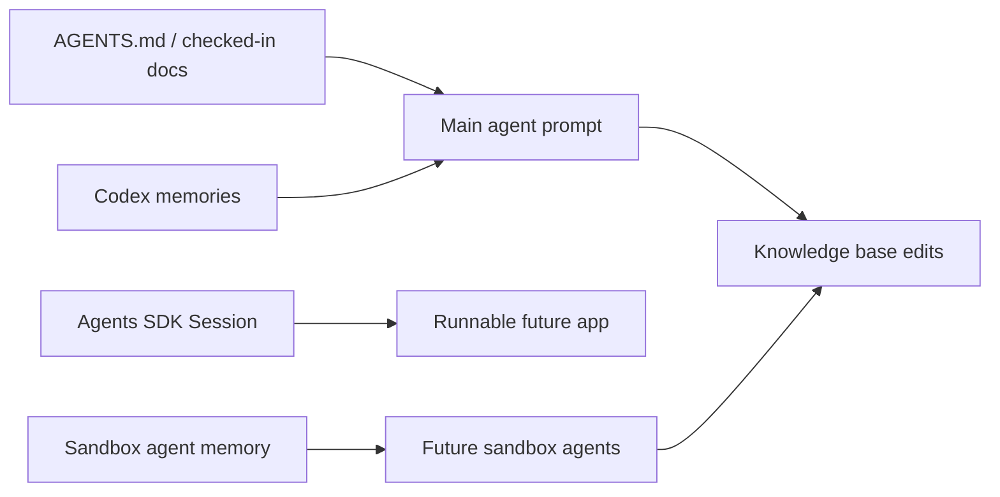

# Память в Codex и Agents SDK

Source status: `official`  
Источники: [Codex memories](https://developers.openai.com/codex/memories), [Agents SDK sessions](https://openai.github.io/openai-agents-js/guides/sessions/), [Agents SDK sandbox agent memory](https://openai.github.io/openai-agents-js/guides/sandbox-agents/memory/), [AGENTS.md](https://developers.openai.com/codex/guides/agents-md).

## Четыре разных слоя контекста

| Слой | Что хранит | Где использовать | Не использовать как |
| --- | --- | --- | --- |
| `AGENTS.md` | Обязательные инструкции проекта | Командные правила, test commands, coding standards | Personal notes или transient state |
| Codex Memories | Полезный локальный контекст из прошлых threads | Preferences, recurring workflows, pitfalls | Единственный источник обязательных правил |
| Agents SDK Sessions | Conversation history для app-level agents | Multi-turn apps and agent runners | Долгосрочная база знаний |
| Sandbox Agent Memory | Lessons from prior sandbox-agent runs in workspace files | Repeated agent workflows and run summaries | Secret storage или непроверяемая истина |

## Рекомендации

- Обязательные инструкции держите в применимых `AGENTS.md`; обычные checked-in docs подключайте явно по задаче или ссылке.
- Memories включайте как вспомогательный recall layer.
- Session memory используйте для conversation continuity внутри приложения.
- Sandbox memory изолируйте layout-ами, если разные агенты не должны делиться опытом.
- Любой memory artifact считайте retained data: не храните secrets и проверяйте перед передачей.

## Архитектура памяти для этого проекта

## Политика обновления

1. Обязательное правило разместите в применимом `AGENTS.md`; справочные docs требуют явной загрузки.
2. Если это личное предпочтение пользователя, оно может идти в memory.
3. Если это вывод из эксперимента, он идет в `docs/insights/` со статусом `experiment`.
4. Если memory противоречит текущему репозиторию или официальным docs, доверяем текущему состоянию и источникам.

## Memory vs observability

Memory отвечает на вопрос "что сохранить для следующего шага или следующей сессии". Observability отвечает на вопрос "почему агент сделал именно это". Для production agent systems нужны оба слоя:

- session memory хранит conversation continuity;
- workspace memory хранит lessons and run summaries;
- tracing хранит tool calls, handoffs, latency and failures;
- source registry хранит проверяемую основу claims.

Не заменяйте tracing памятью: если нужно расследовать failure, нужен event trail, а не только итоговая заметка.

## Управление local Codex memory

Проверено 05.11.2026: [Memories](https://developers.openai.com/codex/memories). ChatGPT web memory и local Codex memory имеют разные stores и controls. В поддерживаемом desktop/TUI используйте `/memories` для выбора, может ли chat читать существующую memory и участвовать в создании новой. Chat-level choices не меняют global settings.

В desktop **Settings → Personalization → Enable Codex memories** управляет локальной функцией. **Allow memories from tool-assisted chats** определяет допустимость таких chats для генерации. Конфигурация разделяет `memories.use_memories` и `memories.generate_memories`; external-context eligibility проверяется отдельно. Генерация фоновая: конец chat не означает немедленную запись.

Хранилища под `CODEX_HOME`: `memories/` и `memories_v2/`. Поведение миграции зависит от клиента и настроек; существующее v1 не означает неисправность. Для диагностики проверьте оба каталога, client/version, use/generate и eligibility. Generated files не являются основным интерфейсом редактирования правил.

**Delete Codex memories** сбрасывает выбранную локальную store и на поддерживаемой машине может очистить Computer History. Это отдельное явное действие, не автоматическое «исправление». Не храните secrets и проверяйте retained data перед передачей artifacts.

`AGENTS.md` загружается по [правилам discovery](https://learn.chatgpt.com/docs/agent-configuration/agents-md); обычный документ не становится instruction только из-за присутствия в repo. Sessions, sandbox memory и traces остаются отдельными слоями приложения.
