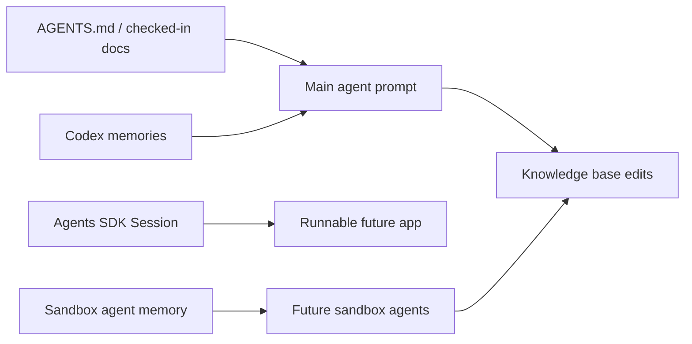

# Память в Codex и Agents SDK

Source status: `official`  
Источники: [Codex memories](https://developers.openai.com/codex/memories), [Agents SDK sessions](https://openai.github.io/openai-agents-js/guides/sessions/), [Agents SDK sandbox agent memory](https://openai.github.io/openai-agents-js/guides/sandbox-agents/memory/), [AGENTS.md](https://developers.openai.com/codex/guides/agents-md).

## Три разных слоя памяти

| Слой | Что хранит | Где использовать | Не использовать как |
| --- | --- | --- | --- |
| `AGENTS.md` | Обязательные инструкции проекта | Командные правила, test commands, coding standards | Personal notes или transient state |
| Codex Memories | Полезный локальный контекст из прошлых threads | Preferences, recurring workflows, pitfalls | Единственный источник обязательных правил |
| Agents SDK Sessions | Conversation history для app-level agents | Multi-turn apps and agent runners | Долгосрочная база знаний |
| Sandbox Agent Memory | Lessons from prior sandbox-agent runs in workspace files | Repeated agent workflows and run summaries | Secret storage или непроверяемая истина |

## Рекомендации

- Все обязательные правила кладите в checked-in docs или `AGENTS.md`.
- Memories включайте как вспомогательный recall layer.
- Session memory используйте для conversation continuity внутри приложения.
- Sandbox memory изолируйте layout-ами, если разные агенты не должны делиться опытом.
- Любой memory artifact считайте retained data: не храните secrets и проверяйте перед передачей.

## Архитектура памяти для этого проекта

## Политика обновления

1. Если правило должно всегда выполняться, оно идет в `AGENTS.md` или docs.
2. Если это личное предпочтение пользователя, оно может идти в memory.
3. Если это вывод из эксперимента, он идет в `docs/insights/` со статусом `experiment`.
4. Если memory противоречит текущему репозиторию или официальным docs, доверяем текущему состоянию и источникам.

## Memory vs observability

Memory отвечает на вопрос "что сохранить для следующего шага или следующей сессии". Observability отвечает на вопрос "почему агент сделал именно это". Для production agent systems нужны оба слоя:

- session memory хранит conversation continuity;
- workspace memory хранит lessons and run summaries;
- tracing хранит tool calls, handoffs, latency and failures;
- source registry хранит проверяемую основу claims.

Не заменяйте tracing памятью: если нужно расследовать failure, нужен event trail, а не только итоговая заметка.
