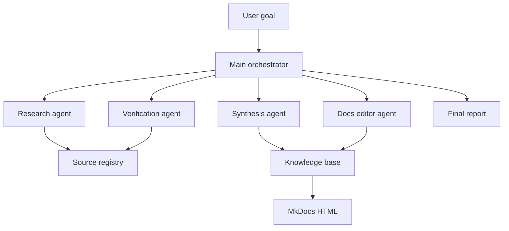

# Agent System Architecture

Source status: `official + experiment`  
Official sources: [Subagents](https://developers.openai.com/codex/concepts/subagents), [Agent Skills](https://developers.openai.com/codex/skills), [AGENTS.md](https://developers.openai.com/codex/guides/agents-md), [Agents SDK sessions](https://openai.github.io/openai-agents-js/guides/sessions/), [Agent memory](https://openai.github.io/openai-agents-js/guides/sandbox-agents/memory/).

## V1 Scope

V1 describes architecture, roles, memory, handoff, and templates. A runnable prototype is not part of v1.

## Basic Flow



## Roles

| Role | Responsibility | Writes files |
| --- | --- | --- |
| Main orchestrator | Accepts the goal, holds constraints, merges results | No, except the final report |
| Research agent | Finds official sources and candidate community signals | `docs/sources/` after review |
| Verification agent | Checks claims against sources and local state | No |
| Synthesis agent | Turns verified facts into instructional explanations | `docs/codex/`, `docs/agent-systems/` |
| Docs editor agent | Brings Markdown, navigation, and schemas into the project format | `docs/`, `mkdocs.yml` |

## Decomposition Rules

- Subagents are useful for independent read-heavy work: source search, audit, log analysis, link checking.
- Split write-heavy work by non-overlapping files.
- The main thread should retain decisions, constraints, and the final result, not raw logs.
- If a subagent result cannot be verified, it remains a suggestion, not a source of truth.

## From Manual Codex To Programmable Agents

There are three maturity levels:

| Level | Tool | When it is enough |
| --- | --- | --- |
| Manual agent workflow | Codex App / CLI / IDE | One-off task or research |
| Reusable operating procedure | `AGENTS.md`, skills, playbooks | Repeatable workflow without production runtime |
| Programmable agent system | Agents SDK + Responses API + Codex MCP | Needs tools, handoffs, guardrails, sessions, tracing, and automatic launch |

For v1 of the project, the target level is the second one. The third level is described in [Agents SDK patterns](sdk-patterns.md) as the next architecture step.

## Handoff Contract

Every agent returns:

```yaml
role: ""
task: ""
inputs_used: []
claims:
  - claim: ""
    source: ""
    confidence: "high | medium | low"
changes_proposed: []
risks: []
next_step: ""
```
