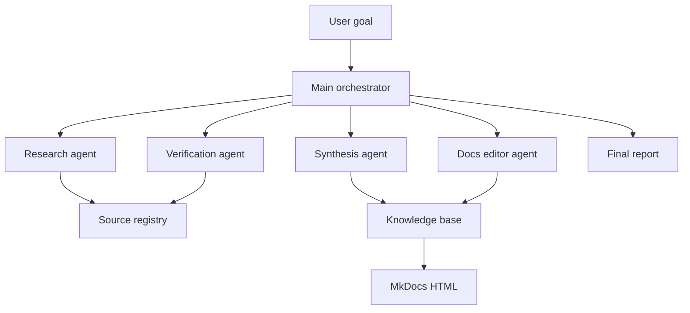

# Архитектура агентных систем

Source status: `official + experiment`  
Официальные источники: [Subagents](https://developers.openai.com/codex/concepts/subagents), [Agent Skills](https://developers.openai.com/codex/skills), [AGENTS.md](https://developers.openai.com/codex/guides/agents-md), [Agents SDK sessions](https://openai.github.io/openai-agents-js/guides/sessions/), [Agent memory](https://openai.github.io/openai-agents-js/guides/sandbox-agents/memory/).

## V1 scope

V1 описывает архитектуру, роли, память, handoff и шаблоны. Runnable-прототип не входит в v1.

## Базовый контур



## Роли

| Роль | Ответственность | Пишет файлы |
| --- | --- | --- |
| Main orchestrator | Принимает цель, держит constraints, объединяет результаты | Нет, кроме финального отчета |
| Research agent | Ищет официальные источники и candidate community signals | `docs/sources/` после review |
| Verification agent | Проверяет claims против источников и локального состояния | Нет |
| Synthesis agent | Превращает verified facts в учебные объяснения | `docs/codex/`, `docs/agent-systems/` |
| Docs editor agent | Приводит Markdown, навигацию и схемы к формату проекта | `docs/`, `mkdocs.yml` |

## Правила decomposition

- Subagents нужны для независимой read-heavy работы: поиск источников, аудит, анализ логов, проверка ссылок.
- Write-heavy работу делите по непересекающимся файлам.
- Main thread должен хранить decisions, constraints и итог, а не сырые логи.
- Если результат subagent нельзя проверить, он остается suggestion, а not source of truth.

## От ручного Codex к programmable agents

Есть три уровня зрелости:

| Уровень | Инструмент | Когда достаточно |
| --- | --- | --- |
| Manual agent workflow | Codex App / CLI / IDE | Разовая задача или исследование |
| Reusable operating procedure | `AGENTS.md`, skills, playbooks | Повторяемый workflow без production runtime |
| Programmable agent system | Agents SDK + Responses API + Codex MCP | Нужны tools, handoffs, guardrails, sessions, tracing и автоматический запуск |

Для v1 проекта целевой уровень - второй. Третий уровень описан в [Agents SDK patterns](sdk-patterns.md) как следующая архитектурная ступень.

## Handoff contract

Каждый agent возвращает:

```yaml
role: ""
task: ""
inputs_used: []
claims:
  - claim: ""
    source: ""
    confidence: "high | medium | low"
changes_proposed: []
risks: []
next_step: ""
```

## Single-agent baseline

Начните с одного агента. Multi-agent нужен, когда representative evals показывают пользу специализации относительно стоимости coordination/handoffs. Затем выберите [runtime ownership](sdk-patterns.md). [Evaluation best practices](https://developers.openai.com/api/docs/guides/evaluation-best-practices).
