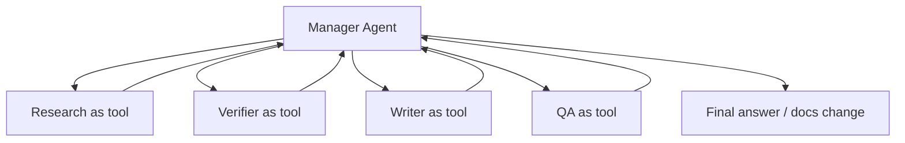

# Agents SDK Patterns

Source status: `official + experiment`
Sources: [OpenAI Agents SDK Python](https://github.com/openai/openai-agents-python), [Agents SDK JS sessions](https://openai.github.io/openai-agents-js/guides/sessions/), [Responses API](https://developers.openai.com/api/docs/guides/migrate-to-responses).

## Core Primitives

Agents SDK is useful when you need to move from a manual Codex workflow to a programmable agent system. Context7 highlights a minimal set of primitives:

| Primitive | Role | Documentation meaning |
| --- | --- | --- |
| `Agent` | LLM with instructions and tools | Unit of specialization |
| Tools | External actions or capabilities | Function tools, hosted tools, MCP tools, agents-as-tools |
| Handoffs | Transfer of control to another agent | Decentralized routing |
| Guardrails | Checking inputs/outputs | Policy, safety, schema, quality gates |
| Sessions | Conversation persistence | Application dialogue memory |
| Tracing | Debugging and monitoring | Visibility into decisions, tools, latency, failures |

## Manager Pattern

Manager pattern: a central orchestrator calls specialized agents as tools and keeps control over the workflow.

Use it when:

- the result needs a single owner;
- constraints, source policy, and acceptance criteria matter;
- several agents may produce conflicting conclusions;
- the final text or code must be reconciled.



For this knowledge base, Manager pattern is the default.

## Handoff Pattern

Handoff pattern: an agent transfers control to another specialized agent. This is closer to routing than to a tool call.

Use it when:

- there are different domains with independent policies;
- the next agent must conduct a long interaction;
- the user request explicitly changes mode, for example docs research -> implementation -> review.

Risk: if the handoff is poorly described, global context is lost. Therefore, the handoff payload must include goal, constraints, sources, decisions, and open questions.

## Responses API As A Low-Level Layer

Responses API is suitable when direct API-level control is needed:

- explicitly define tools;
- get structured output by JSON Schema;
- manage streaming;
- use built-in tools;
- build a custom loop around model/tool responses.

Example contract-first output for agent handoff:

```json
{
  "type": "json_schema",
  "name": "agent_handoff",
  "strict": true,
  "schema": {
    "type": "object",
    "properties": {
      "goal": { "type": "string" },
      "constraints": { "type": "array", "items": { "type": "string" } },
      "sources": { "type": "array", "items": { "type": "string" } },
      "claims": { "type": "array", "items": { "type": "string" } },
      "risks": { "type": "array", "items": { "type": "string" } }
    },
    "required": ["goal", "constraints", "sources", "claims", "risks"],
    "additionalProperties": false
  }
}
```

## Layer Selection

| Need | Choose |
| --- | --- |
| Quickly complete a local engineering task | Codex App / CLI |
| Repeatable workflow without code | Skill + `AGENTS.md` |
| Parallel research in the current session | Codex subagents |
| Agent application | Choose Agents API, Agents SDK or Responses by execution/state ownership; see the matrix below |
| Full control over the wire contract | Responses API |

## GPT-6 API compatibility

Checked 2026-11-03: [API migration](https://developers.openai.com/api/docs/guides/latest-model). The full model table is in [models and reasoning](../codex/models-and-reasoning.md).

| Model | Responses | Chat Completions |
| --- | --- | --- |
| Astra, 6.1 Sol, 6.1 Terra | Use for tool calling | Endpoint available, but tool calling requires Responses |
| 6 Sol, 6 Luna | Use for reasoning with tools | Function calling only with `reasoning_effort: "none"` |

Responses uses `reasoning.effort`; Chat Completions uses `reasoning_effort`. With effort other than `none`, remove `temperature`, `top_p`, `top_logprobs`; also remove Chat Completions `logprobs`, or Responses `message.output_text.logprobs` from `include`. Do not transfer parameters between endpoints. API capability does not automatically require replacing the existing Codex CLI runner.

## Agent runtime ownership

Checked against [Agents](https://developers.openai.com/api/docs/guides/agents) and [Responses Multi-agent](https://developers.openai.com/api/docs/guides/responses-multi-agent).

| Option | Execution and state owner | Product-Agent OS boundary |
| --- | --- | --- |
| Codex subagents | Codex parent session; child roles inherit its controls | Documented surface; task success requires evidence |
| Agents API | OpenAI managed Codex harness and managed progress/state | Documented external capability; no new integration implemented here |
| Agents SDK | Runner in the app; app owns deployment, storage, approvals | Separate app-runtime option, not a hidden plugin dependency |
| Responses API | Application loop/state, with optional hosted orchestration | API contract, not automatic CLI runner migration |
| Responses Multi-agent | Hosted beta orchestration; app integrates tool results | Separate beta: 6.1 Sol and GPT-5.6 on the review date, not all GPT-6 |

Responses Multi-agent has its own beta contract; root/subagents compact automatically and standalone `/responses/compact` is unsupported. Single-agent parameters are not universal: `reasoning.summary` and `max_tool_calls`, for example, are unsupported in this mode. Do not unconditionally combine async tools with parallel tool calls in Multi-agent; check the selected mode. An Agents API session, SDK session, Responses conversation and sandbox are different resources. See [session control](session-control.md) for tool state and steering.
