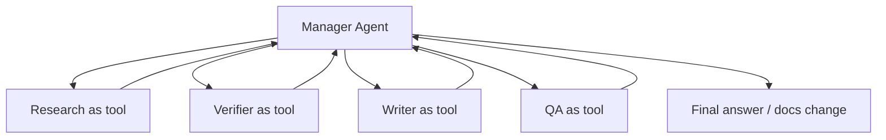

# Agents SDK patterns

Source status: `official + experiment`
Источники: [OpenAI Agents SDK Python](https://github.com/openai/openai-agents-python), [Agents SDK JS sessions](https://openai.github.io/openai-agents-js/guides/sessions/), [Responses API](https://developers.openai.com/api/docs/guides/migrate-to-responses).

## Core primitives

Agents SDK полезен, когда нужно перейти от ручного Codex workflow к программируемой агентной системе. Context7 выделяет минимальный набор primitives:

| Primitive | Роль | Документационный смысл |
| --- | --- | --- |
| `Agent` | LLM с instructions и tools | Единица специализации |
| Tools | Внешние действия или capabilities | Function tools, hosted tools, MCP tools, agents-as-tools |
| Handoffs | Передача контроля другому агенту | Децентрализованная маршрутизация |
| Guardrails | Проверка inputs/outputs | Policy, safety, schema, quality gates |
| Sessions | Conversation persistence | Память диалога приложения |
| Tracing | Debugging and monitoring | Видимость решений, tools, latency, failures |

## Manager pattern

Manager pattern: центральный orchestrator вызывает специализированных agents как tools и сохраняет контроль над workflow.

Использовать, когда:

- нужен единый owner результата;
- важны constraints, source policy, acceptance criteria;
- несколько agents могут дать конфликтующие выводы;
- финальный текст или код должен быть согласован.



Manager pattern — условный выбор для независимых подзадач. Начните с одного агента и усложняйте архитектуру по результатам evals.

## Handoff pattern

Handoff pattern: агент передает управление другому специализированному агенту. Это ближе к routing, чем к tool call.

Использовать, когда:

- есть разные домены с самостоятельными policies;
- следующий агент должен вести long interaction;
- пользовательский запрос явно меняет режим, например docs research -> implementation -> review.

Риск: если handoff плохо описан, теряется global context. Поэтому handoff payload должен включать goal, constraints, sources, decisions и open questions.

## Responses API как низкоуровневый слой

Responses API подходит, когда нужен прямой API-level контроль:

- явно задать tools;
- получить structured output по JSON Schema;
- управлять streaming;
- использовать built-in tools;
- строить собственную loop вокруг model/tool responses.

Пример contract-first вывода для agent handoff:

```json
{
  "type": "json_schema",
  "name": "agent_handoff",
  "strict": true,
  "schema": {
    "type": "object",
    "properties": {
      "goal": { "type": "string" },
      "constraints": { "type": "array", "items": { "type": "string" } },
      "sources": { "type": "array", "items": { "type": "string" } },
      "claims": { "type": "array", "items": { "type": "string" } },
      "risks": { "type": "array", "items": { "type": "string" } }
    },
    "required": ["goal", "constraints", "sources", "claims", "risks"],
    "additionalProperties": false
  }
}
```

## Выбор слоя

| Нужно | Выбирайте |
| --- | --- |
| Быстро выполнить локальную инженерную задачу | Codex App / CLI |
| Повторяемый workflow без кода | Skill + `AGENTS.md` |
| Параллельное исследование в текущей сессии | Codex subagents |
| Agent application | Choose Agents API, Agents SDK or Responses by execution/state ownership; see the matrix below |
| Полный контроль над wire contract | Responses API |

## GPT-6 API compatibility

Проверено 2026-11-03: [API migration](https://developers.openai.com/api/docs/guides/latest-model). Полная модельная таблица — [models and reasoning](../codex/models-and-reasoning.md).

| Модель | Responses | Chat Completions |
| --- | --- | --- |
| Astra, 6.1 Sol, 6.1 Terra | Использовать для tool calling | Endpoint доступен, но tool calling требует Responses |
| 6 Sol, 6 Luna | Использовать для reasoning с tools | Function calling только при `reasoning_effort: "none"` |

В Responses effort задается `reasoning.effort`, в Chat Completions — `reasoning_effort`. При effort, отличном от `none`, уберите `temperature`, `top_p`, `top_logprobs`; для Chat Completions также `logprobs`, для Responses — `message.output_text.logprobs` из `include`. Не переносите параметры одного endpoint в другой. API capability не требует автоматически заменить существующий Codex CLI runner.

## Владение agent runtime

Проверено по [Agents](https://developers.openai.com/api/docs/guides/agents) и [Responses Multi-agent](https://developers.openai.com/api/docs/guides/responses-multi-agent).

| Вариант | Кто управляет выполнением и состоянием | Граница Product-Agent OS |
| --- | --- | --- |
| Codex subagents | Codex parent session; дочерние роли наследуют ее controls | Документированная поверхность; успех конкретной задачи требует evidence |
| Agents API | OpenAI managed Codex harness и managed progress/state | Описанная внешняя возможность, новая интеграция здесь не реализована |
| Agents SDK | Runner в приложении; приложение владеет deployment, storage, approvals | Возможный отдельный app runtime, не скрытая зависимость плагина |
| Responses API | Приложение управляет loop/state, с optional hosted orchestration | API contract, не автоматический переход CLI runner |
| Responses Multi-agent | Hosted beta orchestration; приложение интегрирует tool results | Отдельная beta: на дату проверки 6.1 Sol и GPT-5.6, не все GPT-6 |

Responses Multi-agent требует своего beta contract; root/subagents автоматически compact, standalone `/responses/compact` не поддерживается. Нельзя считать single-agent параметры универсальными: например, `reasoning.summary` и `max_tool_calls` не поддерживаются этим режимом. Async tools нельзя безусловно смешивать с parallel tool calls в Multi-agent; проверяйте выбранный режим. Agents API session, SDK session, Responses conversation и sandbox — разные ресурсы. Для состояния tools и steering см. [session control](session-control.md).

## Пример выбора и failure path

Задача «обработать документы и вернуть проверяемый результат» сначала требует решения о владельце состояния. Если нужен managed harness — рассмотрите Agents API; если приложение владеет Runner, storage и approvals — Agents SDK; если нужен wire-level contract и свой loop — Responses. Это выбор интеграции, не переключение текущего Codex runner.

JSON выше — fragment схемы результата, не полный request для любого endpoint. Для Responses используйте актуальный `text.format`/SDK parsing contract; refusal, incomplete output и фактические ошибки обрабатываются отдельно. [Structured Outputs](https://developers.openai.com/api/docs/guides/structured-outputs).

Если async tool завершился после steering, сначала сопоставьте call_id, проверьте актуальный scope и prior application; не повторяйте side effect. При timeout верните явную ошибку и решите retry по idempotency/budget. [Session control](session-control.md).
