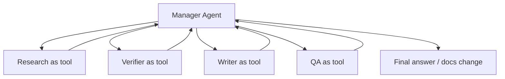

# Agents SDK patterns

Source status: `official + experiment`
Источники: [OpenAI Agents SDK Python](https://github.com/openai/openai-agents-python), [Agents SDK JS sessions](https://openai.github.io/openai-agents-js/guides/sessions/), [Responses API](https://developers.openai.com/api/docs/guides/migrate-to-responses).

## Core primitives

Agents SDK полезен, когда нужно перейти от ручного Codex workflow к программируемой агентной системе. Context7 выделяет минимальный набор primitives:

| Primitive | Роль | Документационный смысл |
| --- | --- | --- |
| `Agent` | LLM с instructions и tools | Единица специализации |
| Tools | Внешние действия или capabilities | Function tools, hosted tools, MCP tools, agents-as-tools |
| Handoffs | Передача контроля другому агенту | Децентрализованная маршрутизация |
| Guardrails | Проверка inputs/outputs | Policy, safety, schema, quality gates |
| Sessions | Conversation persistence | Память диалога приложения |
| Tracing | Debugging and monitoring | Видимость решений, tools, latency, failures |

## Manager pattern

Manager pattern: центральный orchestrator вызывает специализированных agents как tools и сохраняет контроль над workflow.

Использовать, когда:

- нужен единый owner результата;
- важны constraints, source policy, acceptance criteria;
- несколько agents могут дать конфликтующие выводы;
- финальный текст или код должен быть согласован.



Для этой базы знаний Manager pattern является default.

## Handoff pattern

Handoff pattern: агент передает управление другому специализированному агенту. Это ближе к routing, чем к tool call.

Использовать, когда:

- есть разные домены с самостоятельными policies;
- следующий агент должен вести long interaction;
- пользовательский запрос явно меняет режим, например docs research -> implementation -> review.

Риск: если handoff плохо описан, теряется global context. Поэтому handoff payload должен включать goal, constraints, sources, decisions и open questions.

## Responses API как низкоуровневый слой

Responses API подходит, когда нужен прямой API-level контроль:

- явно задать tools;
- получить structured output по JSON Schema;
- управлять streaming;
- использовать built-in tools;
- строить собственную loop вокруг model/tool responses.

Пример contract-first вывода для agent handoff:

```json
{
  "type": "json_schema",
  "name": "agent_handoff",
  "strict": true,
  "schema": {
    "type": "object",
    "properties": {
      "goal": { "type": "string" },
      "constraints": { "type": "array", "items": { "type": "string" } },
      "sources": { "type": "array", "items": { "type": "string" } },
      "claims": { "type": "array", "items": { "type": "string" } },
      "risks": { "type": "array", "items": { "type": "string" } }
    },
    "required": ["goal", "constraints", "sources", "claims", "risks"],
    "additionalProperties": false
  }
}
```

## Выбор слоя

| Нужно | Выбирайте |
| --- | --- |
| Быстро выполнить локальную инженерную задачу | Codex App / CLI |
| Повторяемый workflow без кода | Skill + `AGENTS.md` |
| Параллельное исследование в текущей сессии | Codex subagents |
| Production agent app | Agents SDK |
| Полный контроль над wire contract | Responses API |

