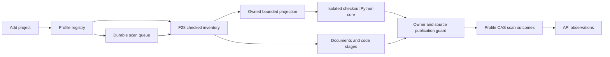

# Data flows and authority boundaries

Source status: repository_source / current_source_architecture_map; 2026-11-15.

Owner: Product-Agent OS architecture; scope/version: DG02 v1. Update when the cited sources, data boundaries or decisions change; related tests are listed below. Source inspection does not prove runtime activation or release readiness.

## FUNC-G03: asynchronous analysis and freshness

The current 2026-11-15 flow supplements historical DG02/DG03 links: Add persists the registry project, then separately requests a background scan. Files/fixed sources/graph and execution inspection use F28 inventory with registry root/policy; visible metadata grants no read permission. Scans persist CAS stage outcomes and source provenance. The checkout adapter passes an allowlisted temporary projection to the existing Python core; target code and DB bytes are not executed/opened. A packaged runtime without core explicitly reports unavailable, without a fallback analyzer.

`GET freshness` returns a cheap profile stamp; `GET task-manager` reads entities and stamp in one SQLite transaction. Numeric stamp policyVersion differs from string source policy identity. There is no watcher: manual refresh/read/scan detects external filesystem changes, and source/adapter revision checks mark analysis stale. The next artifact is a current task snapshot or scan result with rootIdentity/policyVersion/inventoryRevision and coverage/reasons.

Execution obtains saved task scope through metadata-only file-preflight, including taskRevision/digest and file pins. Raw SHA256 content revision remains separate from metadata/policy fileRevision. The browser guard does not grant execution authority: the gateway checks admission preflight, root/policy capture before broker commands and existing approval/ownership fences. SQLite stamps, source pins and command receipts describe different observations; none alone proves task completion.

Parent-provided local integration evidence: F29 API6/6, file-preflight API1/1, gateway policy28/28, F18focused5/5. Final browser/native acceptance is handled separately by the root agent. [Modules](../backend/modules.md), [recovery](../backend/recovery.md) and [API](../api/endpoints.md) identify the next verification contract.

## Project management and storage

1. The SPA sends a request to the local service; HTTP and session-gate boundaries are implemented by the service ([startup](https://github.com/alexroadcaster/product-agent-os/blob/2f8a0cb8b428ba4499d9d7bd35f1f4b42b2be765/apps/local-service/src/main.mts), [application](https://github.com/alexroadcaster/product-agent-os/blob/2f8a0cb8b428ba4499d9d7bd35f1f4b42b2be765/apps/local-service/src/http/application.mts)).
2. The service uses the profile-scoped store. [Local store](https://github.com/alexroadcaster/product-agent-os/blob/2f8a0cb8b428ba4499d9d7bd35f1f4b42b2be765/apps/local-service/src/storage/local-store.mts) sends commands to the SQLite worker; [schema](https://github.com/alexroadcaster/product-agent-os/blob/2f8a0cb8b428ba4499d9d7bd35f1f4b42b2be765/apps/local-service/src/storage/migrations/schema.mts) and the project mode determine data and authority.
3. Project source remains files; the [source adapter](https://github.com/alexroadcaster/product-agent-os/blob/2f8a0cb8b428ba4499d9d7bd35f1f4b42b2be765/apps/local-service/src/adapters/project-sources.ts) binds a path and reads supported sources. Read-only discovery does not authorize workspace changes.
4. Legacy and SQL can have different authority before and after cutover. The [historical architecture](https://github.com/alexroadcaster/product-agent-os/blob/2f8a0cb8b428ba4499d9d7bd35f1f4b42b2be765/research/product-agent-os-web-architecture-2026-11-05.md) records intent and conditions but does not prove every project was migrated. Check the current state of the specific project and its [plan](../planning/product-agent-os-web-task-manager-plan-2026-11-09.md).

## Execution and evidence

The selector chooses the App-agent or API route. For App-agent the service may persist work, but a capability-authenticated consumer must attach and claim it; waiting for a worker does not prove model execution ([gateway](https://github.com/alexroadcaster/product-agent-os/blob/2f8a0cb8b428ba4499d9d7bd35f1f4b42b2be765/apps/local-service/src/runtime/app-agent-gateway.mts), [channel](https://github.com/alexroadcaster/product-agent-os/blob/2f8a0cb8b428ba4499d9d7bd35f1f4b42b2be765/apps/local-service/src/runtime/app-agent-channel.mts)). API is a distinct choice: providing an API key can select it when route is omitted; switching without disconnect and implicit fallback are not assumed ([selector](https://github.com/alexroadcaster/product-agent-os/blob/2f8a0cb8b428ba4499d9d7bd35f1f4b42b2be765/apps/local-service/src/runtime/route-selector.ts)). The UI reports the state and evidence of the specific run; a graph, report or button does not prove completion.

SQLite transactions and file writes do not form one shared transaction: check application and recovery assumptions against the specific supported route and receipt, not this map. The diagram does not imply arbitrary file-write authority.

**Tests:** [project-source tests](https://github.com/alexroadcaster/product-agent-os/blob/2f8a0cb8b428ba4499d9d7bd35f1f4b42b2be765/tests/web/project-sources.test.mts), [route-selector tests](https://github.com/alexroadcaster/product-agent-os/blob/2f8a0cb8b428ba4499d9d7bd35f1f4b42b2be765/tests/web/runtime-route-selector.test.mts), [App-agent gateway tests](https://github.com/alexroadcaster/product-agent-os/blob/2f8a0cb8b428ba4499d9d7bd35f1f4b42b2be765/tests/web/app-agent-gateway.test.mts). The [flow diagram](../diagrams/paos-application-architecture.md) is orientation evidence, not another source of truth.
