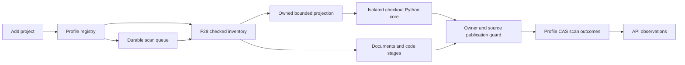

# Потоки и границы данных

Source status: repository_source / current_source_architecture_map; 15.11.2026.

Владелец: архитектура Product-Agent OS; scope/version: DG02 v1. Обновлять при изменении соответствующих исходников, границ данных или решений; связанные проверки указаны ниже. Проверка исходников не доказывает runtime activation или готовность к выпуску.

## FUNC-G03: асинхронный анализ и актуальность

Текущий flow от 15.11.2026 дополняет исторические DG02/DG03 ссылки: Add сохраняет registry project, затем отдельно запрашивает background scan. Files/fixed sources/graph и execution inspector используют F28 inventory с registry root/policy; metadata visibility не даёт read permission. Scan сохраняет CAS stage outcomes и source provenance. Checkout adapter передаёт allowlisted temporary projection существующему Python core; target code и DB bytes не исполняются/не открываются. Packaged runtime без core явно unavailable, fallback analyzer не подключается.

`GET freshness` возвращает дешёвый profile stamp; `GET task-manager` читает entities и stamp в одной SQLite transaction. Numeric stamp policyVersion отличается от строковой source policy identity. Watcher отсутствует: manual refresh/read/scan обнаруживает внешние filesystem changes, source/adapter revision checks помечают анализ stale. Следующий артефакт — актуальный task snapshot или scan result с rootIdentity/policyVersion/inventoryRevision и coverage/reasons.

Execution получает сохранённую task scope через metadata-only file-preflight, включая taskRevision/digest и file pins. Raw SHA256 content revision отделён от metadata/policy fileRevision. Browser guard не даёт execution authority: gateway проверяет admission preflight, root/policy capture перед broker command и существующие approval/ownership fences. SQLite stamp, source pin и command receipt описывают разные observations; ни один сам по себе не доказывает завершение задачи.

Переданное локальное integration evidence: F29 API6/6, file-preflight API1/1, gateway policy28/28, F18focused5/5. Final browser/native acceptance выполняется основным агентом отдельно. [Модули](../backend/modules.md), [recovery](../backend/recovery.md), [API](../api/endpoints.md) указывают следующий контракт проверки.

## Управление проектом и хранение

1. SPA отправляет запрос local service; границы HTTP и session gate реализованы на стороне сервиса ([startup](https://github.com/alexroadcaster/product-agent-os/blob/2f8a0cb8b428ba4499d9d7bd35f1f4b42b2be765/apps/local-service/src/main.mts), [application](https://github.com/alexroadcaster/product-agent-os/blob/2f8a0cb8b428ba4499d9d7bd35f1f4b42b2be765/apps/local-service/src/http/application.mts)).
2. Service обращается к profile-scoped store. [Local store](https://github.com/alexroadcaster/product-agent-os/blob/2f8a0cb8b428ba4499d9d7bd35f1f4b42b2be765/apps/local-service/src/storage/local-store.mts) передаёт команды в SQLite worker; [schema](https://github.com/alexroadcaster/product-agent-os/blob/2f8a0cb8b428ba4499d9d7bd35f1f4b42b2be765/apps/local-service/src/storage/migrations/schema.mts) и конкретный режим проекта определяют данные и authority.
3. Проектные исходники остаются файлами; [source adapter](https://github.com/alexroadcaster/product-agent-os/blob/2f8a0cb8b428ba4499d9d7bd35f1f4b42b2be765/apps/local-service/src/adapters/project-sources.ts) связывает путь и читает поддержанные источники. Read-only discovery не означает разрешение на изменение рабочего пространства.
4. Legacy и SQL могут иметь разные authority до и после cutover. Предыдущая [архитектура](https://github.com/alexroadcaster/product-agent-os/blob/2f8a0cb8b428ba4499d9d7bd35f1f4b42b2be765/research/product-agent-os-web-architecture-2026-11-05.md) описывает замысел и условия, но не доказывает, что каждый проект мигрирован. Проверяйте актуальное состояние конкретного проекта и [план](../planning/product-agent-os-web-task-manager-plan-2026-11-09.md).

## Запуск и evidence

Selector выбирает App-agent или API route. Для App-agent service может сохранить работу, а capability-authenticated consumer должен присоединиться и заявить её; ожидание worker не доказывает запуск модели ([gateway](https://github.com/alexroadcaster/product-agent-os/blob/2f8a0cb8b428ba4499d9d7bd35f1f4b42b2be765/apps/local-service/src/runtime/app-agent-gateway.mts), [channel](https://github.com/alexroadcaster/product-agent-os/blob/2f8a0cb8b428ba4499d9d7bd35f1f4b42b2be765/apps/local-service/src/runtime/app-agent-channel.mts)). API route — отдельный выбор: переданный API key выбирает его при отсутствии route; переключение без отключения и неявный fallback не предполагаются ([selector](https://github.com/alexroadcaster/product-agent-os/blob/2f8a0cb8b428ba4499d9d7bd35f1f4b42b2be765/apps/local-service/src/runtime/route-selector.ts)). UI показывает результат только согласно состоянию и evidence конкретного запуска; наличие графа, отчёта или кнопки не доказывает завершение операции.

SQLite-транзакция и запись файла не образуют одну общую транзакцию: предположения о применении и восстановлении проверяются на конкретном supported route и receipt, а не по данной карте. Никакой универсальный произвольный file write не следует из этой схемы.

**Проверки:** [project-source tests](https://github.com/alexroadcaster/product-agent-os/blob/2f8a0cb8b428ba4499d9d7bd35f1f4b42b2be765/tests/web/project-sources.test.mts), [route-selector tests](https://github.com/alexroadcaster/product-agent-os/blob/2f8a0cb8b428ba4499d9d7bd35f1f4b42b2be765/tests/web/runtime-route-selector.test.mts), [App-agent gateway tests](https://github.com/alexroadcaster/product-agent-os/blob/2f8a0cb8b428ba4499d9d7bd35f1f4b42b2be765/tests/web/app-agent-gateway.test.mts). [Схема потока](../diagrams/paos-application-architecture.md) — вспомогательная карта, не новое хранилище истины.
