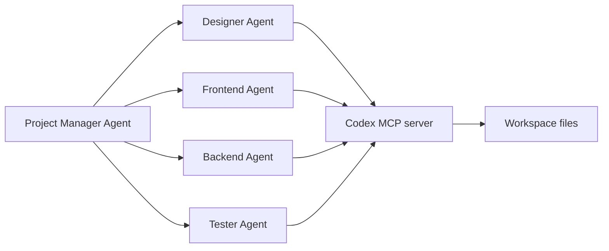

# Codex Configuration and Extensibility

Source status: `official`
Sources: [Agent approvals and security](https://developers.openai.com/codex/agent-approvals-security), [Create a skill](https://developers.openai.com/codex/skills/create-skill), [Subagents](https://developers.openai.com/codex/subagents), [Agents SDK with Codex](https://developers.openai.com/codex/guides/agents-sdk).

## Approval policy as a managed interface

For advanced work, approval policy is better described not as one global switch, but as a set of separate gates:

```toml
approval_policy = { granular = {
  sandbox_approval = true,
  rules = true,
  mcp_elicitations = true,
  request_permissions = false,
  skill_approval = false
} }
```

Practical meaning:

| Gate | What it controls | Recommendation |
| --- | --- | --- |
| `sandbox_approval` | A command crossing the sandbox boundary | Enable for local projects |
| `rules` | Confirmation for rule-based actions | Enable when the access policy is complex |
| `mcp_elicitations` | Confirmation requests from MCP tools | Enable for external systems |
| `request_permissions` | Requests for expanded permissions | Disable by default, enable deliberately |
| `skill_approval` | Permission for skill invocation | Enable if skills have side effects |

Baseline for analysis and review:

```toml
approval_policy = "untrusted"
sandbox_mode = "read-only"
allow_login_shell = false
```

Baseline for controlled implementation:

```toml
approval_policy = "on-request"
sandbox_mode = "workspace-write"
allow_login_shell = false
```

## Skill metadata

The official skill structure can include `agents/openai.yaml` to describe UI, invocation policy and tool dependencies:

```yaml
interface:
  display_name: "Source Card Writer"
  short_description: "Turns an official documentation page into a source card."
  icon_small: "./assets/source-card.svg"
  brand_color: "#0F766E"
  default_prompt: "Create a source card for this documentation URL."

policy:
  allow_implicit_invocation: false

dependencies:
  tools:
    - type: "mcp"
      value: "openaiDeveloperDocs"
      description: "OpenAI Docs MCP server"
      transport: "streamable_http"
      url: "https://developers.openai.com/mcp"
```

For this project, `allow_implicit_invocation: false` is preferred: source collection and claim transfer must happen explicitly so that official and community layers are not mixed.

## Codex MCP as the backend for an agentic system

Context7 showed an official example where the Agents SDK runs a multi-agent workflow and connects Codex CLI as an MCP server. Architecturally, this is an important bridge:



For our knowledge base, this means:

- Codex can be used not only as a standalone assistant, but also as an execution tool inside broader Agents SDK orchestration.
- Project Manager must define source of truth documents: `REQUIREMENTS.md`, `AGENT_TASKS.md`, `TEST.md`.
- Each worker-agent must have narrow deliverables and a sandbox/approval policy.
- Handoff back to Project Manager is mandatory so that the final assembly of decisions does not fall apart into independent results.

