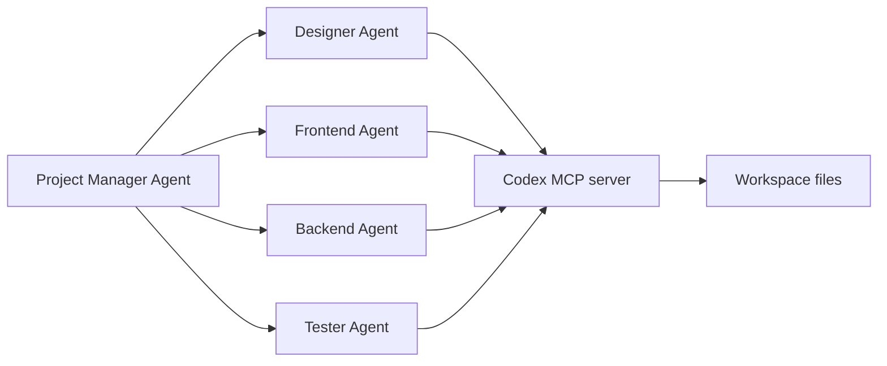

# Codex Configuration and Extensibility

Source status: `official + experiment`
Sources: [Agent approvals and security](https://learn.chatgpt.com/docs/permissions), [Create a skill](https://developers.openai.com/codex/skills/create-skill), [Subagents](https://learn.chatgpt.com/docs/agent-configuration/subagents), [Agents SDK with Codex](https://developers.openai.com/codex/guides/agents-sdk).

## Approval policy and permission profiles

Checked 2026-11-03 against [Configuration Reference](https://learn.chatgpt.com/docs/config-file/config-reference) and [Permissions](https://learn.chatgpt.com/docs/permissions). These are standalone examples, not changes to this repository's configuration. Effective settings also depend on client version, trusted project layers and managed policy.

`on-request` allows eligible interactive approval prompts; `never` rejects requests that need approval. Neither grants extra filesystem access. `untrusted` is retired as an approval policy; project `trust_level` is a different setting. `approvals_reviewer` chooses the reviewer for eligible prompts, not sandbox permissions or review of already permitted actions.

### Granular prompt categories

This complete TOML example uses regular tables to remain compatible with the project's TOML parser. Do not combine it with a scalar `approval_policy` in the same configuration.

```toml
[approval_policy.granular]
sandbox_approval = true
rules = true
mcp_elicitations = true
request_permissions = false
skill_approval = false
```

| Key | Meaning when true |
| --- | --- |
| `sandbox_approval` | Permit sandbox escalation approval prompts |
| `rules` | Permit prompts triggered by rules |
| `mcp_elicitations` | Permit MCP elicitation prompts |
| `request_permissions` | Permit permission-expansion prompts |
| `skill_approval` | Permit skill-script approval prompts; not general skill invocation |

False denies that prompt category; it does not silently approve the operation. Choose each flag for the authorized workflow rather than enabling all categories by habit.

### Permission profiles (beta)

Independent parent-session example for analysis:

```toml
default_permissions = ":read-only"
approval_policy = "on-request"
allow_login_shell = false
```

Independent parent-session example for authorized local editing:

```toml
default_permissions = ":workspace"
approval_policy = "on-request"
allow_login_shell = false
```

Profiles do not compose with `sandbox_mode` / `sandbox_workspace_write`. Check every loaded layer and CLI override: legacy settings can select the legacy route; managed profile requirements may reject that route. The legacy option remains supported where documented:

```toml
sandbox_mode = "workspace-write"
approval_policy = "on-request"
```

Use this legacy example only instead of a permission-profile configuration. `:workspace` protects `.git`, `.agents`, `.codex` and `.aws` inside writable roots; inspect effective policy before claiming a path is writable. See [security boundaries](security.md) for command network versus MCP/web/browser controls.

### Models and current project contract

The [model matrix](models-and-reasoning.md) records applicability. Following authorized technical work on 2026-11-03, the repository uses GPT-6.1 Sol/Terra pins, parent `default_permissions = ":workspace"` and parent MCP. The validator follows these contracts. Effective permissions and model selection in a fresh session require separate evidence; see [technical follow-up](../product-agent-os/codex-compatibility.md).

## Skill metadata

The official skill structure can include `agents/openai.yaml` to describe UI, invocation policy and tool dependencies:

```yaml
interface:
  display_name: "Source Card Writer"
  short_description: "Turns an official documentation page into a source card."
  icon_small: "./assets/source-card.svg"
  brand_color: "#0F766E"
  default_prompt: "Create a source card for this documentation URL."

policy:
  allow_implicit_invocation: false

dependencies:
  tools:
    - type: "mcp"
      value: "openaiDeveloperDocs"
      description: "OpenAI Docs MCP server"
      transport: "streamable_http"
      url: "https://developers.openai.com/mcp"
```

For this project, `allow_implicit_invocation: false` is preferred: source collection and claim transfer must happen explicitly so that official and community layers are not mixed.

## Codex MCP as the backend for an agentic system

Context7 showed an official example where the Agents SDK runs a multi-agent workflow and connects Codex CLI as an MCP server. Architecturally, this is an important bridge:



For our knowledge base, this means:

- Codex can be used not only as a standalone assistant, but also as an execution tool inside broader Agents SDK orchestration.
- Project Manager must define source of truth documents: `REQUIREMENTS.md`, `AGENT_TASKS.md`, `TEST.md`.
- Each worker must have bounded deliverables; Codex subagents inherit the parent session sandbox and approvals. Separate runtimes need their own explicit execution policy.
- Handoff back to Project Manager is mandatory so that the final assembly of decisions does not fall apart into independent results.

## Check effective settings

After configuration changes check client/version, workspace root and managed policy. `/status`, `/debug-config` and `--strict-config` help on supported clients; a file does not prove loading. Current Cloud configuration is separate from local configuration. [Developer settings](https://learn.chatgpt.com/docs/developer-settings).
