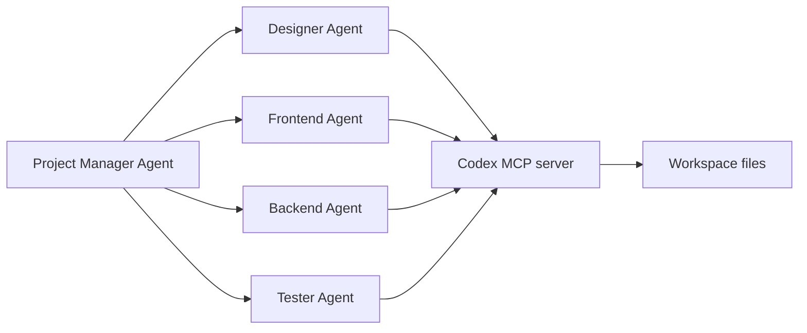

# Конфигурация и расширяемость Codex

Source status: `official + experiment`
Источники: [Agent approvals and security](https://learn.chatgpt.com/docs/permissions), [Create a skill](https://developers.openai.com/codex/skills/create-skill), [Subagents](https://learn.chatgpt.com/docs/agent-configuration/subagents), [Agents SDK with Codex](https://developers.openai.com/codex/guides/agents-sdk).

## Approval policy и permission profiles

Проверено 2026-11-03 по [Configuration Reference](https://learn.chatgpt.com/docs/config-file/config-reference) и [Permissions](https://learn.chatgpt.com/docs/permissions). Ниже независимые примеры, а не изменения конфигурации репозитория. Effective settings зависят также от версии клиента, доверенных project layers и managed policy.

`on-request` допускает соответствующие интерактивные approval prompts; `never` отклоняет запросы, требующие approval. Ни один вариант не расширяет filesystem permissions. `untrusted` больше не поддерживается как approval policy; project `trust_level` — другой параметр. `approvals_reviewer` выбирает проверяющего для допустимых запросов, но не изменяет sandbox и не проверяет уже разрешенные действия.

### Категории granular prompts

Полный TOML-пример использует обычные таблицы и совместим с парсером проекта. Не объединяйте его со скалярным `approval_policy` в одной конфигурации.

```toml
[approval_policy.granular]
sandbox_approval = true
rules = true
mcp_elicitations = true
request_permissions = false
skill_approval = false
```

| Ключ | Значение true |
| --- | --- |
| `sandbox_approval` | Допускает approval prompts для sandbox escalation |
| `rules` | Допускает запросы подтверждения по rules |
| `mcp_elicitations` | Допускает MCP elicitation prompts |
| `request_permissions` | Допускает запросы расширения permissions |
| `skill_approval` | Допускает skill-script approval prompts, а не любой вызов skill |

False запрещает соответствующую категорию запросов; это не молчаливое разрешение операции. Флаги выбираются под разрешенный workflow, а не включаются все по умолчанию.

### Permission profiles (beta)

Независимый пример родительской сессии для анализа:

```toml
default_permissions = ":read-only"
approval_policy = "on-request"
allow_login_shell = false
```

Независимый пример родительской сессии для разрешенных локальных изменений:

```toml
default_permissions = ":workspace"
approval_policy = "on-request"
allow_login_shell = false
```

Profiles не объединяются с `sandbox_mode` / `sandbox_workspace_write`. Проверяйте все загруженные layers и CLI overrides: legacy settings могут выбрать старую схему, а managed profile requirements — отклонить ее. Legacy-вариант остается доступным в документированных условиях:

```toml
sandbox_mode = "workspace-write"
approval_policy = "on-request"
```

Этот legacy-пример используется только вместо profile configuration. `:workspace` защищает `.git`, `.agents`, `.codex` и `.aws` внутри writable roots; перед заявлением о возможности записи проверяйте effective policy. Различия command network и MCP/web/browser — в [руководстве по безопасности](security.md).

### Модели и текущий контракт проекта

Применимость моделей указана в [матрице](models-and-reasoning.md). После разрешённого технического продолжения 2026-11-03 репозиторий использует GPT-6.1 Sol/Terra pins, parent `default_permissions = ":workspace"` и parent MCP. Валидатор согласован с этими контрактами. Эффективные permissions и модель в новой сессии требуют отдельного доказательства; см. [технические зависимости](../product-agent-os/codex-compatibility.md).

## Skill metadata

Официальная структура skill может включать `agents/openai.yaml`, чтобы описать UI, invocation policy и tool dependencies:

```yaml
interface:
  display_name: "Source Card Writer"
  short_description: "Turns an official documentation page into a source card."
  icon_small: "./assets/source-card.svg"
  brand_color: "#0F766E"
  default_prompt: "Create a source card for this documentation URL."

policy:
  allow_implicit_invocation: false

dependencies:
  tools:
    - type: "mcp"
      value: "openaiDeveloperDocs"
      description: "OpenAI Docs MCP server"
      transport: "streamable_http"
      url: "https://developers.openai.com/mcp"
```

Для этого проекта `allow_implicit_invocation: false` предпочтителен: сбор источников и перенос claims должны происходить явно, чтобы не смешивать official и community layers.

## Codex MCP как backend для агентной системы

Context7 показал официальный пример, где Agents SDK запускает multi-agent workflow и подключает Codex CLI как MCP server. Архитектурно это важный мост:



Для нашей базы знаний это означает:

- Codex можно использовать не только как standalone assistant, но и как execution tool внутри более широкой Agents SDK orchestration.
- Project Manager должен задавать source of truth documents: `REQUIREMENTS.md`, `AGENT_TASKS.md`, `TEST.md`.
- Каждый worker получает ограниченный результат; Codex subagents наследуют sandbox и approvals родителя. Для отдельных runtimes нужна собственная явно заданная политика исполнения.
- Handoff обратно к Project Manager обязателен, чтобы финальная сборка решений не распалась на независимые результаты.
