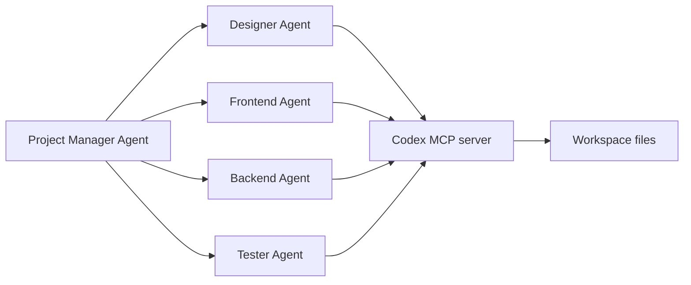

# Конфигурация и расширяемость Codex

Source status: `official`
Источники: [Agent approvals and security](https://developers.openai.com/codex/agent-approvals-security), [Create a skill](https://developers.openai.com/codex/skills/create-skill), [Subagents](https://developers.openai.com/codex/subagents), [Agents SDK with Codex](https://developers.openai.com/codex/guides/agents-sdk).

## Approval policy как управляемый интерфейс

Для продвинутой работы approval policy лучше описывать не как один общий переключатель, а как набор отдельных gates:

```toml
approval_policy = { granular = {
  sandbox_approval = true,
  rules = true,
  mcp_elicitations = true,
  request_permissions = false,
  skill_approval = false
} }
```

Практический смысл:

| Gate | Что контролирует | Рекомендация |
| --- | --- | --- |
| `sandbox_approval` | Выход команды за sandbox boundary | Включать для локальных проектов |
| `rules` | Подтверждение rule-based действий | Включать при сложной политике доступа |
| `mcp_elicitations` | Запросы подтверждений от MCP tools | Включать для внешних систем |
| `request_permissions` | Запросы расширенных permissions | Отключать по умолчанию, включать осознанно |
| `skill_approval` | Разрешение на skill invocation | Включать, если skills имеют side effects |

Baseline для анализа и review:

```toml
approval_policy = "untrusted"
sandbox_mode = "read-only"
allow_login_shell = false
```

Baseline для controlled implementation:

```toml
approval_policy = "on-request"
sandbox_mode = "workspace-write"
allow_login_shell = false
```

## Skill metadata

Официальная структура skill может включать `agents/openai.yaml`, чтобы описать UI, invocation policy и tool dependencies:

```yaml
interface:
  display_name: "Source Card Writer"
  short_description: "Turns an official documentation page into a source card."
  icon_small: "./assets/source-card.svg"
  brand_color: "#0F766E"
  default_prompt: "Create a source card for this documentation URL."

policy:
  allow_implicit_invocation: false

dependencies:
  tools:
    - type: "mcp"
      value: "openaiDeveloperDocs"
      description: "OpenAI Docs MCP server"
      transport: "streamable_http"
      url: "https://developers.openai.com/mcp"
```

Для этого проекта `allow_implicit_invocation: false` предпочтителен: сбор источников и перенос claims должны происходить явно, чтобы не смешивать official и community layers.

## Codex MCP как backend для агентной системы

Context7 показал официальный пример, где Agents SDK запускает multi-agent workflow и подключает Codex CLI как MCP server. Архитектурно это важный мост:



Для нашей базы знаний это означает:

- Codex можно использовать не только как standalone assistant, но и как execution tool внутри более широкой Agents SDK orchestration.
- Project Manager должен задавать source of truth documents: `REQUIREMENTS.md`, `AGENT_TASKS.md`, `TEST.md`.
- Каждый worker-agent должен иметь narrow deliverables и sandbox/approval policy.
- Handoff обратно к Project Manager обязателен, чтобы финальная сборка решений не распалась на независимые результаты.

