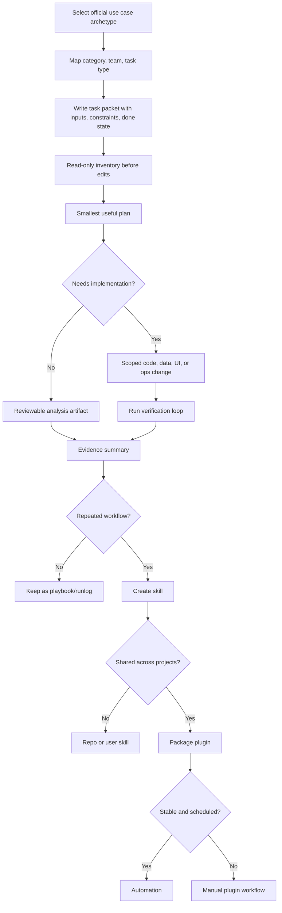

# Deep analysis of Codex use cases

Source status: `official + tool-assisted`  
Sources: [Codex use cases](https://developers.openai.com/codex/use-cases), [Codex workflows](https://developers.openai.com/codex/workflows), [Agent skills](https://developers.openai.com/codex/skills), [Codex plugins](https://developers.openai.com/codex/plugins), [Build plugins](https://developers.openai.com/codex/plugins/build), [AGENTS.md](https://developers.openai.com/codex/guides/agents-md).

Analysis date: **2026-05-14**.

## Why this layer is needed

The official Codex use cases section is useful not only as a list of examples. It can be read as a catalog of product workflows from which real agent teams, skills and plugins are assembled. Each use case card usually contains:

- a concrete outcome;
- difficulty and time horizon;
- who the workflow fits;
- recommended skills/plugins;
- starter prompt;
- constraints before changes;
- expected output;
- verification loop;
- related use cases.

For our project, this means a use case should be turned not into a note, but into an operational template. If the template repeats at least several times, it becomes a skill. If the skill is needed by several projects or teams, or requires a bundle of skills, MCP, app integrations and settings, it becomes a plugin.

## Taxonomy of the official catalog

The filters on the use cases page define the baseline ontology for plugin design.

| Layer | Official values | How to use in documentation |
| --- | --- | --- |
| Category | Engineering, Evaluation, Front-end, Quality | Defines the main result type: code, eval, UI, QA. |
| Native | iOS, Mobile, macOS | Indicates platform runtimes and checks: simulator, XcodeBuildMCP, SwiftUI, Expo, macOS logs. |
| Workflows | Automation, Data, Integrations, Knowledge Work | Shows that Codex works not only with code, but also with sources, tables, messages, documents and operations. |
| Team | Design, Engineering, Finance, Operations, Product, QA | Helps design agent roles and tone/output for different users. |
| Task type | Analysis, Code, Design, Testing, Workflow | Helps choose the mode: read-only analysis, code change, design implementation, test/eval loop, repeatable workflow. |

Main conclusion: a plugin must declare not only "what it can do", but also which category, team, task type, runtime and verification loop it is intended for.

## Collections as product areas

| Collection | Meaning | What to add to our docs |
| --- | --- | --- |
| Production systems | Controlled changes, production quality, repeatable work. | More attention to review gates, evals, PR evidence, rollback, scoped diffs. |
| Productivity and collaboration | Data, source material, apps, services, action from insights. | Templates for connector work: read-only first, staged drafts, no source-of-truth writes without approval. |
| Web development | Design inputs, responsive UI, frontend reviews. | Visual QA loop: screenshots, Playwright, responsive viewports, existing design system. |
| Native development | iOS/macOS build, refactor, app actions, validation loop. | CLI-first native loops, simulator evidence, `Logger`/`OSLog`, platform-specific plugins. |
| Game development | First playable loop to production quality. | Long-running `/goal`, `PLAN.md`, visual assets, `.logs`, Playwright gameplay checks. |

## Anatomy of a plugin-ready use case

Every official use case can be decomposed into the same fields. This is the minimal structure of a future plugin blueprint.

| Field | What to extract | Where we store it |
| --- | --- | --- |
| Outcome | What the user gets at the end. | `docs/playbooks/*` and `docs/artifact-templates/plugin-blueprint.md`. |
| User/team | Who launches the workflow. | `docs/product-agent/roles.md`. |
| Inputs | Repo, screenshots, Figma node, Slack thread, CSV, logs, issue, PR, docs. | Prompt packet and skill inputs. |
| Read-only phase | What Codex must inventory first. | Workflow steps and safety rules. |
| Plan | The smallest useful plan before edits. | `PLAN.md` or playbook section. |
| Skills/plugins | Which capabilities are needed: Playwright, Figma, GitHub, Slack, Sentry, Spreadsheet, OpenAI Docs. | Skill dependency list and plugin manifest notes. |
| Runtime | App, CLI, Cloud, GitHub, Slack, Computer Use, MCP, automation. | `docs/runtime/overview.md`. |
| Verification | Build, tests, evals, screenshots, simulator logs, LLM-as-judge, manual review. | `TEST.md`, `EVALS.md`, `RUNLOG.md`. |
| Promotion path | Manual thread -> playbook -> skill -> plugin -> automation. | `docs/playbooks/use-case-to-plugin.md`. |

## General workflow from use cases

## Repeated concepts

### Inspect before edit

In many starter prompts, Codex must first read the project, sources or current state. This repeats in evals, API migrations, data analysis, Figma-to-code, iOS simulator debugging, bug triage and deploy workflows.

Document as a rule: any plugin that writes files or changes an external system must have a read-only phase.

### Smallest useful slice

Use cases rarely suggest "redo everything". They constrain the work to one behavior, one UI adjustment, one feature slice, one eval target or one migration checkpoint.

Document as a rule: a skill must have one job. A large plugin can contain several skills, but each skill remains narrow.

### Evidence over assertion

Official use cases constantly require proof: eval command, Playwright check, simulator screenshot, `log stream`, build output, PR review comment, staged rows, deployment URL, source inventory.

Document as a rule: the agent's final answer must include changed files, checks run, evidence, unresolved risk and next action.

### App path over raw model path

In AI app evals, an important idea is to test the path the user takes whenever possible, not only the raw prompt. This transfers to product agents: test the real endpoint, UI flow, CLI command, simulator path or connector read, not an isolated model guess.

### Staged drafts before external writes

Operational workflows such as onboarding, bug triage, inbox, Slack actions and verified operations separate draft/stage from actual write. The agent first prepares a reviewable artifact and explicitly forbids sending messages, creating tickets, changing sharing, inviting people or editing source-of-truth without approval.

Document as a rule: all plugins with external systems must have `write_policy`: `read_only`, `draft_only`, `approved_write`.

### Runtime follows the task

Use cases show surface selection:

- GitHub review for PR review;
- Slack integration for async kickoff;
- CLI for local loops and `/goal`;
- App/Computer Use for actions through GUI;
- MCP/plugins for access to specialized tools;
- automations only after manual workflow stabilization.

Document as a rule: a plugin blueprint must record supported surfaces and forbidden surfaces.

### Skills preserve working behavior

The Save workflows as skills page shows the right packaging moment: there is a working thread, review rules, test commands, release checklist, writing examples or repo scripts. A skill should not be born from an abstract idea without a successful example.

Document as a rule: a skill candidate requires a working example, source material, commands/scripts, good output and a failure log.

### `/goal` for long-running work

Follow a goal adds a separate contract: the objective must be durable, the stopping condition must be verifiable, progress must move through checkpoints, and status must stay compact. This fits migrations, large refactors, prototypes, games, prompt optimization and eval loops.

Document as a rule: a long-running plugin workflow must have an explicit stop condition, checkpoint cadence, max-risk boundary and pause conditions.

## Use case map to reusable assets

| Group | Official use cases | Reusable asset for our plugin |
| --- | --- | --- |
| AI quality | Add evals to your AI application, Iterate on difficult problems, Upgrade your API integration | `eval-suite-writer`, `eval-loop-runner`, `api-migration-auditor`. |
| PR and production review | Codex code review for GitHub pull requests, Refactor your codebase, Run code migrations, Keep documentation up-to-date | `pr-risk-reviewer`, `migration-checkpointer`, `docs-drift-finder`. |
| Front-end and design | Build responsive front-end designs, Turn Figma designs into code, Make granular UI changes, Get from idea to proof of concept, Deploy an app or website | `ui-visual-reviewer`, `figma-to-code-planner`, `preview-deployer`. |
| Native/mobile | Build for iOS, Build for macOS, Add iOS app intents, Adopt liquid glass, Debug in iOS simulator, Add Mac telemetry, Refactor SwiftUI screens, Build React Native apps with Expo | `native-build-loop`, `simulator-debugger`, `swiftui-refactorer`, `telemetry-verifier`. |
| Tooling | Create a CLI Codex can use, Save workflows as skills, Bring your app to ChatGPT | `agent-cli-designer`, `skill-packager`, `chatgpt-app-planner`. |
| Data and finance | Analyze datasets and ship reports, Clean and prepare messy data, Query tabular data, Forecast cash flow, Model a DCF valuation, Review budget vs. actuals | `data-inventory-analyst`, `spreadsheet-model-reviewer`, `finance-workbook-checker`. |
| Operations and collaboration | Automate bug triage, Run verified operations, Kick off coding tasks from Slack, Complete tasks from messages, Manage your inbox, Prioritize Slack action items, Coordinate new-hire onboarding, Set up a teammate | `bug-triage-sweeper`, `verified-ops-runner`, `inbox-action-drafter`, `teammate-monitor`. |
| Knowledge and product | Draft PRDs from internal context, Learn a new concept, Turn feedback into actions, Turn user stories into UI mocks, Understand large codebases | `prd-synthesizer`, `learning-report-writer`, `feedback-action-synthesizer`, `codebase-cartographer`. |
| Long-running creation | Follow a goal, Create browser-based games | `goal-runner`, `prototype-builder`, `game-plan-builder`. |

## Detailed pattern matrix

| Use case | Main idea | Artifact | Verification |
| --- | --- | --- | --- |
| Add evals to your AI application | Turn expected AI app behavior into a runnable eval suite before changing prompt/model/retrieval/agent. | Eval config, seed cases, target adapter, eval command. | Baseline run, passing/failing cases, next evals. |
| Codex code review for GitHub pull requests | Add review signal before human merge approval. | PR comment, findings, AGENTS.md review rules. | GitHub review thread, severity, affected files. |
| Create a CLI Codex can use | Make a composable command for API/log/export/script and a companion skill. | CLI, command surface, auth/setup checks, skill. | CLI runs from another folder, JSON output, draft-before-write behavior. |
| Save workflows as skills | Save a working Codex thread or runbook as a reusable skill. | `SKILL.md`, references, scripts, assets. | Trigger tests, real task run, failure log update. |
| Build responsive front-end designs | Turn screenshots/design brief into responsive UI using the design system. | Route/components/styles. | Playwright visual check on desktop and mobile. |
| Turn Figma designs into code | Use structured Figma context, assets and variants. | UI implementation aligned to repo patterns. | Figma screenshot comparison through Playwright. |
| Make granular UI changes | One small UI adjustment at a time. | Minimal UI patch. | Browser inspection, file summary, stop after one change. |
| Deploy an app or website | Build/update web app and deploy preview. | Working preview URL. | Local build and deployment readiness check. |
| Bring your app to ChatGPT | Plan one narrow ChatGPT app outcome. | MCP server plan, tool metadata, optional widget, golden prompts. | Local HTTPS test and ChatGPT developer-mode verification. |
| Build for iOS | CLI-first SwiftUI scaffold/build/debug loop. | App scaffold or feature slice, build-and-launch script. | `xcodebuild`/simulator validation. |
| Debug in iOS simulator | Reproduce, inspect UI, logs, screenshots, stack traces, patch, rerun. | Repro steps, fix, evidence. | Same simulator flow proves bug is gone. |
| Build for macOS | Desktop-native SwiftUI shell with explicit scene model. | App shell, build/run script, desktop follow-ups. | `xcodebuild`, `swift build`, logs, signing checks when needed. |
| Add Mac telemetry | Add `Logger`/`OSLog` instrumentation to prove runtime actions. | Structured log events. | Console or `log stream` evidence. |
| Automate bug triage | Sweep alerts/issues/logs/chat and rank bugs. | P0-P3 list with evidence and next action. | Inaccessible sources named; no external writes. |
| Run verified operations | Normalize inputs, run approved scripts/APIs, retry bounded failures, audit result. | Operation log and result artifact. | Explicit approvals, bounded retries, audit trail. |
| Coordinate new-hire onboarding | Stage tracker, summaries, welcome-space plan from approved sources. | Reviewable onboarding packet. | No identity-bearing actions until approved. |
| Use your computer with Codex | GUI handoff across Mac apps when no plugin exists. | Completed local app action or draft. | Human approval for access; avoid parallel runs in same app. |
| Follow a goal | Durable objective across turns with verifiable stop condition. | Active goal, checkpoint log, final evidence. | `/goal` status, stop condition, pause/resume/clear. |
| Create browser-based games | PLAN.md-driven long build with assets and live browser iteration. | Game plan, implementation, assets, logs. | Build/test, Playwright gameplay checks, asset prompt log. |

## Plugin-readiness rubric

A use case can be turned into a plugin if these conditions hold:

| Criterion | Requirement |
| --- | --- |
| Repetition | The workflow repeats across several projects or teams. |
| Stable input contract | Required inputs and allowed formats are clear. |
| Stable output contract | The final artifact and evidence format are clear. |
| Capability bundle | Several skills, app integrations, MCP servers or scripts are needed. |
| Safety policy | There is a read/write policy, approval gates and forbidden actions. |
| Verification | There are deterministic checks, visual checks, evals or a manual review checklist. |
| Failure log | Common errors and correction methods are known. |
| Ownership | It is clear who maintains the plugin and updates sources. |

## What to add to our documentation

1. Use cases should become a separate navigation section inside Codex, not only a source registry link.
2. Each product-agent playbook should state its official use case archetype.
3. The skill template should require: trigger, inputs, outputs, source material, verification, failure log, write policy.
4. The plugin template should require: target teams, categories, task types, runtime surfaces, permissions, skills, MCP/connectors, evals, packaging, update loop.
5. AGENTS.md should explicitly say: repeated workflows are promoted along the chain manual thread -> playbook -> skill -> plugin -> automation.
6. For operations with external systems, staged draft policy must always be documented.
7. For long-running work, `/goal` or an equivalent run loop with a verifiable stop condition is needed.
8. UI/native/game workflows need visual/runtime verification, not only a code diff.

## Minimal extraction process

1. Select an official use case or group of use cases.
2. Write down outcome, inputs, skills/plugins, starter prompt, verification and risks.
3. Formulate one repeatable job.
4. Create a playbook with a manual workflow.
5. Run the workflow manually in one project and save the runlog.
6. Create a skill from the successful runlog.
7. Run the skill on two different fixture projects.
8. If the skill requires external integrations or is needed by several teams, create a plugin blueprint.
9. Add eval cases: should trigger, should not trigger, unsafe write, missing source, verification failure.
10. Only after a stable plugin workflow should automation be considered.

## Critical gaps after analysis

| Gap | Why it matters | What to do |
| --- | --- | --- |
| Plugin blueprint was missing | Without it, docs teach skills but do not explain packaging a reusable operating system. | Add `docs/artifact-templates/plugin-blueprint.md`. |
| Use case taxonomy was not reflected in docs | The connection "team/category/task type -> agent role -> artifact" was lost. | Add this page and link to it from playbooks. |
| External-write safety was scattered | Operational plugins are dangerous without staged drafts and approvals. | Introduce `write_policy` into the plugin template. |
| `/goal` was described narrowly | Long-running workflows require a durable objective and stop condition. | Connect `/goal` with migrations, prototypes, eval loops and games. |
| Visual/runtime evidence was not a general rule | UI/native/game workflows cannot be validated only by reading the diff. | Add evidence requirements to playbooks and the plugin template. |

