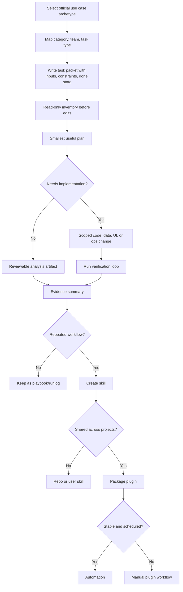

# Deep analysis of Codex use cases

Source status: `official + tool-assisted`  
Источники: [Codex use cases](https://developers.openai.com/codex/use-cases), [Codex workflows](https://developers.openai.com/codex/workflows), [Agent skills](https://developers.openai.com/codex/skills), [Codex plugins](https://developers.openai.com/codex/plugins), [Build plugins](https://developers.openai.com/codex/plugins/build), [AGENTS.md](https://developers.openai.com/codex/guides/agents-md).

Дата анализа: **2026-05-14**.

## Зачем нужен этот слой

Официальный раздел Codex use cases полезен не только как список примеров. Его можно читать как каталог продуктовых workflow, из которых собираются реальные agent teams, skills и plugins. Каждая карточка use case обычно содержит:

- конкретный outcome;
- difficulty и time horizon;
- кому подходит workflow;
- рекомендуемые skills/plugins;
- starter prompt;
- ограничения перед изменениями;
- ожидаемый output;
- verification loop;
- связанные use cases.

Для нашего проекта это означает: use case нужно превращать не в заметку, а в операционный шаблон. Если шаблон повторяется минимум несколько раз, он становится skill. Если skill нужен нескольким проектам, командам или требует bundle из skills, MCP, app integrations и настроек, он становится plugin.

## Таксономия официального каталога

Фильтры на странице use cases задают базовую онтологию для проектирования plugin.

| Слой | Официальные значения | Как использовать в документации |
| --- | --- | --- |
| Category | Engineering, Evaluation, Front-end, Quality | Определяет основной тип результата: код, eval, UI, QA. |
| Native | iOS, Mobile, macOS | Указывает платформенные runtime и проверки: simulator, XcodeBuildMCP, SwiftUI, Expo, macOS logs. |
| Workflows | Automation, Data, Integrations, Knowledge Work | Показывает, что Codex работает не только с кодом, но и с источниками, таблицами, сообщениями, документами и операциями. |
| Team | Design, Engineering, Finance, Operations, Product, QA | Помогает проектировать agent roles и tone/output для разных пользователей. |
| Task type | Analysis, Code, Design, Testing, Workflow | Помогает выбрать режим: read-only analysis, code change, design implementation, test/eval loop, repeatable workflow. |

Главный вывод: plugin должен объявлять не только "что он умеет", но и для какой категории, команды, task type, runtime и verification loop он предназначен.

## Коллекции как product areas

| Коллекция | Смысл | Что добавить в наши docs |
| --- | --- | --- |
| Production systems | Controlled changes, production quality, repeatable work. | Больше внимания к review gates, evals, PR evidence, rollback, scoped diffs. |
| Productivity and collaboration | Data, source material, apps, services, action from insights. | Шаблоны для connector work: read-only first, staged drafts, no source-of-truth writes without approval. |
| Web development | Design inputs, responsive UI, frontend reviews. | Visual QA loop: screenshots, Playwright, responsive viewports, existing design system. |
| Native development | iOS/macOS build, refactor, app actions, validation loop. | CLI-first native loops, simulator evidence, `Logger`/`OSLog`, platform-specific plugins. |
| Game development | First playable loop to production quality. | Long-running `/goal`, `PLAN.md`, visual assets, `.logs`, Playwright gameplay checks. |

## Anatomy of a plugin-ready use case

Каждый официальный use case можно разобрать на одинаковые поля. Это и есть минимальная структура будущего plugin blueprint.

| Поле | Что извлекать | Где хранить у нас |
| --- | --- | --- |
| Outcome | Что пользователь получает в конце. | `docs/playbooks/*` и `docs/artifact-templates/plugin-blueprint.md`. |
| User/team | Кто запускает workflow. | `docs/product-agent/roles.md`. |
| Inputs | Repo, screenshots, Figma node, Slack thread, CSV, logs, issue, PR, docs. | Prompt packet и skill inputs. |
| Read-only phase | Что Codex должен сначала инвентаризировать. | Workflow steps и safety rules. |
| Plan | Самый маленький полезный план до правок. | `PLAN.md` или playbook section. |
| Skills/plugins | Какие capability нужны: Playwright, Figma, GitHub, Slack, Sentry, Spreadsheet, OpenAI Docs. | Skill dependency list и plugin manifest notes. |
| Runtime | App, CLI, Cloud, GitHub, Slack, Computer Use, MCP, automation. | `docs/runtime/overview.md`. |
| Verification | Build, tests, evals, screenshots, simulator logs, LLM-as-judge, manual review. | `TEST.md`, `EVALS.md`, `RUNLOG.md`. |
| Promotion path | Manual thread -> playbook -> skill -> plugin -> automation. | `docs/playbooks/use-case-to-plugin.md`. |

## Общий workflow из use cases

## Повторяющиеся концепции

### Inspect before edit

Во многих starter prompts Codex сначала должен прочитать проект, источники или текущее состояние. Это повторяется в evals, API migrations, data analysis, Figma-to-code, iOS simulator debugging, bug triage и deploy workflows.

Документировать как правило: любой plugin, который пишет файлы или меняет внешнюю систему, обязан иметь read-only phase.

### Smallest useful slice

Use cases редко предлагают "переделай все". Они ограничивают работу одним behavior, одним UI adjustment, одной feature slice, одним eval target, одной migration checkpoint.

Документировать как правило: skill должен иметь один job. Большой plugin может содержать несколько skills, но каждый skill остается узким.

### Evidence over assertion

Официальные use cases постоянно требуют proof: eval command, Playwright check, simulator screenshot, `log stream`, build output, PR review comment, staged rows, deployment URL, source inventory.

Документировать как правило: финальный ответ агента должен включать changed files, checks run, evidence, unresolved risk, next action.

### App path over raw model path

В AI app evals важная идея: проверять путь, по которому ходит пользователь, когда это возможно, а не только raw prompt. Это переносится на продуктовые агенты: тестировать реальный endpoint, UI flow, CLI command, simulator path, connector read, а не изолированную догадку модели.

### Staged drafts before external writes

Операционные workflows вроде onboarding, bug triage, inbox, Slack actions и verified operations разделяют draft/stage и actual write. Агент сначала готовит reviewable artifact и явно запрещает отправлять сообщения, создавать тикеты, менять sharing, приглашать людей или редактировать source-of-truth без approval.

Документировать как правило: все plugins с внешними системами должны иметь `write_policy`: `read_only`, `draft_only`, `approved_write`.

### Runtime follows the task

Use cases показывают выбор surface:

- GitHub review для PR review;
- Slack integration для async kickoff;
- CLI для local loops и `/goal`;
- App/Computer Use для действий через GUI;
- MCP/plugins для доступа к специализированным tools;
- automations только после ручной стабилизации workflow.

Документировать как правило: plugin blueprint должен фиксировать supported surfaces и forbidden surfaces.

### Skills preserve working behavior

Страница Save workflows as skills показывает правильный момент упаковки: есть рабочий thread, review rules, test commands, release checklist, writing examples или repo scripts. Skill не должен рождаться из абстрактной идеи без удачного примера.

Документировать как правило: skill candidate требует working example, source material, commands/scripts, good output, failure log.

### `/goal` for long-running work

Follow a goal добавляет отдельный контракт: objective должен быть durable, stopping condition должен быть verifiable, прогресс должен идти checkpoints, а статус должен быть компактным. Это подходит для migrations, large refactors, prototypes, games, prompt optimization и eval loops.

Документировать как правило: long-running plugin workflow должен иметь explicit stop condition, checkpoint cadence, max-risk boundary и pause conditions.

## Карта use cases в reusable assets

| Группа | Официальные use cases | Reusable asset для нашего plugin |
| --- | --- | --- |
| AI quality | Add evals to your AI application, Iterate on difficult problems, Upgrade your API integration | `eval-suite-writer`, `eval-loop-runner`, `api-migration-auditor`. |
| PR and production review | Codex code review for GitHub pull requests, Refactor your codebase, Run code migrations, Keep documentation up-to-date | `pr-risk-reviewer`, `migration-checkpointer`, `docs-drift-finder`. |
| Front-end and design | Build responsive front-end designs, Turn Figma designs into code, Make granular UI changes, Get from idea to proof of concept, Deploy an app or website | `ui-visual-reviewer`, `figma-to-code-planner`, `preview-deployer`. |
| Native/mobile | Build for iOS, Build for macOS, Add iOS app intents, Adopt liquid glass, Debug in iOS simulator, Add Mac telemetry, Refactor SwiftUI screens, Build React Native apps with Expo | `native-build-loop`, `simulator-debugger`, `swiftui-refactorer`, `telemetry-verifier`. |
| Tooling | Create a CLI Codex can use, Save workflows as skills, Bring your app to ChatGPT | `agent-cli-designer`, `skill-packager`, `chatgpt-app-planner`. |
| Data and finance | Analyze datasets and ship reports, Clean and prepare messy data, Query tabular data, Forecast cash flow, Model a DCF valuation, Review budget vs. actuals | `data-inventory-analyst`, `spreadsheet-model-reviewer`, `finance-workbook-checker`. |
| Operations and collaboration | Automate bug triage, Run verified operations, Kick off coding tasks from Slack, Complete tasks from messages, Manage your inbox, Prioritize Slack action items, Coordinate new-hire onboarding, Set up a teammate | `bug-triage-sweeper`, `verified-ops-runner`, `inbox-action-drafter`, `teammate-monitor`. |
| Knowledge and product | Draft PRDs from internal context, Learn a new concept, Turn feedback into actions, Turn user stories into UI mocks, Understand large codebases | `prd-synthesizer`, `learning-report-writer`, `feedback-action-synthesizer`, `codebase-cartographer`. |
| Long-running creation | Follow a goal, Create browser-based games | `goal-runner`, `prototype-builder`, `game-plan-builder`. |

## Детальная матрица паттернов

| Use case | Главная идея | Artifact | Проверка |
| --- | --- | --- | --- |
| Add evals to your AI application | Превратить ожидаемое поведение AI app в runnable eval suite до изменения prompt/model/retrieval/agent. | Eval config, seed cases, target adapter, eval command. | Baseline run, passing/failing cases, next evals. |
| Codex code review for GitHub pull requests | Добавить review signal до human merge approval. | PR comment, findings, AGENTS.md review rules. | GitHub review thread, severity, affected files. |
| Create a CLI Codex can use | Сделать composable command для API/log/export/script и companion skill. | CLI, command surface, auth/setup checks, skill. | CLI runs from another folder, JSON output, draft-before-write behavior. |
| Save workflows as skills | Сохранить working Codex thread или runbook как reusable skill. | `SKILL.md`, references, scripts, assets. | Trigger tests, real task run, failure log update. |
| Build responsive front-end designs | Перевести screenshots/design brief в responsive UI по design system. | Route/components/styles. | Playwright visual check on desktop and mobile. |
| Turn Figma designs into code | Использовать structured Figma context, assets and variants. | UI implementation aligned to repo patterns. | Figma screenshot comparison through Playwright. |
| Make granular UI changes | Один small UI adjustment за раз. | Minimal UI patch. | Browser inspection, file summary, stop after one change. |
| Deploy an app or website | Build/update web app and deploy preview. | Working preview URL. | Local build and deployment readiness check. |
| Bring your app to ChatGPT | Спланировать one narrow ChatGPT app outcome. | MCP server plan, tool metadata, optional widget, golden prompts. | Local HTTPS test and ChatGPT developer-mode verification. |
| Build for iOS | CLI-first SwiftUI scaffold/build/debug loop. | App scaffold or feature slice, build-and-launch script. | `xcodebuild`/simulator validation. |
| Debug in iOS simulator | Reproduce, inspect UI, logs, screenshots, stack traces, patch, rerun. | Repro steps, fix, evidence. | Same simulator flow proves bug is gone. |
| Build for macOS | Desktop-native SwiftUI shell with explicit scene model. | App shell, build/run script, desktop follow-ups. | `xcodebuild`, `swift build`, logs, signing checks when needed. |
| Add Mac telemetry | Add `Logger`/`OSLog` instrumentation to prove runtime actions. | Structured log events. | Console or `log stream` evidence. |
| Automate bug triage | Sweep alerts/issues/logs/chat and rank bugs. | P0-P3 list with evidence and next action. | Inaccessible sources named; no external writes. |
| Run verified operations | Normalize inputs, run approved scripts/APIs, retry bounded failures, audit result. | Operation log and result artifact. | Explicit approvals, bounded retries, audit trail. |
| Coordinate new-hire onboarding | Stage tracker, summaries, welcome-space plan from approved sources. | Reviewable onboarding packet. | No identity-bearing actions until approved. |
| Use your computer with Codex | GUI handoff across Mac apps when no plugin exists. | Completed local app action or draft. | Human approval for access; avoid parallel runs in same app. |
| Follow a goal | Durable objective across turns with verifiable stop condition. | Active goal, checkpoint log, final evidence. | `/goal` status, stop condition, pause/resume/clear. |
| Create browser-based games | PLAN.md-driven long build with assets and live browser iteration. | Game plan, implementation, assets, logs. | Build/test, Playwright gameplay checks, asset prompt log. |

## Plugin-readiness rubric

Use case можно превращать в plugin, если выполняются условия:

| Criterion | Требование |
| --- | --- |
| Repetition | Workflow повторяется в нескольких проектах или командах. |
| Stable input contract | Понятны required inputs и допустимые formats. |
| Stable output contract | Понятен финальный artifact и формат evidence. |
| Capability bundle | Нужны несколько skills, app integrations, MCP servers или scripts. |
| Safety policy | Есть read/write policy, approval gates и forbidden actions. |
| Verification | Есть deterministic checks, visual checks, evals или manual review checklist. |
| Failure log | Известны типовые ошибки и способы correction. |
| Ownership | Понятно, кто поддерживает plugin и обновляет sources. |

## Что добавить в нашу документацию

1. Use cases должны стать отдельным навигационным разделом внутри Codex, а не только ссылкой в реестре источников.
2. Каждый product-agent playbook должен указывать свой official use case archetype.
3. Skill template должен требовать: trigger, inputs, outputs, source material, verification, failure log, write policy.
4. Plugin template должен требовать: target teams, categories, task types, runtime surfaces, permissions, skills, MCP/connectors, evals, packaging, update loop.
5. AGENTS.md должен явно говорить: повторяемые workflow продвигаются по цепочке manual thread -> playbook -> skill -> plugin -> automation.
6. Для операций с внешними системами нужно всегда документировать staged draft policy.
7. Для long-running work нужен `/goal` или эквивалентный run loop с verifiable stop condition.
8. Для UI/native/game workflows нужна visual/runtime verification, а не только code diff.

## Минимальный extraction process

1. Выберите официальный use case или группу use cases.
2. Выпишите outcome, inputs, skills/plugins, starter prompt, verification, risks.
3. Сформулируйте один repeatable job.
4. Создайте playbook с manual workflow.
5. Проведите workflow вручную в одном проекте и сохраните runlog.
6. На основе успешного runlog создайте skill.
7. Прогоните skill на двух разных fixture projects.
8. Если skill требует внешних integrations или нужен нескольким командам, оформите plugin blueprint.
9. Добавьте eval cases: should trigger, should not trigger, unsafe write, missing source, verification failure.
10. Только после стабильного plugin workflow рассматривайте automation.

## Critical gaps после анализа

| Gap | Почему важно | Что делать |
| --- | --- | --- |
| Plugin blueprint отсутствовал | Без него docs учат skills, но не объясняют packaging reusable operating system. | Добавить `docs/artifact-templates/plugin-blueprint.md`. |
| Use case taxonomy не была отражена в docs | Терялась связь "team/category/task type -> agent role -> artifact". | Добавить эту страницу и ссылать на нее из playbooks. |
| External-write safety была рассеяна | Операционные plugins опасны без staged drafts и approvals. | Ввести `write_policy` в plugin template. |
| `/goal` был описан узко | Long-running workflows требуют durable objective и stop condition. | Связать `/goal` с migrations, prototypes, eval loops, games. |
| Visual/runtime evidence не было общим правилом | UI/native/game workflows нельзя валидировать только чтением diff. | Добавить evidence requirements в playbooks и plugin template. |

