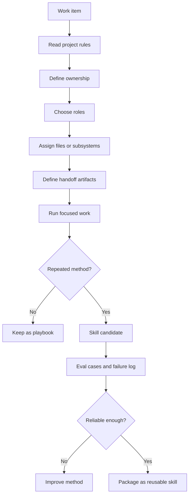

# Agent team and skills

Source status: `official + experiment`

This page shows how to design an agent team around ownership, handoffs, model/reasoning policy, skills and stop conditions.

## Inputs

- Implementation plan, source context, ownership boundaries and approval limits.
- Available skills, subagents and verification gates.

## Outputs

- Role cards with owned files, model policy, handoff schema and stop conditions.
- A safe route for skill promotion when a method repeats.

## Verification

Each handoff must include sources used, assumptions, files touched or proposed, verification evidence, open risks and recommended next role.

## Risks

- Parallel workers without disjoint ownership can overwrite each other.
- A skill created before manual success can encode a brittle method.
