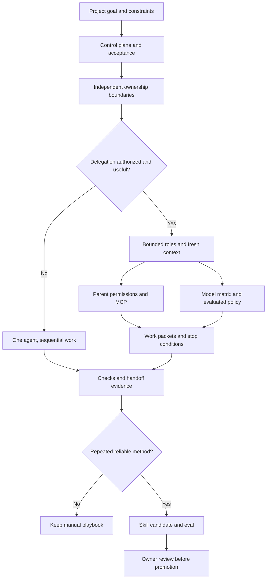

# Agent team and skills for a project

Source status: `official + experiment`

Checked 2026-11-03: [Subagents](https://learn.chatgpt.com/docs/agent-configuration/subagents), [Models](https://learn.chatgpt.com/docs/models).

## How to apply

1. Classify project type, current state and risk; identify requirements, plan, tests/evals and runlog owners.
2. Split by independent files/subsystems. Prefer one agent when shared writes or sequential dependencies erase the benefit of delegation.
3. Give each role inputs, owned and forbidden files, output artifact, checks, stop conditions, budget and handoff destination.
4. Choose model/effort using the [single model matrix](../codex/models-and-reasoning.md) and [role policy](../product-agent/roles.md). Current active profiles are pinned to GPT-6.1 Sol/Terra; behavioral promotion remains a separate gate. This guide does not change pins. Use the [migration playbook](../playbooks/model-migration.md) before promotion.
5. Return sources, assumptions, touched/proposed files, observed checks, residual risks and the next role. The primary agent reconciles conflicting findings.
6. Promote manual workflow -> playbook -> skill -> plugin -> automation candidate only after representative evals, failure records, owner review and rollback design. Scheduling is a separate authorized action.

## Delegation and execution profile

Local Codex can delegate on an explicit user request or applicable AGENTS/skill instructions. ChatGPT Work Ultra is a different proactive route. Apply the stricter project policy where required; tool availability is not authorization.

Role cards define ownership, model policy, baseline effort, escalation/downgrade triggers and latency/cost limits. Higher effort requires task need or measured benefit, not a maximum-for-every-role default. Model IDs, client/auth applicability and allowed efforts belong in the shared matrix rather than duplicate tables here.

Custom agents inherit parent permissions, approvals, provider and MCP. Read-only role text does not create separate sandbox enforcement. Resolve model/effort using the current custom-agent schema; inspect the effective settings instead of assuming every unspecified value always inherits unchanged.

## Agent versus skill

| Need | Artifact |
| --- | --- |
| One bounded exploration | Agent/subagent when authorized |
| Repeatable method | Skill with one job, inputs, outputs and verification |
| Stable recurring work | Automation candidate; no schedule without authority |
| Durable project rule | Applicable AGENTS guidance |
| Current task evidence | RUNLOG and owning plan |

Before packaging a skill, define triggers and non-triggers, representative eval cases, failure log, deterministic script needs and owner. Load references only when relevant. Memory cannot replace current source reads or applicable instructions.

## Verification and Risks

Verify disjoint ownership, inherited controls, model applicability and complete handoff evidence. Missing runtime isolation, MCP availability or model-quality evidence remains explicit. Avoid overlapping writes, unbounded fan-out, automatic model escalation and premature automation. This diagram describes a design process; it activates no team, model or skill.

## Inputs

Current goal, applicable instructions, source context, ownership boundaries and required evidence.

## Outputs

A bounded work packet, source-backed result and explicit handoff with unresolved risks.

## Risks

Overlapping writes, stale context and treating a proposed capability as activated behavior.
