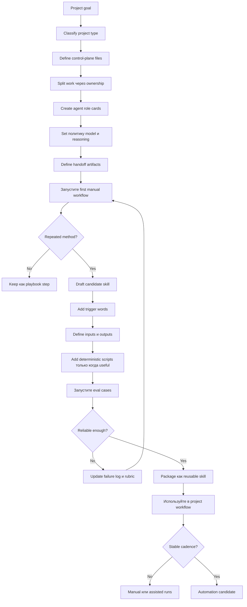

# Команда агентов и skills под проект

Source status: `official + experiment`

Эта страница является практической инструкцией по созданию агентной команды и skills под конкретный проект. Главная идея: агентная система проектируется не вокруг красивых ролей, а вокруг ownership, handoff artifacts, проверок и повторяемых методов.

Официальные источники: [Codex models](https://developers.openai.com/codex/models), [Subagents](https://developers.openai.com/codex/subagents), [Codex best practices](https://developers.openai.com/codex/learn/best-practices), [Agents SDK models and providers](https://developers.openai.com/api/docs/guides/agents/models), [Reasoning best practices](https://developers.openai.com/api/docs/guides/reasoning-best-practices), [Codex use cases](https://developers.openai.com/codex/use-cases).

## Диаграмма



## Инструкция по созданию команды

### 1. Определите тип проекта

Выберите один основной тип. Если типов несколько, разделите проект на этапы.

| Тип проекта | Базовая команда |
| --- | --- |
| Продуктовая функция | Product Manager, Architect, Builder, Tester, Reviewer |
| Research/docs | Researcher, Source Reviewer, Synthesizer, Verifier, Docs Maintainer |
| Refactor | Architect, Builder, Regression Tester, Reviewer |
| UI/product surface | Product Manager, UI Builder, Visual QA, Accessibility Reviewer |
| Release/maintenance | Release Operator, CI Reviewer, Docs Maintainer |

### 2. Создайте control-plane files

Минимальный набор для проекта:

- `AGENTS.md` — постоянные правила проекта, стиль работы, запреты, команды проверки.
- `REQUIREMENTS.md` — цель, аудитория, scope, out-of-scope, acceptance criteria.
- `PLAN.md` — исполнимые шаги, ownership, файлы, проверки.
- `TEST.md` — deterministic checks: unit, integration, build, lint, link checks.
- `EVALS.md` — quality checks: rubric, examples, LLM-as-judge, visual QA.
- `RUNLOG.md` — решения, failures, retries, score history, links к artifacts.

### 3. Проектируйте роли через ownership

Хорошая role card содержит:

```yaml
role: "Reviewer"
owns: "Correctness, regressions, unsupported claims"
inputs: "PLAN.md, diff, TEST.md, EVALS.md"
outputs: "Findings с severity, required fixes, residual risk"
may_edit: false
model_policy:
  model: "project-default | gpt-5.5 | gpt-5.4 | gpt-5.4-mini"
  reasoning_effort: "low | medium | high | xhigh"
  use_when:
    - "Cross-file review"
    - "Regression risk"
    - "Ambiguous behavior"
  downgrade_when:
    - "Mechanical formatting"
    - "Single-file low-risk edit"
  escalate_when:
    - "Security, data loss, migration, architecture, eval failure"
  cost_latency_budget: "fast | balanced | quality-first"
handoff_to: "Builder или Release Operator"
stop_conditions:
  - "Missing source для factual claim"
  - "Tests не может быть run"
  - "Scope changed"
```

Не создавайте роли вроде “умный помощник” или “универсальный агент”. Они не дают модели четких границ и плохо проверяются.

### 4. Задайте политику model и reasoning

Модель и уровень reasoning должны быть частью role card, а не устной договоренностью. Официальная документация Codex указывает, что для большинства задач в Codex стоит начинать с `gpt-5.5`, а `gpt-5.4-mini` использовать для более быстрых и дешевых легких задач или subagents. Для Codex CLI/IDE модель задается в `config.toml`, временно меняется через `/model` или `--model`, а для Codex cloud tasks текущую default model изменить нельзя.

Agents SDK рекомендует в production выбирать модель явно: на уровне agent, run-level default или process fallback через `OPENAI_DEFAULT_MODEL`. В Codex custom agents официальный schema поддерживает `model` и `model_reasoning_effort`; если они не указаны, значения наследуются от parent session.

| Роль | Политика модели по умолчанию | Reasoning | Почему |
| --- | --- | --- | --- |
| Product Manager | `gpt-5.5` или настройка проекта по умолчанию | `medium` / `high` | Требуются компромиссы, scope и acceptance criteria |
| Architect | `gpt-5.5` | `high` / `xhigh` | Архитектура, decomposition, multi-step planning |
| Builder | настройка проекта по умолчанию; `gpt-5.4-mini` для малых правок | `medium` / `high` | Баланс скорости и качества реализации |
| Explorer / Researcher | `gpt-5.4-mini` или настройка проекта по умолчанию | `low` / `medium` | Поиск с большим объёмом чтения и сбор фактов |
| Reviewer | `gpt-5.5` | `high` | Review, debugging и multi-file risk analysis выигрывают от более глубокого reasoning |
| Tester / Eval Judge | `gpt-5.5` для judge, default для deterministic checks | `medium` / `high` | Evals проверяют поведение, grounding и регрессии |
| Docs Maintainer | настройка проекта по умолчанию | `low` / `medium` | Обычно важнее источники и структуру, чем максимальный reasoning |
| Release Operator | настройка проекта по умолчанию | `medium` | Нужны аккуратность, approvals и аудиторский след |

Не ставьте всем агентам максимальную модель и `xhigh` по умолчанию. Официальные best practices рекомендуют выбирать reasoning level по сложности задачи: `low` для быстрых scoped tasks, `medium`/`high` для сложных изменений и debugging, `xhigh` для долгих agentic reasoning-heavy задач.

Правило escalation:

```yaml
escalate_reasoning_if:
  - "task spans multiple systems или files"
  - "requirements являются ambiguous"
  - "security, privacy, data loss, или irreversible action является possible"
  - "eval score regressed или failure является hard к localize"
  - "agent должен choose strategy, не just execute"
downgrade_reasoning_if:
  - "task является read-only collection"
  - "output является mechanical или template-based"
  - "deterministic tool decides correctness"
  - "latency или cost является main constraint"
```

### 5. Отделите agent от skill

| Если нужно | Используйте |
| --- | --- |
| Разово исследовать область | Agent / subagent |
| Выполнить повторяемый метод | Skill |
| Запустить стабильный workflow по расписанию | Automation |
| Сохранить правило для всех будущих задач | `AGENTS.md` |
| Сохранить состояние текущего проекта | `RUNLOG.md` |

### 6. Превращайте workflow в skill только после проверки

Skill готов к упаковке, если:

- у него одна работа;
- есть trigger words;
- известны входы и выходы;
- есть 3-5 eval cases;
- есть failure log;
- понятно, когда skill не применять;
- scripts используются только для deterministic behavior.

## Минимальный проектный шаблон

```text
project/
  AGENTS.md
  docs/
    REQUIREMENTS.md
    PLAN.md
    TEST.md
    EVALS.md
    RUNLOG.md
  .codex-or-agent-skills/
    product-spec-writer/
    implementation-planner/
    test-gap-finder/
    release-note-writer/
```

## Главные нюансы

- Сначала делайте playbook, потом skill, потом automation.
- Один агент должен владеть понятным участком работы, а не всем проектом.
- Каждый handoff должен быть файлом, diff, checklist или structured output.
- Memory не заменяет `AGENTS.md`: память может устареть, а правила проекта должны быть явными.
- Parallel agents полезны только при раздельном ownership; write-heavy задачи требуют координации.
- Качество команды измеряется не количеством агентов, а сокращением повторных объяснений и числом пойманных ошибок.
