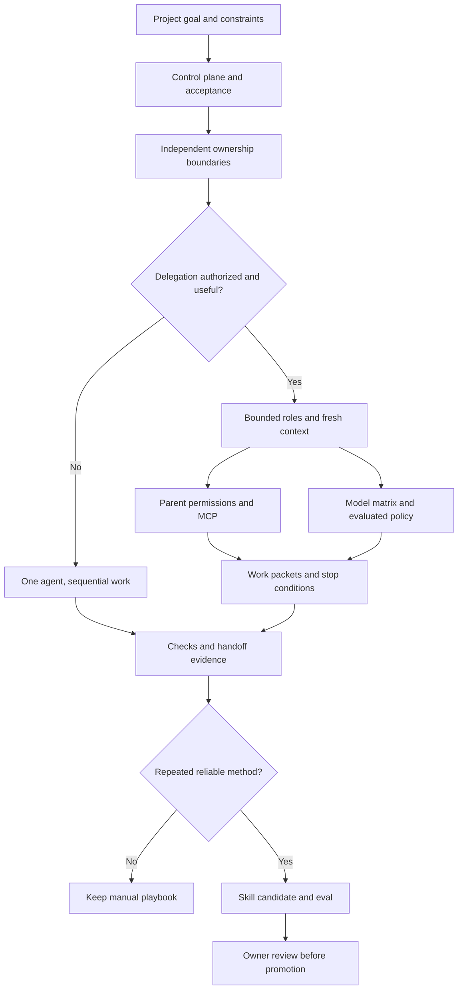

# Команда агентов и skills под проект

Source status: `official + experiment`

Проверено 2026-11-03: [Subagents](https://learn.chatgpt.com/docs/agent-configuration/subagents), [Models](https://learn.chatgpt.com/docs/models).

## Как применять

1. Определите тип проекта, состояние и риск; назначьте владельцев requirements, plan, tests/evals и runlog.
2. Разделите независимые файлы/подсистемы. Если общие записи и последовательные зависимости убирают пользу делегации, используйте одного агента.
3. Каждой роли задайте входы, разрешенные и запрещенные файлы, выходной artifact, проверки, stop conditions, бюджет и адресата handoff.
4. Выбирайте model/effort по [единой матрице](../codex/models-and-reasoning.md) и [политике ролей](../product-agent/roles.md). Текущие active profiles закреплены на GPT-6.1 Sol/Terra; behavioral promotion остаётся отдельной проверкой. Этот guide не меняет pins. До promotion используйте [playbook миграции](../playbooks/model-migration.md).
5. Возвращайте sources, assumptions, измененные/предложенные файлы, наблюдаемые проверки, остаточные риски и следующую роль. Основной агент согласует противоречащие выводы.
6. Продвигайте manual workflow -> playbook -> skill -> plugin -> automation candidate после репрезентативных evals, учета failures, owner review и rollback. Создание расписания — отдельное разрешенное действие.

## Делегация и execution profile

Local Codex может делегировать по явному запросу пользователя или применимым инструкциям AGENTS/skill. ChatGPT Work Ultra — отдельный проактивный маршрут. Применяйте более строгую политику проекта, когда она требуется; наличие tools не является разрешением.

Role cards задают ownership, model policy, baseline effort, escalation/downgrade и пределы latency/cost. Повышение effort требует сложности задачи или измеренной пользы, а не максимального default для всех. Model ID, client/auth applicability и допустимые effort принадлежат единой матрице, а не дублирующим таблицам.

Custom agents наследуют permissions, approvals, provider и MCP родителя. Read-only текст роли не создает отдельного sandbox enforcement. Разрешайте model/effort по текущей custom-agent schema; проверяйте effective settings, не предполагая неизменное наследование любого неуказанного значения.

## Agent и skill

| Потребность | Artifact |
| --- | --- |
| Разовое ограниченное исследование | Agent/subagent при наличии разрешения |
| Повторяемый метод | Skill с одной задачей, входами, выходами и проверкой |
| Стабильная регулярная работа | Automation candidate; расписание требует разрешения |
| Постоянное правило проекта | Применимые AGENTS instructions |
| Доказательства текущей задачи | RUNLOG и owning plan |

До упаковки skill определите triggers/non-triggers, репрезентативные eval cases, failure log, необходимость deterministic scripts и владельца. References загружайте по необходимости. Memory не заменяет актуальные source reads и применимые инструкции.

## Проверки и типичные ошибки

Проверьте независимость ownership, наследуемые controls, применимость модели и полноту handoff evidence. Отсутствие доказательств runtime isolation, MCP availability или качества модели остается явным. Избегайте пересечения записей, неограниченного fan-out, автоматического escalation модели и преждевременной автоматизации. Диаграмма описывает проектирование; она не активирует команду, модель или skill.

## Входы и выходы

Входы: текущая цель, применимые инструкции, источники, ownership и требуемые доказательства. Выходы: ограниченный пакет работы, обоснованный результат и handoff с открытыми рисками. Проверяйте применимость, полномочия и наблюдаемые evidence. Основные риски: пересечение записей, устаревший контекст и выдача предложения за активированное поведение.
