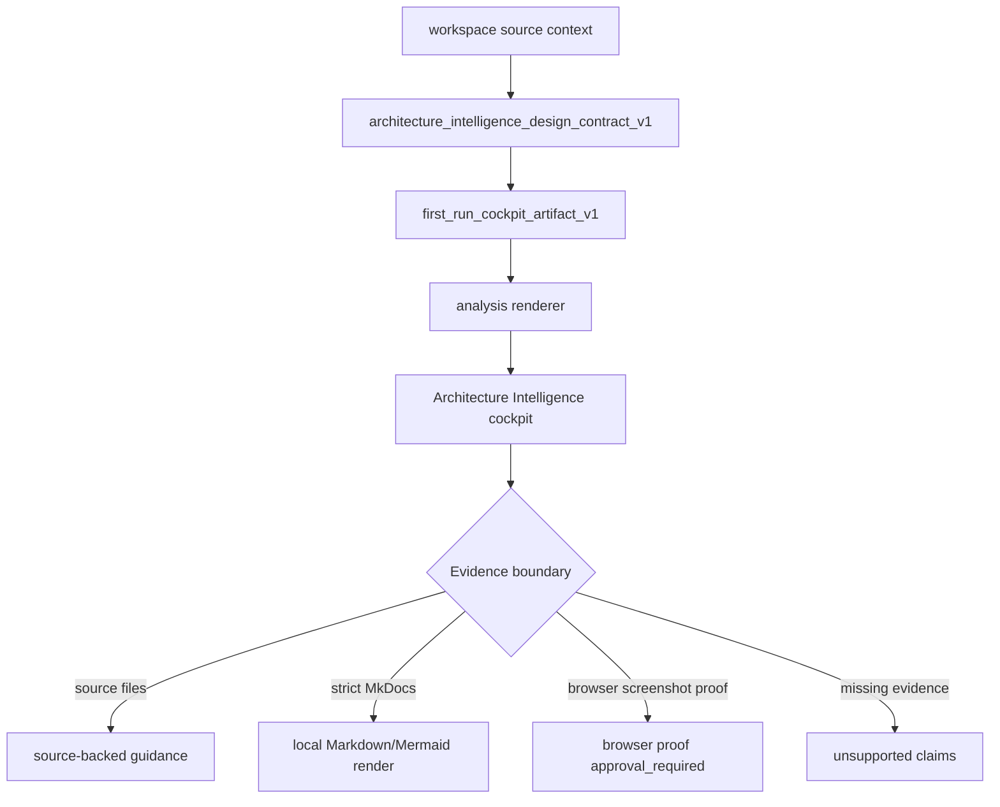
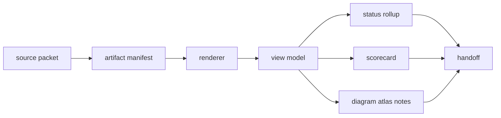
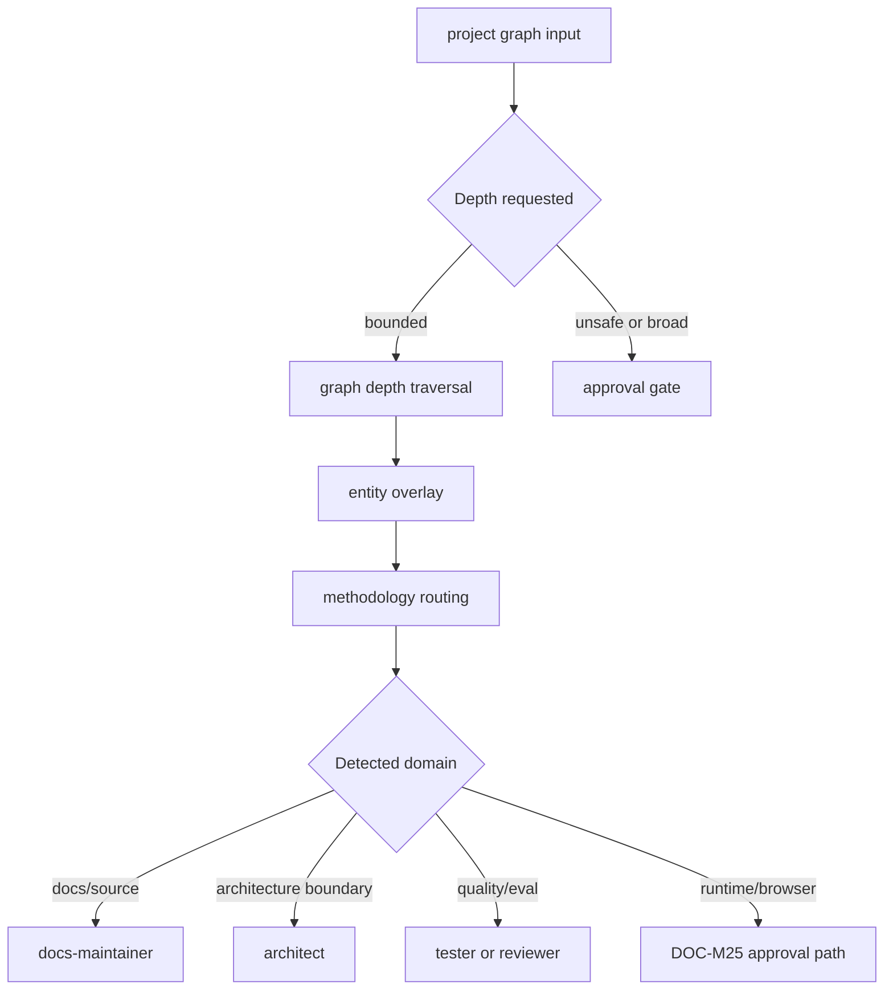
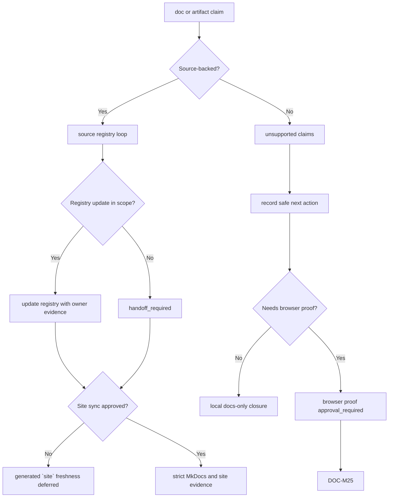
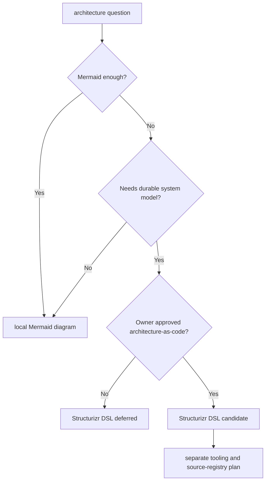

# Architecture Intelligence diagram atlas

Source status: `project-plan + local-docs-boundary`

Эта страница собирает `DOC-M23` diagram atlas для `architecture_intelligence_design_contract_v1`. Она показывает first-run flow, artifact pipeline, graph depth, methodology routing, approval gates, site sync, source registry loop и deferred `Structurizr DSL` trigger criteria без установки `Structurizr DSL` и без копирования stale generated site views.

## First-run flow

## Artifact pipeline

## Graph depth and methodology routing

## Approval gates, site sync and source registry loop

## Structurizr DSL trigger criteria

## Как применять

Используйте atlas как маршрутную карту, когда Architecture Intelligence output затрагивает несколько доказательных поверхностей. Сначала определите источник claim: source file, first-run artifact, generated view, `strict MkDocs`, browser runtime или owner evidence. Затем выберите next role и не повышайте generated view до source truth.

`local Mermaid` подходит для текущих diagram atlas pages и reviewer handoff. `Cosmos.gl/WebGL` относится к интерактивной graph/cockpit поверхности и не доказывается через Markdown. `browser screenshot proof` и browser proof approval_required остаются отдельным `DOC-M25` маршрутом.

## Related artifacts

- Track 11 G3 source context for `DOC-M23`.
- `architecture_intelligence_design_contract_v1`.
- `first_run_cockpit_artifact_v1`.
- `DOC-M25` browser proof follow-up.
- Source registry loop in `docs/sources/registry.md` and `docs/sources/registry.en.md` when registry edits are in scope.
- Local Mermaid diagram pages under `docs/diagrams/`.

## Common failure modes

- Stale generated `site` view is copied into source docs instead of being re-derived from source context.
- Graph depth output is treated as complete architecture understanding without source-file inspection.
- Methodology routing detects a domain but skips ownership, evidence boundary or handoff.
- `strict MkDocs` rendering is conflated with browser screenshot proof or `Cosmos.gl/WebGL` runtime behavior.
- `Structurizr DSL` is installed or introduced before trigger criteria and owner approval exist.
- Source registry loop is skipped for a source-backed claim when registry edits are in scope.
- `unsupported claims` are hidden instead of kept as explicit risks and safe next actions.
