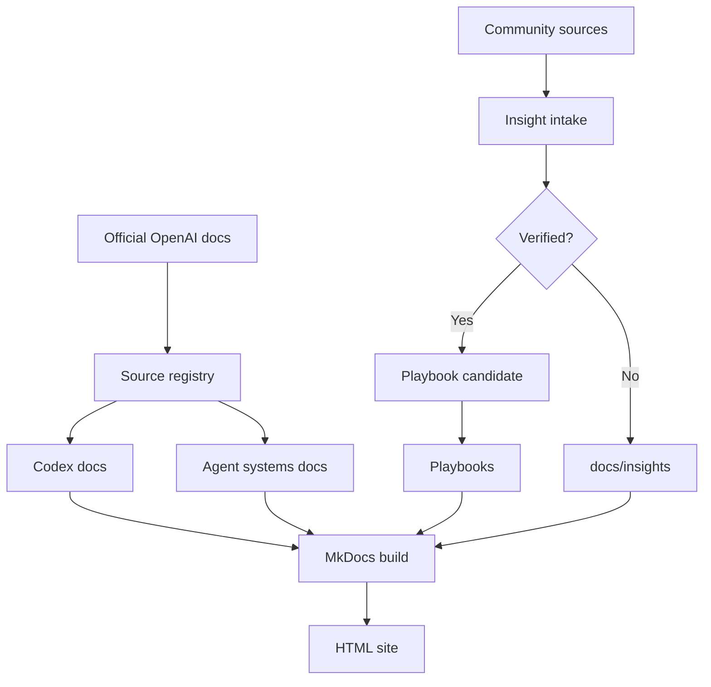
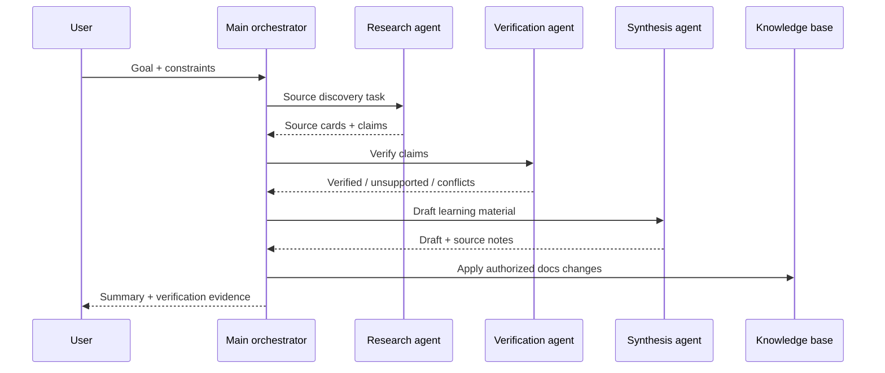
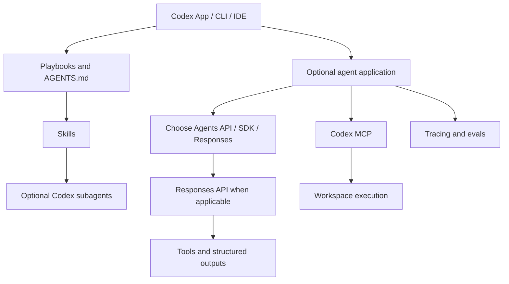
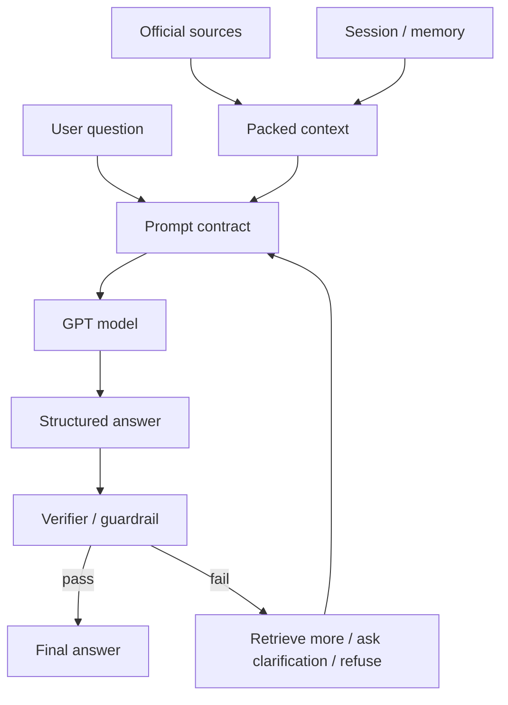
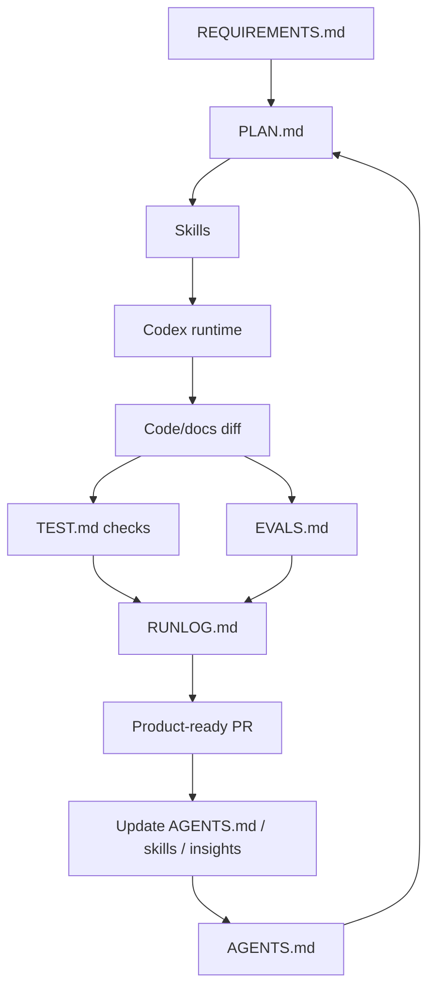

# Project architecture

Source status: `official + experiment`

The map separates sources, execution and evidence. One agent can perform research, verification and synthesis sequentially for an ordinary task. The team sequence is a conditional example, not a mandatory runtime.

## Knowledge base pipeline

## Optional agent workflow

## Runtime ownership choices

## Claim verification loop

## Product-agent operating system

## Usage and verification

Choose a [delivery route](product-delivery-lifecycle.md) by task size. Select an app runtime by [loop/state ownership](../agent-systems/sdk-patterns.md): Codex subagents do not require Agents SDK. JSON schemas, guardrails and a separate Verifier do not guarantee factual correctness. Check sources, observed results and applicable verification. Documents and diagrams do not activate hooks, providers, Git or deployment.

## Failure modes

Mandatory teams without independent tasks; confusing generated artifacts with source truth; verification loops without a budget/stop condition; publishing results without authority.

## Inputs

User goal, current sources, constraints, ownership and applicable approvals.

## Outputs

A selected route, reviewable artifact and evidence with explicit limits.

## Verification

Check the selected route against source files and observed task results; render the diagram after syntax changes.

## Risks

A diagram is orientation, not runtime activation or release evidence.
