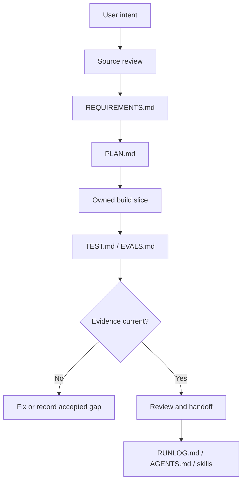

# Project architecture diagram

Source status: `official + experiment`

This page shows the high-level architecture for a Product-Agent OS project: product intent, source review, control-plane files, agent ownership, implementation, verification, review and learning.

## Inputs

- Source docs, repository files, user constraints and approval policy.
- Product-Agent OS control-plane files and current verification commands.

## Outputs

- A route from intent to evidence-backed handoff.
- A shared architecture boundary for agents, skills, docs and runtime choices.

## Verification

Check that every implementation route names source context, owned files, verification evidence, risks and the next artifact.

## Risks

- Architecture diagrams can become stale if they are not updated with workflow changes.
- Implementation without ownership and verification can make parallel agent work unsafe.
