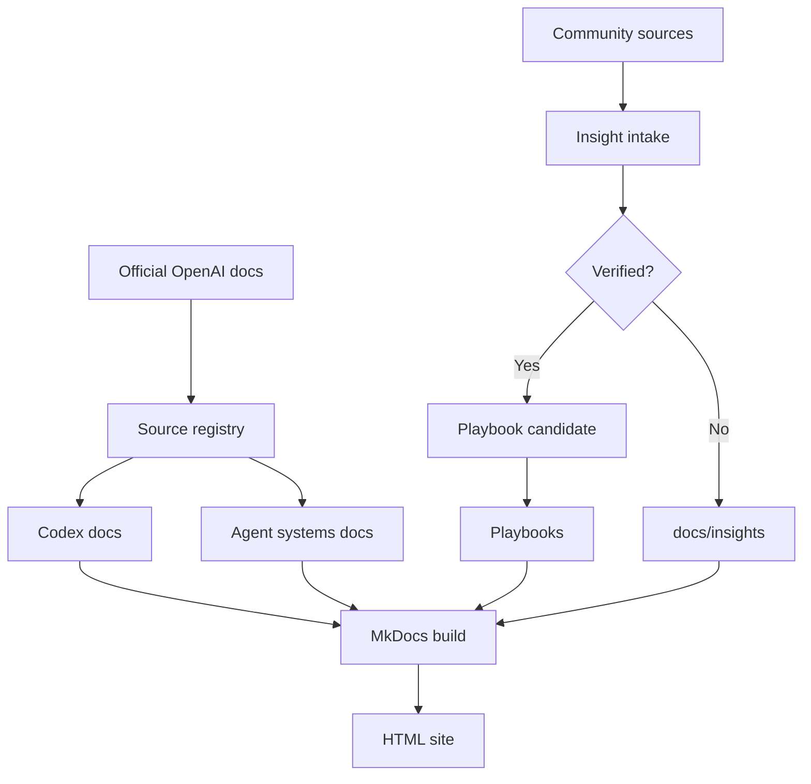
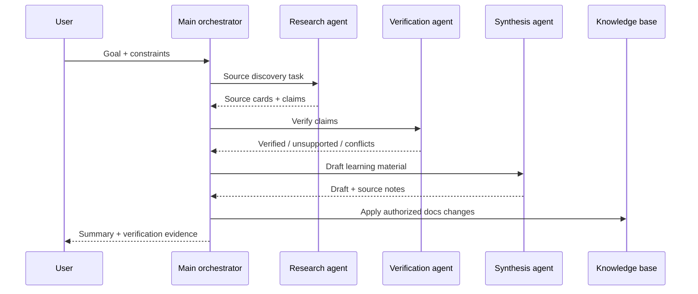
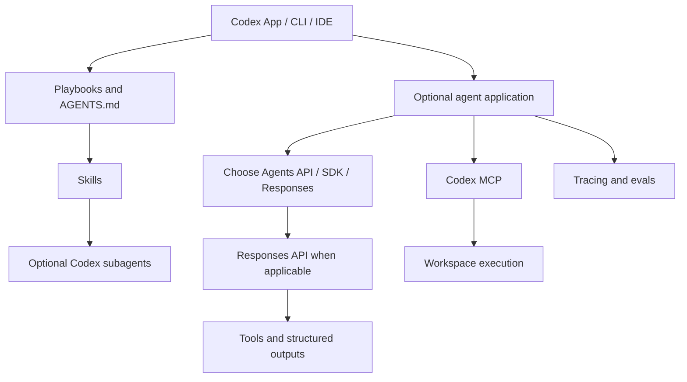
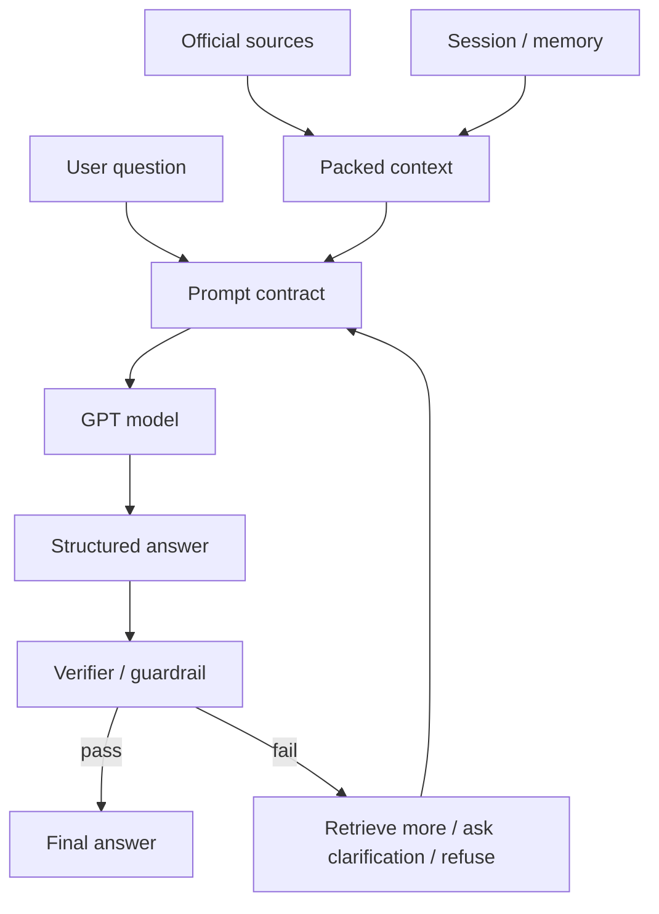
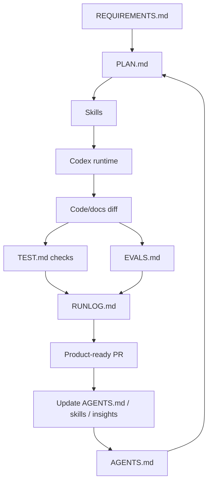

# Архитектура проекта

Source status: `official + experiment`

Карта разделяет источники, выполняемую работу и evidence. Для обычной задачи один агент может последовательно выполнить research, verification и synthesis. Командный sequence — условный пример, не обязательный runtime.

## Knowledge base pipeline

## Optional agent workflow

## Runtime ownership choices

## Claim verification loop

## Product-agent operating system

## Как использовать и проверить

Выберите [delivery route](product-delivery-lifecycle.md) по размеру задачи. Runtime app выбирайте по [владению loop/state](../agent-systems/sdk-patterns.md): Codex subagents не требуют Agents SDK. JSON schema, guardrail и отдельный Verifier не гарантируют factual correctness. Проверяйте источники, наблюдаемый результат и применимые checks. Документы и схемы не активируют hooks, providers, Git или deployment.

## Типовые ошибки

Обязательная команда без независимых задач; смешение generated artifacts и source truth; рост verification loop без budget/stop condition; автоматическая публикация результата без authority.

## Входы

Цель пользователя, текущие источники, ограничения, ownership и применимые разрешения.

## Выходы

Выбранный маршрут, проверяемый artifact и evidence с явными ограничениями.

## Проверка

Сверьте маршрут с исходниками и наблюдаемым результатом; после изменения синтаксиса проверьте render.

## Риски

Диаграмма помогает навигации, но не доказывает runtime activation или release.
