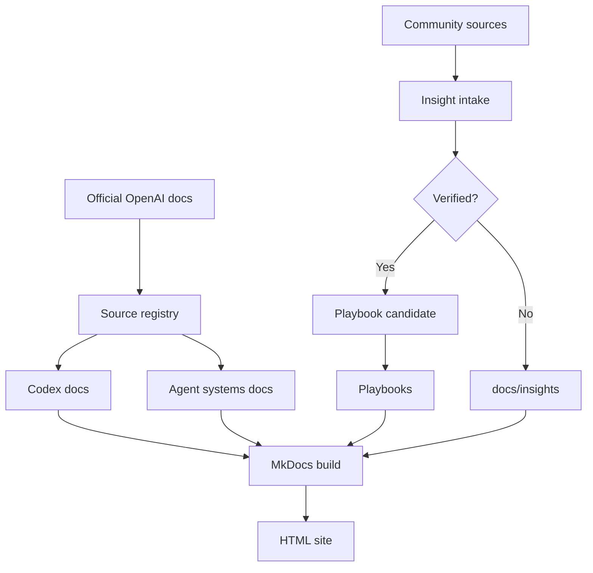
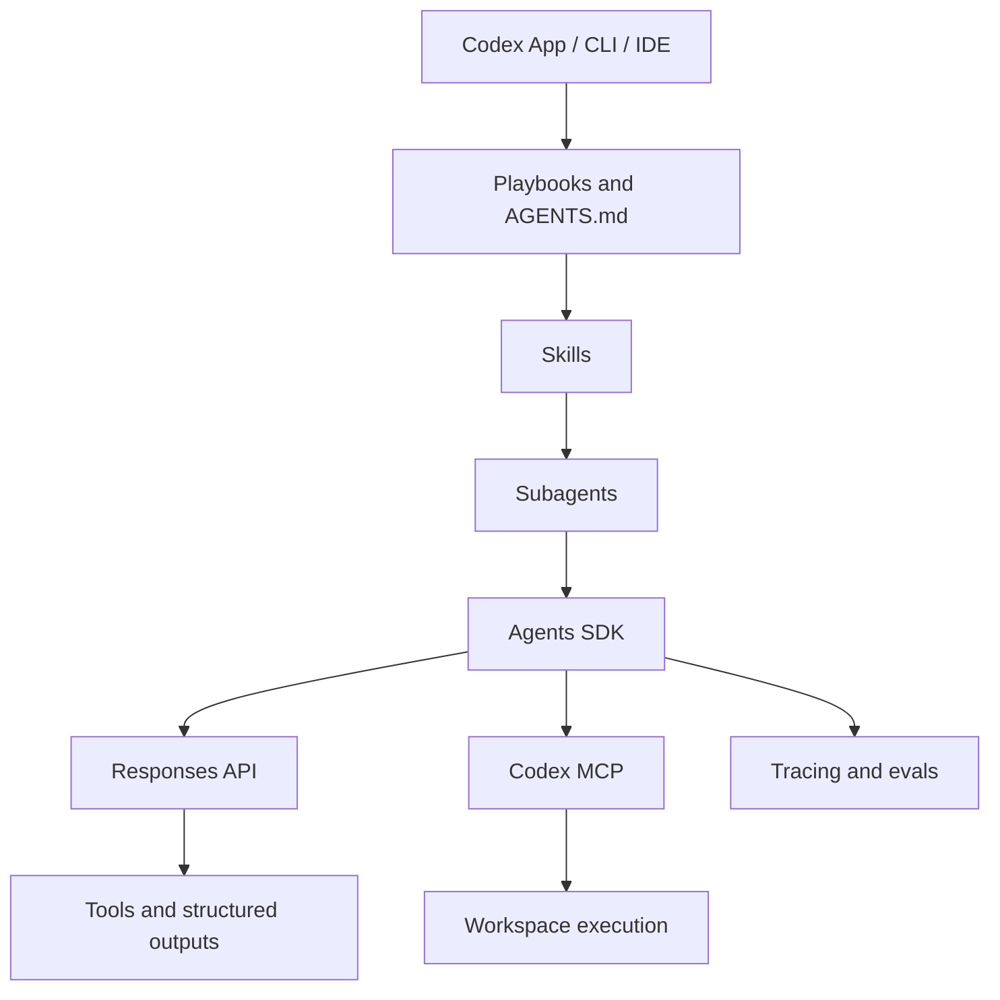
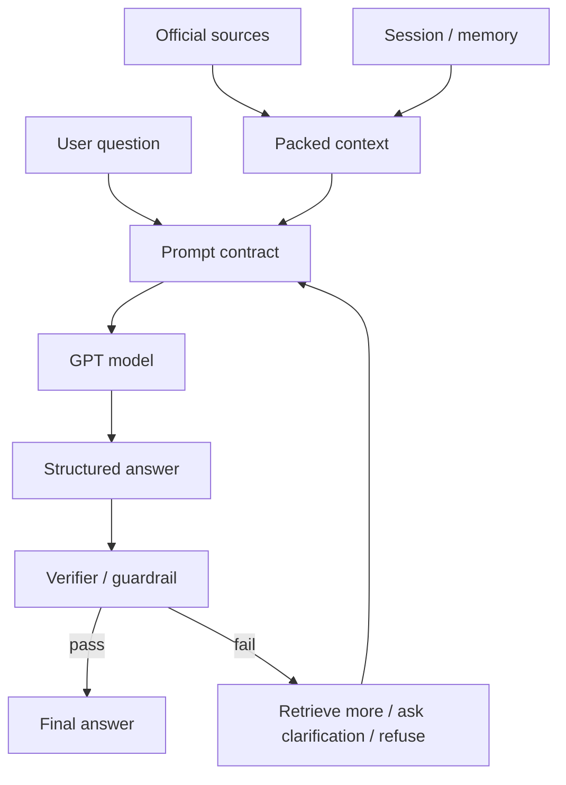
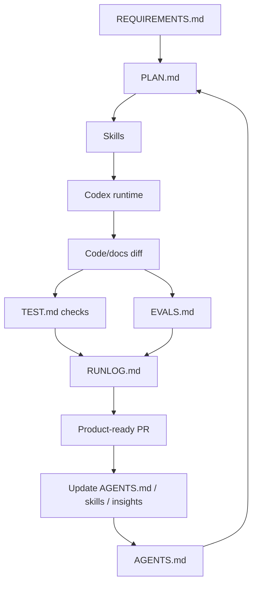

# Архитектура проекта

Source status: `experiment`

Эта страница остается общей архитектурной картой базы знаний. Для реализации реальных проектов начинайте с [Diagram atlas](index.md), затем переходите к lifecycle, agent team, runtime, skill и verification схемам.

## Knowledge base pipeline

## Agent workflow pipeline

## Runtime layer map

## Hallucination control loop

## Product-agent operating system

