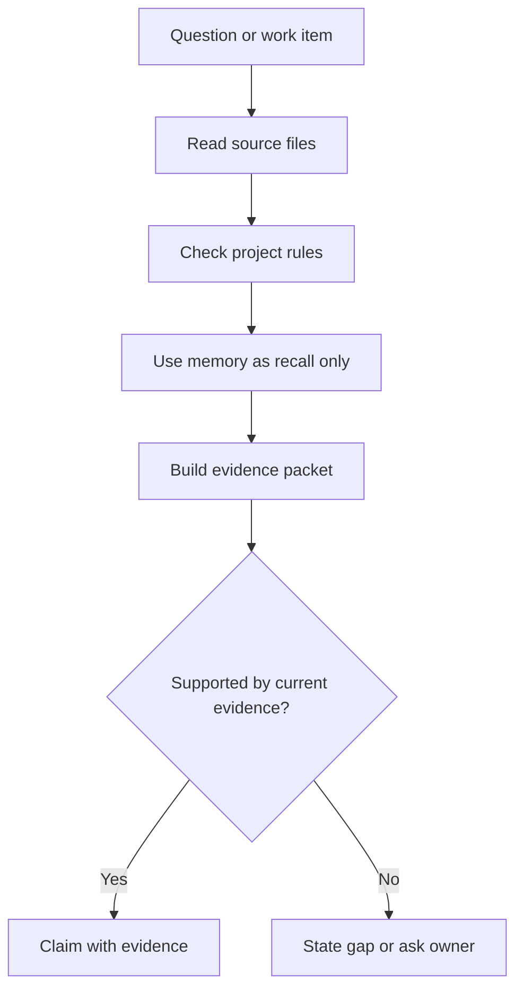

# Context, memory and verification

Source status: `official + experiment`

This map shows how Product-Agent OS separates source truth, context, memory and evidence before making readiness or completion claims.

## Inputs

- Source files, docs, commands, logs, eval reports and owner decisions.
- Memory, chat history and generated views as context only.

## Outputs

- A grounded response or handoff with evidence and explicit gaps.
- Durable updates to rules, docs or skills only when current evidence supports them.

## Verification

Before a completion claim, run the command or inspect the current evidence that proves the claim.

## Risks

- Treating memory or generated reports as source truth can preserve stale claims.
- Long context without evidence can create confident but unsupported answers.
