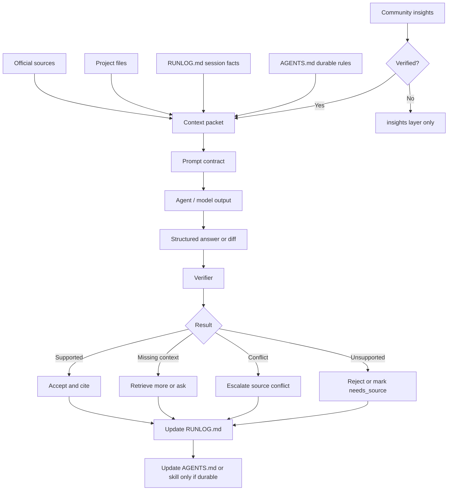

# Context, Memory & Verification Loop

Source status: `official + experiment`

Эта диаграмма объясняет, как собирать context, memory и verification loop так, чтобы уменьшить hallucinations в проектной агентной работе.

## Диаграмма



## Как применять

Перед тем как агент отвечает, пишет код или меняет документацию, сформируйте context packet:

```text
Goal:
  Что должно измениться.

Sources:
  Official docs, repo files, source IDs, checked_at.

Constraints:
  Что запрещено, какие approvals нужны, какие claims нельзя делать.

Memory:
  Только релевантные решения из RUNLOG.md и durable rules из AGENTS.md.

Output contract:
  Формат результата, citations, verification evidence.

Verification:
  Команды, eval rubric, reviewer role, stop conditions.
```

## Разделение памяти

| Слой | Что хранит | Когда обновлять |
| --- | --- | --- |
| `AGENTS.md` | Постоянные правила проекта | После повторяющегося решения |
| `RUNLOG.md` | Ход конкретной сессии | После важных действий и failures |
| `EVALS.md` | Quality rubric и score history | После eval loop |
| `docs/insights` | Community tricks и hypotheses | До официальной проверки |
| Skill instructions | Повторяемый метод | После ручных прогонов и eval cases |

## Антигаллюцинационный baseline

- Каждый factual claim должен иметь source, file reference или статус assumption.
- Community insight не становится правилом без verification status.
- Если context недостаточен, агент должен запросить недостающий input или пометить claim как unsupported.
- LLM-as-judge не заменяет deterministic checks.
- Session summary не заменяет source registry и `RUNLOG.md`.
