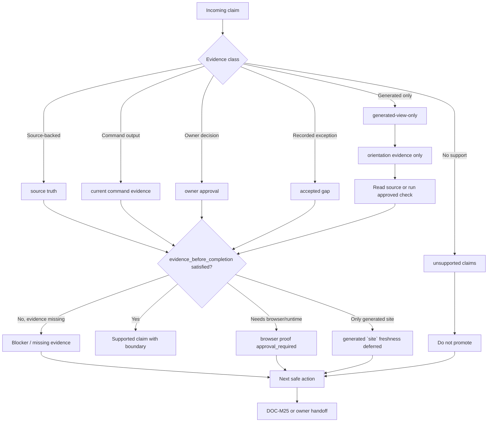

# Evidence and Risk Lifecycle

Source status: `project-local plan + accepted boundary`

This diagram shows how a claim moves from intake to supported scope, blocker, `accepted gap`, owner decision or next safe action. It supports Track 11 G3 `DOC-M09` and keeps one boundary clear: a doubt packet, generated view or review note is not proof by itself.

## Diagram

## How to Use

Use this map during review, docs sync and completion checks when deciding whether a claim can appear in documentation or a closing handoff.

1. Classify the claim as `source truth`, `current command evidence`, `generated-view-only`, `owner approval`, `accepted gap` or `unsupported claims`.
2. Require `evidence_before_completion` before completion or readiness wording.
3. If you only have `orientation evidence`, read the source or run an approved check first.
4. If the claim needs UI or runtime evidence, record `browser proof approval_required` instead of readiness.
5. If freshness depends only on generated `site`, record this status: generated `site` freshness deferred.
6. If the claim remains unsupported, name the next safe action or route it to `DOC-M25`.

## Related Artifacts

| Artifact | Role |
| --- | --- |
| `.codex/workflows/task-plan-lifecycle.md` | Requires Task Brief and Completion Brief before closure. |
| `.codex/workflows/control-plane-sync.md` | Records whether root control-plane update or handoff is needed. |
| `docs/sources/registry.md` | Source-backed claim status outside this slice. |
| Doubt / verifier packet | Evidence ledger; not proof without source or current evidence. |
| `DOC-M25` | Next routing point for unresolved evidence and risk boundaries. |

## Common Failure Modes

- Writing "verified" or "ready" based on a doubt packet without source or current evidence.
- Treating `generated-view-only` HTML as a complete check.
- Hiding blockers in a neutral summary instead of naming the next safe action.
- Calling an `accepted gap` accepted without owner, reason, scope and follow-up.
- Mixing `unsupported claims` with supported claims in one paragraph without a boundary.
