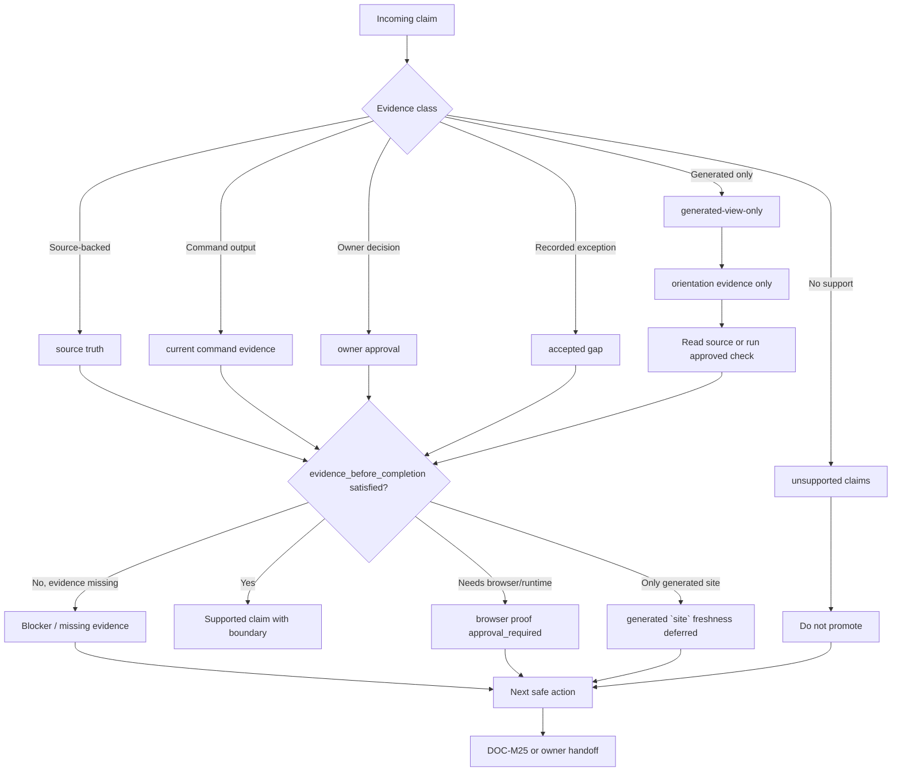

# Цикл evidence и risk

Source status: `project-local plan + accepted boundary`

Эта диаграмма показывает, как claim проходит от intake до supported scope, blocker, `accepted gap`, owner decision или следующего безопасного действия. Она нужна для Track 11 G3 `DOC-M09` и напоминает: doubt packet, generated view или review note не являются proof сами по себе.

## Диаграмма

## Как применять

Используйте схему в review, docs sync и completion checks, когда нужно решить, можно ли claim включить в документацию или closing handoff.

1. Разделите claim на evidence class: `source truth`, `current command evidence`, `generated-view-only`, `owner approval`, `accepted gap` или `unsupported claims`.
2. Для completion/readiness wording требуйте `evidence_before_completion`.
3. Если есть только `orientation evidence`, сначала прочитайте source или выполните разрешенную проверку.
4. Если нужна UI/runtime проверка, фиксируйте `browser proof approval_required`, а не readiness.
5. Если freshness опирается только на generated `site`, записывайте `generated `site` freshness deferred`.
6. Если claim остается unsupported, укажите next safe action или route в `DOC-M25`.

## Связанные артефакты

| Артефакт | Роль |
| --- | --- |
| `.codex/workflows/task-plan-lifecycle.md` | Требует Task Brief и Completion Brief перед закрытием. |
| `.codex/workflows/control-plane-sync.md` | Фиксирует, нужен ли root control-plane update или handoff. |
| `docs/sources/registry.md` | Источник статуса source-backed claims вне этого среза. |
| Doubt / verifier packet | Evidence ledger; не proof без source или current evidence. |
| `DOC-M25` | Следующая точка маршрутизации для unresolved evidence/risk boundaries. |

## Типовые ошибки

- Писать "verified" или "ready" на основании doubt packet без source или current evidence.
- Считать `generated-view-only` HTML полноценной проверкой.
- Прятать blockers в нейтральном summary вместо явного next safe action.
- Называть `accepted gap` принятым без owner, причины, scope и follow-up.
- Смешивать `unsupported claims` с supported claims в одном абзаце без границы.
