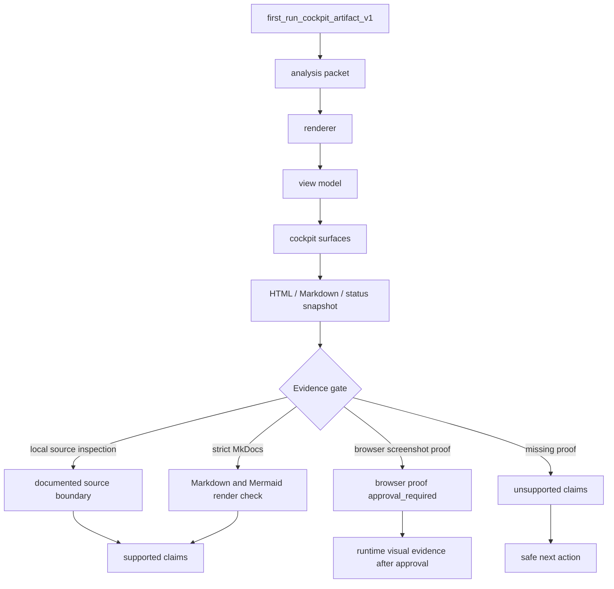
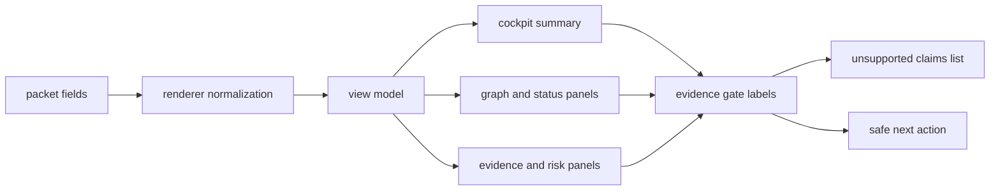

# First-Run Cockpit Architecture

Source status: `project-plan + local-docs-boundary`

This page describes how `first_run_cockpit_artifact_v1` should move from a source packet to cockpit surfaces without treating generated `site`, HTML, or screenshots as source truth. DOC-M08 gives a practical map for reading first-run artifacts, evidence gates, and unsupported claims.

## Diagram

## Component Map

| Component | Role | Evidence boundary |
| --- | --- | --- |
| `first_run_cockpit_artifact_v1` | Source first-run packet for cockpit rendering | Source for artifact shape, not proof of UI runtime |
| Renderer | Converts the packet into a view model and HTML/Markdown surfaces | Requires local source or file evidence |
| View model | Normalizes statuses, links, gates, and unsupported claims | Must not add a claim without a source boundary |
| Cockpit surfaces | Show analysis, graph, scorecard, status, and handoff | Generated views remain orientation evidence |
| Evidence gates | Separate source inspection, `strict MkDocs`, and `browser screenshot proof` | Browser proof needs separate approval |

## Artifact Flow

## How To Use

Use this page as a reading map when a first-run cockpit looks convincing but does not yet have runtime proof. Check the source packet and renderer output first, then separate `strict MkDocs` rendering from `browser screenshot proof`. If browser proof is missing, make only source-doc or local render claims.

For DOC-M25, this page defines the safe next action: get separate approval for browser proof, run the approved runtime/browser check, and only then discuss screenshots, visual overlap, or final root site freshness. Until then, `generated site freshness deferred` and browser proof remain separate boundaries, and generated `site` freshness deferred does not close UI evidence.

## Related Artifacts

- Track 11 G3 source context for DOC-M08.
- `first_run_cockpit_artifact_v1`.
- `architecture_intelligence_design_contract_v1`.
- `strict MkDocs` render path for Markdown and Mermaid.
- Local Mermaid docs pages under `docs/diagrams/`.
- DOC-M25 browser-proof follow-up.

## Common Failure Modes

- Generated cockpit HTML is treated as source truth without checking the source packet.
- A `strict MkDocs` render check is described as `browser screenshot proof`.
- Browser screenshots, visual overlap, or Cosmos.gl/WebGL behavior are claimed without approval and runtime evidence.
- `unsupported claims` are removed from the handoff instead of being tied to an explicit next action.
- Missing local Mermaid dependency blocks diagram rendering, but the page is still described as visually proven.
- Generated `site` freshness deferred is forgotten and presented as a current publication build.
