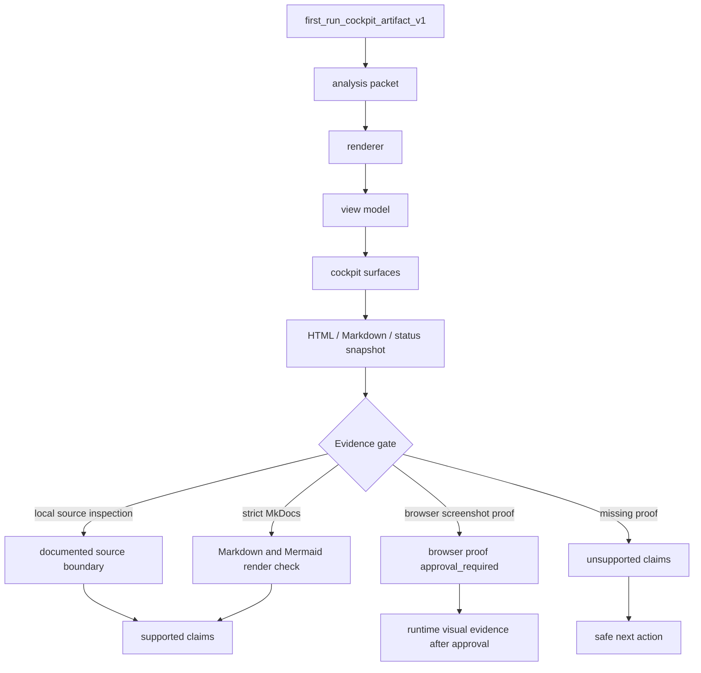
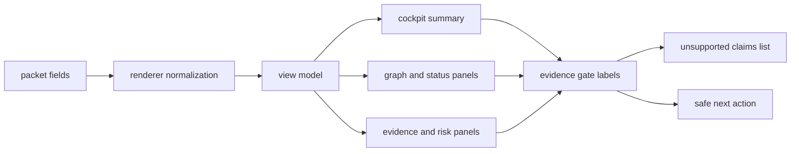

# Архитектура first-run cockpit

Source status: `project-plan + local-docs-boundary`

Эта страница описывает, как `first_run_cockpit_artifact_v1` проходит от исходного пакета до cockpit surfaces без превращения generated `site`, HTML или скриншотов в источник истины. Цель `DOC-M08` - дать практическую схему для чтения first-run artifacts, evidence gates и `unsupported claims`.

## Диаграмма

## Component map

| Component | Role | Evidence boundary |
| --- | --- | --- |
| `first_run_cockpit_artifact_v1` | Исходный first-run packet для cockpit rendering. | Источник структуры artifact, не доказательство UI runtime. |
| Renderer | Преобразует packet в view model и HTML/Markdown surfaces. | Требует локального source/file evidence. |
| View model | Нормализует statuses, links, gates и `unsupported claims`. | Не должен добавлять claim без source boundary. |
| Cockpit surfaces | Показывают analysis, graph, scorecard, status и handoff. | Generated view остается `orientation evidence`. |
| Evidence gates | Разделяют source inspection, `strict MkDocs` и `browser screenshot proof`. | Browser proof требует отдельного approval. |

## Artifact flow

## Как применять

Используйте страницу как карту чтения, когда first-run cockpit выглядит убедительно, но еще не имеет runtime proof. Сначала проверьте source packet и renderer output, затем отделите `strict MkDocs` rendering от `browser screenshot proof`. Если browser proof отсутствует, формулируйте только source-doc или local render claims.

Для `DOC-M25` эта страница задает safe next action: получить отдельное approval на browser proof, выполнить согласованный runtime/browser check и только после этого обсуждать screenshots, visual overlap или final root site freshness. До этого `generated site freshness deferred` и browser proof остаются отдельной границей, а generated `site` freshness deferred не закрывает UI evidence.

## Related artifacts

- Track 11 G3 source context for `DOC-M08`.
- `first_run_cockpit_artifact_v1`.
- `architecture_intelligence_design_contract_v1`.
- `strict MkDocs` render path for Markdown and Mermaid.
- Local Mermaid docs pages under `docs/diagrams/`.
- `DOC-M25` browser-proof follow-up.
- `Cosmos.gl/WebGL` runtime boundary for interactive graph surfaces.

## Common failure modes

- Generated cockpit HTML принимается за source truth без проверки исходного packet.
- `strict MkDocs` render check описывается как `browser screenshot proof`.
- Browser screenshot, visual overlap или `Cosmos.gl/WebGL` behavior заявлены без approval и runtime evidence.
- `unsupported claims` удаляются из handoff вместо явного next action.
- Local Mermaid dependency missing blocks diagram rendering, but the page is still described as visually proven.
- Generated `site` freshness deferred забывается и подается как актуальная публикационная сборка.
