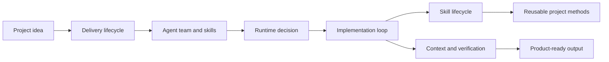

# Diagram atlas

Source status: `official + experiment`

This section turns the knowledge base into an implementation map for building projects with Codex, agents, skills, runtime choices and eval loops.

## Route

1. Start with [Product-Agent Delivery Lifecycle](product-delivery-lifecycle.md) to see the full path from idea to release.
2. Use [Agent Team And Skills](agent-team-and-skills.md) to split roles, ownership and reusable methods.
3. Use [Runtime Decision Map](runtime-decision-map.md) to choose Codex App, CLI, Cloud, `codex exec`, MCP, GitHub Action or automation.
4. Check [Skill Lifecycle](skill-lifecycle.md) before turning a playbook into a skill.
5. Finish with [Context, Memory, Verification](context-memory-verification.md) to reduce unsupported claims and keep useful knowledge.

## Inputs

- Product goal, source context and project constraints.
- Existing control-plane files, routes, skills and runtime options.

## Outputs

- A practical route through the Product-Agent OS operating model.
- Links to the next artifact for delivery, team design, runtime selection, skill promotion and verification.

## Verification

Each atlas page should have a practical diagram, usage guidance, related artifacts and failure modes. Run `python tools\check_docs.py` and strict MkDocs after navigation or Mermaid changes.

## Risks

- Decorative diagrams can hide missing implementation decisions.
- Skipping the atlas can lead to runtime or agent choices that are not aligned with approvals and evidence.
