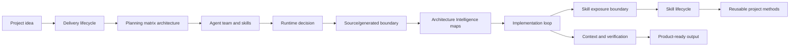

# Diagram atlas

Source status: `official + experiment`

This section turns the knowledge base into an implementation map for building projects with Codex, agents, skills, runtime choices and eval loops.

## Route

1. Start with [Product-Agent Delivery Lifecycle](product-delivery-lifecycle.md) to see the full path from idea to release.
2. Use [planning matrix architecture](../product-agent-os/architecture.md#task-and-plan-architecture) when work needs a task matrix, staged delivery or completion report.
3. Use [Agent Team And Skills](agent-team-and-skills.md) to split roles, ownership and reusable methods.
4. Use [Runtime Decision Map](runtime-decision-map.md) to choose Codex App, CLI, Cloud, `codex exec`, MCP, GitHub Action or automation.
5. Check [Source And Generated Evidence Boundary](source-generated-trust-boundary.md) when work depends on generated graph, cockpit HTML, reports or `site/`.
6. Use [First-Run Cockpit Architecture](first-run-cockpit-architecture.md), [Evidence And Risk Lifecycle](evidence-risk-lifecycle.md) and [Architecture Intelligence Diagram Atlas](architecture-intelligence-diagram-atlas.md) when first-run outputs become documentation or handoff material.
7. Check [Skill Exposure And Invocation Boundary](skill-exposure-and-invocation.md) when a claim touches source bundle, installed cache or active session behavior.
8. Check [Skill Lifecycle](skill-lifecycle.md) before turning a playbook into a skill.
9. Finish with [Context, Memory, Verification](context-memory-verification.md) to reduce unsupported claims and keep useful knowledge.

## Inputs

- Product goal, source context and project constraints.
- Existing control-plane files, routes, skills and runtime options.

## Outputs

- A practical route through the Product-Agent OS operating model.
- Links to the next artifact for delivery, planning matrix architecture, team design, runtime selection, source/generated trust, Architecture Intelligence maps, skill exposure, skill promotion and verification.

## Verification

Each atlas page should have a practical diagram, usage guidance, related artifacts and failure modes. Run `python tools\check_docs.py` and strict MkDocs after navigation or Mermaid changes.

## Risks

- Decorative diagrams can hide missing implementation decisions.
- Skipping the atlas can lead to runtime or agent choices that are not aligned with approvals and evidence.
- Treating generated views, browser proof gaps or installed skill cache as source truth can create unsupported completion claims.

## Model and runtime refresh

Use the [model matrix](../codex/models-and-reasoning.md) and [migration playbook](../playbooks/model-migration.md) with the team/runtime diagrams. API capabilities and candidate models are documented separately from current Product-Agent OS activation.
