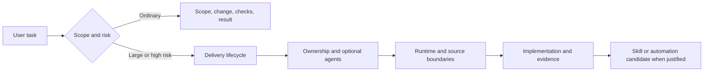

# Diagram atlas

Source status: `official + experiment`

Этот раздел превращает базу знаний из набора статей в рабочую карту реализации проектов через Codex, agents, skills, runtime и eval loops.

Используйте диаграммы не как иллюстрации, а как порядок действий:

1. Начните с [Product-Agent Delivery Lifecycle](product-delivery-lifecycle.md), чтобы понять весь путь от идеи до release.
2. Зафиксируйте [архитектуру планов и задач](../product-agent-os/architecture.md#planning-contract), если проект требует матрицу задач, поэтапную поставку или отчет после реализации.
3. Перейдите к [Команде агентов и skills](agent-team-and-skills.md), чтобы разложить проект на роли, зоны владения и reusable methods.
4. Используйте [Runtime decision map](runtime-decision-map.md), чтобы выбрать Codex App, CLI, Cloud, `codex exec`, MCP, GitHub Action или automation.
5. Проверьте [границу source и generated evidence](source-generated-trust-boundary.md), если работа опирается на generated graph, cockpit HTML, reports или `site/`.
6. Используйте [архитектуру first-run cockpit](first-run-cockpit-architecture.md), [цикл evidence и risk](evidence-risk-lifecycle.md) и [Architecture Intelligence diagram atlas](architecture-intelligence-diagram-atlas.md), когда first-run выводы превращаются в документацию или handoff.
7. Проверьте [границу skill exposure и invocation](skill-exposure-and-invocation.md), если claim касается source bundle, installed cache или active session behavior.
8. Проверьте [Skill lifecycle](skill-lifecycle.md), прежде чем превращать playbook в skill.
9. Завершите проект через [Context, memory, verification](context-memory-verification.md), чтобы снизить hallucinations и сохранить полезные знания.

## Как читать atlas

Каждая страница отвечает на один практический вопрос:

| Диаграмма | Рабочий вопрос | Главный результат |
| --- | --- | --- |
| Product-Agent Delivery Lifecycle | Как реализовать проект end-to-end? | Понятный путь от идеи до PR/release |
| Архитектура планов и задач | Как создавать, обновлять и очищать файлы-планы? | Плановый контракт для задач, отчетов, evidence и handoffs |
| Команда агентов и skills | Как собрать агентную команду под проект? | Роли, handoffs, candidate skills |
| Runtime decision map | Где запускать задачу Codex? | Выбор runtime-поверхности |
| Source/generated trust boundary | Что является source truth, а что только orientation evidence? | Явная граница generated-view-only, command evidence, owner approval и accepted gap |
| First-run cockpit architecture | Как first-run packet становится cockpit surface? | Artifact flow, evidence gates и browser-proof boundary |
| Evidence and risk lifecycle | Когда claim supported, blocked или unsupported? | Evidence-before-completion route и next safe action |
| Skill exposure and invocation | Почему source skill, installed cache и active session не одно и то же? | Route для source/cache/session proof |
| Architecture Intelligence diagram atlas | Как читать expanded architecture intelligence maps? | First-run flow, graph depth, methodology routing, site sync и Structurizr trigger boundary |
| Skill lifecycle | Когда workflow достоин стать skill? | Проверенный reusable method |
| Context, memory, verification | Как уменьшить hallucinations? | Grounded workflow с проверкой |

## Минимальный рабочий маршрут

Для нового проекта проходите страницы в таком порядке:

Для небольшой задачи достаточно короткого маршрута: scope → изменение → affected checks → результат. Пять control-plane files нужны по применимости; переиспользуйте имеющиеся artifacts.

## Обновление моделей и runtimes

Используйте [матрицу моделей](../codex/models-and-reasoning.md) и [playbook миграции](../playbooks/model-migration.md) вместе с диаграммами команды/runtime. API-возможности и кандидатные модели описаны отдельно от текущей активации Product-Agent OS.

## Выберите короткий или полный маршрут

Для локального package → profile → backup/restore → rollback используйте [операторский маршрут и согласованный Web-пилот](../web/pilot.md). Эта упаковка не меняет runtime permissions и не снимает коммерческие gates.

[Delivery lifecycle](product-delivery-lifecycle.md) начинается с размера и риска. Ordinary task не требует команды, worktree или нового набора файлов. Полный маршрут atlas используется, когда есть существенные зависимости, ownership или release/readiness. Следующая диаграмма должна отвечать на конкретный вопрос задачи.
