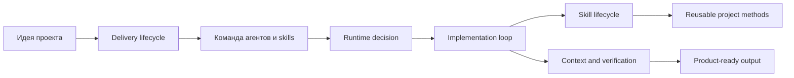

# Diagram atlas

Source status: `official + experiment`

Этот раздел превращает базу знаний из набора статей в рабочую карту реализации проектов через Codex, agents, skills, runtime и eval loops.

Используйте диаграммы не как иллюстрации, а как порядок действий:

1. Начните с [Product-Agent Delivery Lifecycle](product-delivery-lifecycle.md), чтобы понять весь путь от идеи до release.
2. Перейдите к [Команде агентов и skills](agent-team-and-skills.md), чтобы разложить проект на роли, зоны владения и reusable methods.
3. Используйте [Runtime decision map](runtime-decision-map.md), чтобы выбрать Codex App, CLI, Cloud, `codex exec`, MCP, GitHub Action или automation.
4. Проверьте [Skill lifecycle](skill-lifecycle.md), прежде чем превращать playbook в skill.
5. Завершите проект через [Context, memory, verification](context-memory-verification.md), чтобы снизить hallucinations и сохранить полезные знания.

## Как читать atlas

Каждая страница отвечает на один практический вопрос:

| Диаграмма | Рабочий вопрос | Главный результат |
| --- | --- | --- |
| Product-Agent Delivery Lifecycle | Как реализовать проект end-to-end? | Понятный путь от идеи до PR/release |
| Команда агентов и skills | Как собрать агентную команду под проект? | Роли, handoffs, candidate skills |
| Runtime decision map | Где запускать задачу Codex? | Выбор runtime-поверхности |
| Skill lifecycle | Когда workflow достоин стать skill? | Проверенный reusable method |
| Context, memory, verification | Как уменьшить hallucinations? | Grounded workflow с проверкой |

## Минимальный рабочий маршрут

Для нового проекта проходите страницы в таком порядке:

Если после прохождения маршрута у проекта нет `REQUIREMENTS.md`, `PLAN.md`, `TEST.md`, `EVALS.md` и `RUNLOG.md`, значит workflow еще не готов к автономной или полуавтономной агентной работе.
