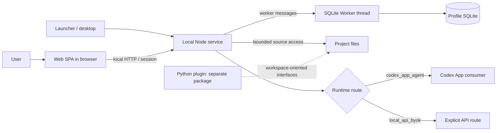

# PAOS application architecture

Source status: repository_source / static_architecture_map; 2026-11-15.

Owner: Product-Agent OS architecture; scope/version: DG02 v1. Update when the cited sources, data boundaries or decisions change; related tests are listed below. Source inspection does not prove runtime activation or release readiness.

## Question and scope

Which boundaries does a Web request cross and where does data reside? This diagram reflects source at the review date, not a particular installation's runtime. The Python plugin is a separate package; the dotted relationship does not imply every Web request starts Python.

## How to use

Start with [context](../architecture/system-context.md), then [components](../architecture/containers.md), [data flows](../architecture/data-flow.md) and [architecture decisions](../architecture/decisions/index.md). For a specific installation verify actual profile/project authority and the selected route's availability.

## Sources and checks

[Service startup](https://github.com/alexroadcaster/product-agent-os/blob/2f8a0cb8b428ba4499d9d7bd35f1f4b42b2be765/apps/local-service/src/main.mts), [HTTP application](https://github.com/alexroadcaster/product-agent-os/blob/2f8a0cb8b428ba4499d9d7bd35f1f4b42b2be765/apps/local-service/src/http/application.mts), [SQLite worker](https://github.com/alexroadcaster/product-agent-os/blob/2f8a0cb8b428ba4499d9d7bd35f1f4b42b2be765/apps/local-service/src/storage/sqlite-worker.mts), [route selector](https://github.com/alexroadcaster/product-agent-os/blob/2f8a0cb8b428ba4499d9d7bd35f1f4b42b2be765/apps/local-service/src/runtime/route-selector.ts), [Python package](https://github.com/alexroadcaster/product-agent-os/blob/2f8a0cb8b428ba4499d9d7bd35f1f4b42b2be765/plugins/product-agent-os/README.md); [route tests](https://github.com/alexroadcaster/product-agent-os/blob/2f8a0cb8b428ba4499d9d7bd35f1f4b42b2be765/tests/web/runtime-route-selector.test.mts) and [project-source tests](https://github.com/alexroadcaster/product-agent-os/blob/2f8a0cb8b428ba4499d9d7bd35f1f4b42b2be765/tests/web/project-sources.test.mts). Test references do not assert a current execution.

## Common failures

- Treating a worker thread as a network service or SQL as owner of source files without checking cutover mode.
- Claiming that waiting for an App consumer is a successful model call, or that the API route is automatic fallback.
- Promoting an old diagram or planned team storage to a fact about a live integration.
