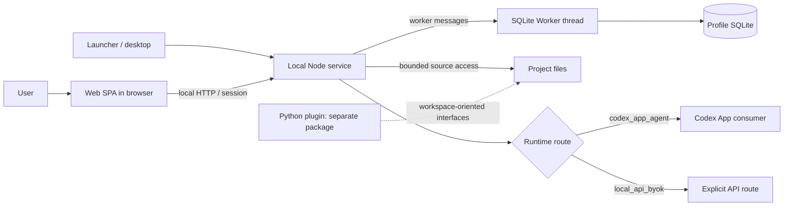

# Архитектура приложения PAOS

Source status: repository_source / static_architecture_map; 15.11.2026.

Владелец: архитектура Product-Agent OS; scope/version: DG02 v1. Обновлять при изменении соответствующих исходников, границ данных или решений; связанные проверки указаны ниже. Проверка исходников не доказывает runtime activation или готовность к выпуску.

## Вопрос и область

Какие границы пересекает пользовательский запрос Web и где располагаются данные? Схема показывает исходники на дату проверки, а не runtime конкретной установки. Python plugin показан отдельным package; пунктир не означает, что каждый Web-запрос запускает Python.

## Как использовать

Начните с [контекста](../architecture/system-context.md), затем перейдите к [компонентам](../architecture/containers.md), [потокам данных](../architecture/data-flow.md) и [архитектурным решениям](../architecture/decisions/index.md). Для отдельной установки проверьте реальный profile/project authority и доступность выбранного route.

## Источники и проверки

[Service startup](https://github.com/alexroadcaster/product-agent-os/blob/2f8a0cb8b428ba4499d9d7bd35f1f4b42b2be765/apps/local-service/src/main.mts), [HTTP application](https://github.com/alexroadcaster/product-agent-os/blob/2f8a0cb8b428ba4499d9d7bd35f1f4b42b2be765/apps/local-service/src/http/application.mts), [SQLite worker](https://github.com/alexroadcaster/product-agent-os/blob/2f8a0cb8b428ba4499d9d7bd35f1f4b42b2be765/apps/local-service/src/storage/sqlite-worker.mts), [route selector](https://github.com/alexroadcaster/product-agent-os/blob/2f8a0cb8b428ba4499d9d7bd35f1f4b42b2be765/apps/local-service/src/runtime/route-selector.ts), [Python package](https://github.com/alexroadcaster/product-agent-os/blob/2f8a0cb8b428ba4499d9d7bd35f1f4b42b2be765/plugins/product-agent-os/README.md); [route tests](https://github.com/alexroadcaster/product-agent-os/blob/2f8a0cb8b428ba4499d9d7bd35f1f4b42b2be765/tests/web/runtime-route-selector.test.mts) и [project-source tests](https://github.com/alexroadcaster/product-agent-os/blob/2f8a0cb8b428ba4499d9d7bd35f1f4b42b2be765/tests/web/project-sources.test.mts). Ссылки на тесты не утверждают их текущий запуск.

## Типичные ошибки

- Считать worker thread отдельным сетевым сервисом или SQL владельцем файлов без проверки режима cutover.
- Объявлять ожидание App consumer успешным вызовом модели, а API route — автоматическим fallback.
- Повышать старую схему или planned team storage до факта действующей интеграции.
