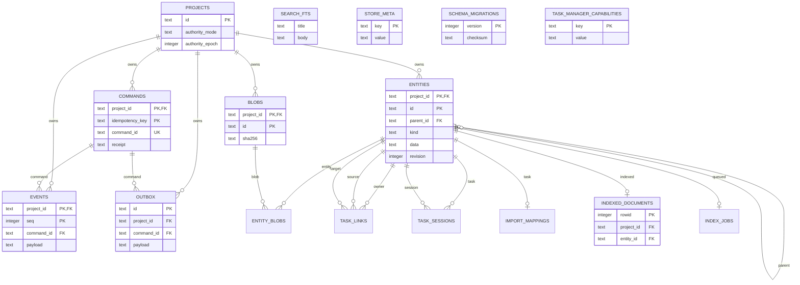

# PAOS SQLite: relationships and authority

Source status: repository_source / static_architecture_map; 2026-11-15.

Owner: backend/storage; scope/version: DG03 v1. Update with [schema.mts](https://github.com/alexroadcaster/product-agent-os/blob/2f8a0cb8b428ba4499d9d7bd35f1f4b42b2be765/apps/local-service/src/storage/migrations/schema.mts), constraints or migrations; related [storage tests](https://github.com/alexroadcaster/product-agent-os/blob/2f8a0cb8b428ba4499d9d7bd35f1f4b42b2be765/tests/web/storage.test.mts) and [backup tests](https://github.com/alexroadcaster/product-agent-os/blob/2f8a0cb8b428ba4499d9d7bd35f1f4b42b2be765/tests/web/storage-backup.test.mts) are not a new run. The diagram describes the PAOS source contract, not a real user database or the F33 target.

## Declared FKs

Lines below represent only declared foreign keys. Composite FKs include `project_id`; separate owner/source/target and task/session roles are shown separately. Zero or many relationships do not guarantee a business scenario and depend on guards. Tables without FKs appear separately; all columns, CHECK, UNIQUE and indexes are in the [exact DDL](../db/schema.md).

## Logical relationships without a SQL FK

`SEARCH_FTS.rowid` corresponds to `INDEXED_DOCUMENTS.rowid` in worker queries, but no SQL FK is declared. `STORE_META`, `SCHEMA_MIGRATIONS` and conditional `TASK_MANAGER_CAPABILITIES` are local system tables without a project FK. Do not infer semantic retrieval or an external DB map from FTS.

## Usage and common failures

Start with the [authority model](../db/index.md), then [transactions](../db/transactions.md), [migrations](../db/migrations.md) and [restore](../db/backup-restore.md). Common errors: treating all relationships as SQL FKs, confusing stream and index generations, or treating planned PostgreSQL/M5 or target DB F33 as current PAOS storage.
