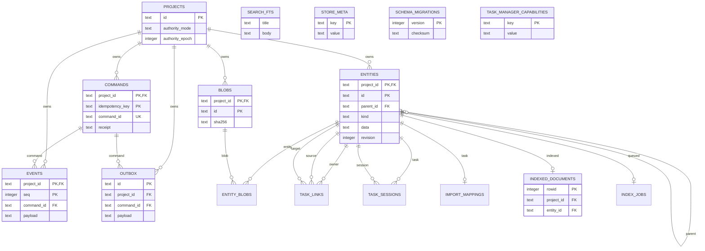

# SQLite PAOS: отношения и authority

Source status: repository_source / static_architecture_map; 15.11.2026.

Владелец: backend/storage; scope/version: DG03 v1. Обновлять вместе с [schema.mts](https://github.com/alexroadcaster/product-agent-os/blob/2f8a0cb8b428ba4499d9d7bd35f1f4b42b2be765/apps/local-service/src/storage/migrations/schema.mts), constraints или migrations; связанные [storage tests](https://github.com/alexroadcaster/product-agent-os/blob/2f8a0cb8b428ba4499d9d7bd35f1f4b42b2be765/tests/web/storage.test.mts) и [backup tests](https://github.com/alexroadcaster/product-agent-os/blob/2f8a0cb8b428ba4499d9d7bd35f1f4b42b2be765/tests/web/storage-backup.test.mts) не являются новым прогоном. Схема показывает исходный контракт PAOS, не исследует реальную пользовательскую БД или целевую F33.

## Declared FK

Линии ниже показывают только объявленные внешние ключи. Составные FK включают `project_id`; отдельные роли owner/source/target и task/session показаны отдельно. Нулевая или множественная связь не гарантирует бизнес-сценарий и зависит от guards. Таблицы без FK показаны отдельно; все колонки, CHECK, UNIQUE и индексы — в [точном DDL](../db/schema.md).

## Логические связи без SQL FK

`SEARCH_FTS.rowid` соотносится с `INDEXED_DOCUMENTS.rowid` в запросах worker, но SQL FK не объявлен. `STORE_META`, `SCHEMA_MIGRATIONS` и условная `TASK_MANAGER_CAPABILITIES` — локальные служебные таблицы; они не принадлежат конкретному project по FK. Не выводите из FTS наличие semantic retrieval или карты сторонней БД.

## Использование и частые ошибки

Начните с [модели authority](../db/index.md), затем [транзакции](../db/transactions.md), [миграции](../db/migrations.md) и [восстановление](../db/backup-restore.md). Ошибки: считать все связи SQL FK, перепутать stream и index generation, интерпретировать planned PostgreSQL/M5 или target DB F33 как существующее хранилище PAOS.
