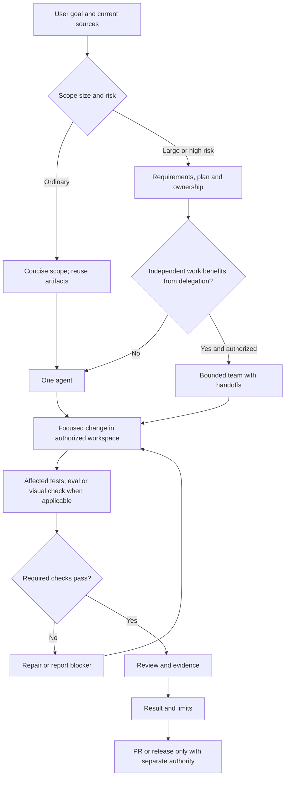

# Product-Agent Delivery Lifecycle

Source status: `official + experiment`

Choose a route by task and risk. The diagram describes a workflow; it does not grant authority.

## Usage

For an ordinary change use scope, the change, relevant verification and the result. Reuse existing `REQUIREMENTS.md`, `PLAN.md`, `TEST.md`, `EVALS.md` and `RUNLOG.md`; create artifacts when they capture actual requirements, dependencies or evidence. For larger work define acceptance, ownership, risks and rollback first. A worktree provides file isolation with the required Git authority; it is not mandatory for every task.

One role can cover several stages. Add a team, skills and evals when applicable. Repeat required checks after a new change, failure or unresolved risk. A PR draft is not publication.

## Outputs and verification

A reviewable diff or artifact, observed checks, limits and the next action. Runtime/model activation needs separate evidence; a plan or diagram does not prove it.

## Failure modes

Mandatory teams without independent tasks; duplicate control-plane files; an unbounded general gate; publication without authority.

Related guidance: [lifecycle](../product-agent/lifecycle.md), [Product-Agent OS plugin](../product-agent-os/index.md), [model guidance](https://developers.openai.com/api/docs/guides/latest-model), [eval guidance](https://developers.openai.com/api/docs/guides/evaluation-best-practices).

## Inputs

User goal, current sources, constraints, ownership and applicable approvals.

## Outputs

A selected route, reviewable artifact and evidence with explicit limits.

## Verification

Check the selected route against source files and observed task results; render the diagram after syntax changes.

## Risks

A diagram is orientation, not runtime activation or release evidence.
