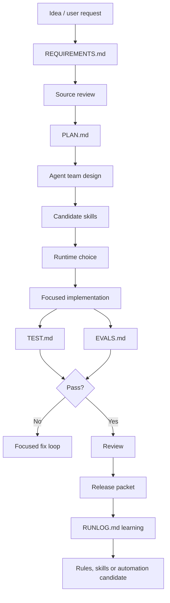

# Product-Agent Delivery Lifecycle

Source status: `official + experiment`

This diagram shows the end-to-end product delivery loop for Codex work, from idea to release notes and updated agent operating documentation.

## Inputs

- Product goal, users, constraints and success metric.
- Source review, project rules and available runtime surface.

## Outputs

- A reviewable sequence of requirements, plan, implementation, evidence, review and learning artifacts.
- Candidate skills or automation only after repeated manual success.

## Verification

Confirm that requirements, plan, tests, evals and run log are current before claiming a slice is ready.

## Risks

- Starting implementation before requirements and plan can create broad unowned changes.
- Automating a workflow before evidence and failure handling can repeat mistakes.
