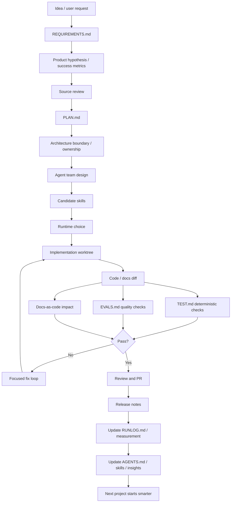

# Product-Agent Delivery Lifecycle

Source status: `official + experiment`

Эта диаграмма показывает полный рабочий процесс реализации проекта через Codex: от идеи до release notes и обновления agent operating docs.

## Диаграмма

## Как применять

Используйте эту схему как checklist для любого проекта, который больше одной небольшой правки.

1. Сначала зафиксируйте продуктовую цель, гипотезу и success metric в `REQUIREMENTS.md`.
2. Перед планом проведите source review: официальные docs, существующий код, ограничения проекта.
3. В `PLAN.md` пишите не размышления, а исполнимую последовательность работ с architecture boundary и docs impact.
4. Агентов назначайте по зонам владения: architecture, build, review, test, docs, release.
5. Skills создавайте только для повторяемых методов, а не для разовых идей.
6. Evals добавляйте там, где качество нельзя проверить только тестом.
7. Docs-as-code artifacts обновляйте вместе с поведением: architecture, API, UI, DB и release docs.
8. После PR переносите устойчивые правила в `AGENTS.md`, а повторяемые методы в skills.

## Артефакты на выходе

| Этап | Артефакт | Зачем нужен |
| --- | --- | --- |
| Discovery | `REQUIREMENTS.md` | Удерживает цель, scope и constraints |
| Planning | `PLAN.md` | Делает работу исполнимой по шагам |
| Implementation | Worktree / branch | Изолирует изменения и ownership |
| Verification | `TEST.md`, `EVALS.md` | Разделяет deterministic checks и quality checks |
| Learning | `RUNLOG.md`, `AGENTS.md`, skills | Превращает опыт проекта в память системы |

Если этот lifecycle нужно упаковать в переносимый инструмент для проектов, используйте [Product-Agent OS plugin](../product-agent-os/index.md) как пользовательский entrypoint для plugin, skills, custom agents, hooks, evals и automation promotion.

## Типовые ошибки

- Начинать с implementation без `REQUIREMENTS.md`.
- Создавать много агентов без явных handoff artifacts.
- Делать skill до того, как workflow был несколько раз выполнен вручную.
- Автоматизировать workflow без eval threshold и failure log.
- Смешивать community insight с official rule без статуса проверки.
