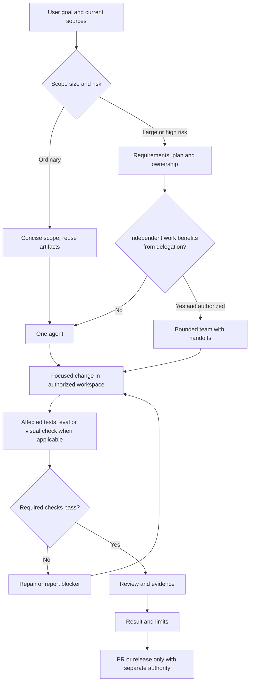

# Product-Agent Delivery Lifecycle

Source status: `official + experiment`

Маршрут зависит от задачи и риска. Diagram описывает workflow, а не автоматически выдаёт полномочия.

## Как применять

Для обычной правки достаточно scope, изменения, релевантной проверки и результата. Существующие `REQUIREMENTS.md`, `PLAN.md`, `TEST.md`, `EVALS.md` и `RUNLOG.md` переиспользуйте; новые artifacts создавайте, когда они удерживают реальные требования, зависимости или evidence. Для большой работы сначала определите acceptance, ownership, risks и rollback. Worktree нужен для изоляции файлов при соответствующем Git authority, а не для каждой задачи.

Одна роль может выполнять несколько этапов. Команду, skills и evals подключайте по применимости. После required checks повтор оправдан новой правкой, failure или неустранённым риском. PR draft не означает публикацию.

## Результат и проверка

Проверяемый diff или artifact, выполненные checks, ограничения и следующий шаг. Runtime/model activation требует отдельного evidence; наличие плана или диаграммы этого не доказывает.

## Типовые ошибки

Обязательная команда без независимых задач; дублирующие control-plane files; бесконечный общий gate; публикация без authority.

Связанные материалы: [lifecycle](../product-agent/lifecycle.md), [Product-Agent OS plugin](../product-agent-os/index.md), [model guidance](https://developers.openai.com/api/docs/guides/latest-model), [eval guidance](https://developers.openai.com/api/docs/guides/evaluation-best-practices).

## Входы

Цель пользователя, текущие источники, ограничения, ownership и применимые разрешения.

## Выходы

Выбранный маршрут, проверяемый artifact и evidence с явными ограничениями.

## Проверка

Сверьте маршрут с исходниками и наблюдаемым результатом; после изменения синтаксиса проверьте render.

## Риски

Диаграмма помогает навигации, но не доказывает runtime activation или release.
