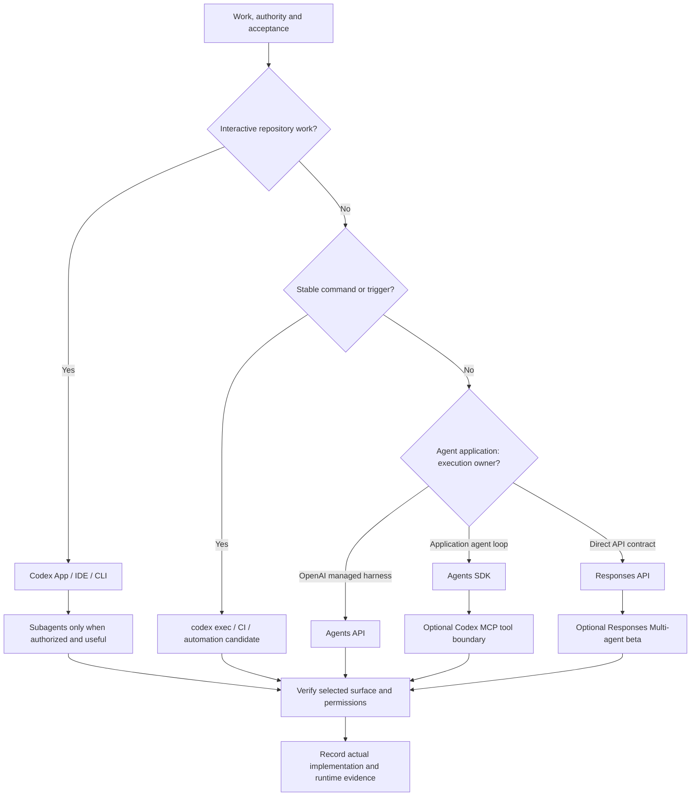

# Runtime decision map

Source status: `official + experiment`

Reviewed 2026-11-03.

## How to use

Choose by uncertainty, execution owner, state lifetime, tools, approval scope and failure cost. Interactive ambiguity belongs in App/IDE/CLI; a stable self-contained contract may fit `codex exec`. CI/GitHub Action and schedules need explicit authority, minimal permissions and predictable failure handling. MCP exposes a tool boundary; it does not resolve missing requirements.

For an agent application, [Agents API](https://developers.openai.com/api/docs/guides/agents) provides an OpenAI-managed Codex harness; SDK runs in your app; Responses exposes the API contract with optional hosted orchestration. [Responses Multi-agent](https://developers.openai.com/api/docs/guides/responses-multi-agent) is a separate beta with model/mode limits. None is automatically interchangeable with Codex subagents.

## Outputs and Verification

Record runtime/client/auth/model, state and tool owners, allowed actions, stop/rollback and required evidence. Use [runtime overview](../runtime/overview.md), [SDK contracts](../agent-systems/sdk-patterns.md), [session control](../agent-systems/session-control.md) and [model matrix](../codex/models-and-reasoning.md). Mark documented, designed, implemented and runtime-verified separately. This refresh activates no new runtime.

## Risks

- Treating a session, conversation and sandbox as the same resource.
- Transferring one model's beta support to the whole family.
- Treating MCP or automation as a workaround for unclear scope.
- Publishing, launching servers or calling providers without separate authority.
- Treating a static diagram or passing docs build as runtime evidence.

## Inputs

Current goal, applicable instructions, source context, ownership boundaries and required evidence.

## Verification

Check applicability, authority, ownership and observed evidence before accepting a result.
